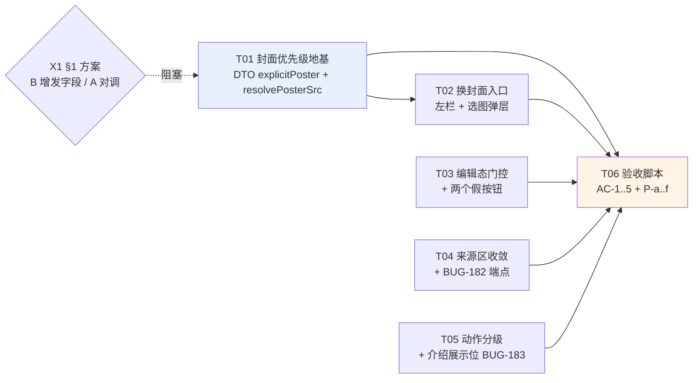

# 剧集封面替换 + 剧集内页布局收敛：增量设计

> **上游 PRD**：`docs/design/episode-internal-ia-v2-2026-09-29.md`（许清楚；P0 = V1–V6，P1 = V7–V11，P2 = V12–V14，验收 AC-1–AC-5）。
> **上游设计**：`docs/design/media-library-layout-prd-2026-09-28.md`（封面回退链裁定）、`docs/design/media-library-layout-design-2026-09-28.md`（§3.1.3 封面归属单点）。
> **同批缺陷档**：`docs/bugs/BUG-182.md`（摘除接错端点）、**`docs/bugs/BUG-183.md`**（剧集介绍展示位缺失，本文同批新建）。
> **范围**：`tauri-shell/src`（前端）+ `orig-tg/src/media.rs` 的 **DTO 序列化**（1 个字段，无 schema 变更）。
> **标记约定**：**【现状】**= 已复核事实（附 file:line）；**【改动】**= 本设计提出；**【待明确】**= §6。

---

## 0. 取证结论（本设计的事实基底）

### 0.1 已复核事实

| # | 事实 | 证据 |
|---|---|---|
| F1 | `media_series.poster TEXT` 可空，建表即有，**无 ALTER、无校验** | `media.rs:244` |
| F2 | **写路径三层齐备**：`update_series` 真写 `UPDATE media_series SET ... poster=?4`；入参 `SeriesPatch.poster: Option<Option<String>>`（缺省=不改 / `null`=清空）；`PATCH /api/media/series/:id` 存在；`patchSeries(id,{poster})` 已声明 | `media.rs:2163-2173`、`:3682-3692`、`routes.rs:101-105`、`:3447-3451`、`api/media.ts:400-412` |
| F3 | 前端**唯一**调用点是**自动抽帧回写** | `SeriesCard.tsx:32-48` → `MediaLibraryPanel.tsx:1105` |
| F4 | **无任何人工换封面入口**：`SeriesEditPanel.tsx` 与 `SeriesDialog.tsx` 全文 grep `poster\|封面\|cover` **零命中**；`series-cover` 是纯展示 div（无 onClick） | `SeriesEditPanel.tsx`、`SeriesDialog.tsx`、`SeriesDetail.tsx:305-322` |
| F5 | `SeriesView.poster` 被后端**合并**：`poster: explicit.or(cover_poster)` —— 显式值与自动回退值**进同一字段**，前端**无法判别来源** | `media.rs:1459`、`:1467`、`:776-794`（结构体**无** `explicitPoster`/`posterIsExplicit`） |
| F6 | `SeriesView` 全仓**只有 1 个构造点**，`list_series()` 委托 `list_series_filtered(None)` ⇒ 加字段只需改 **1 结构体 + 1 构造点** | `media.rs:776`、`:1462`、`:1416-1418` |
| F7 | 前端封面链：`coverKind==='photo' && coverItemId` → `mediaItemUrl(coverItemId)` → `detail.poster` → `firstPlayable?.poster` | `episodePresentation.ts:117-128` |
| F8 | 导出 SQL **不选** `s.poster`；`ExportedSeries` **无** poster 字段 ⇒ **剧集封面列与导出无交集** | `media.rs:1905-1908`、`:1760-1766` |
| F9 | 导出对**条目** poster（`i.poster`）的处理：非 `data:` 前缀 ⇒ 按**库根相对路径** `resolve_item_path` 后 `fs::copy(...)?`（`?` = 失败中断整批） | `media.rs:1950`、`:2005-2014`；`cache.rs:79-86` |
| F10 | TG photo 无 `file_path` 时，`raw` 端点**现场代理 TG 缩略图**（不持久化） | `routes.rs:3067-3095`（BUG-049） |
| F11 | `poster=null` **只回退**不重抽：`explicit.or(cover_poster)`；且 `if (poster \|\| coverFailed) return` 使回退后**永不重抽** | `media.rs:1467`、`SeriesCard.tsx:32` |
| F12 | **无上传通路**：两个 `routes.rs` 全文 `multipart\|upload` **零命中** | `orig-tg/src/routes.rs`、`orig-daemon/src/routes.rs` |
| F13 | 右栏编辑表单**无条件渲染**（强制进入编辑态） | `SeriesDetail.tsx:612-619` |
| F14 | 假按钮 **2 处且全仓仅此 2 处**：`:533` `episode-edit-desc`、`:605` `episode-edit`，onClick 只做 `scrollIntoView`（全仓 `scrollIntoView` 共 3 处，第 3 处 `EpisodeList.tsx:86` 为列表定位，正常） | `SeriesDetail.tsx:533`、`:605` |
| F15 | 活左栏**无剧集介绍展示位**：`SeriesDetail.tsx` 全文 `detail.description` **零命中**；`:523 {cur.description}` 是**分集**介绍 | `SeriesDetail.tsx` |
| F16 | `SeriesHero.tsx:208-241` 是全仓**唯一** `series-description`/`-toggle`/`-edit`，且**零 importer**（死代码） | `SeriesHero.tsx`；`SeriesDetail.tsx:88-91` 注释自称「能力零删减（BUG-149）」——**该注释与实际不符** |

### 0.2 【实测】影响面量化（只读查在产库，**未动在产库**）

库：`%APPDATA%\com.origadmin.orighub\tg\store.db`（5,226,496 B，`mode=ro` 只读打开）

| 指标 | 值 |
|---|---|
| 剧集总数 / 分集总数 | **13 / 56** |
| `media_series.poster` 非空 / 空 | **8 / 5** |
| 含 photo 分集的剧集数 | **1**（series 80《网调我的冰山妈妈》） |
| **有 poster ∩ 含 photo 分集** | **0** |
| `poster` 值域：`data:` / `http` / `item:` / 其他非空 | **8 / 0 / 0 / 0** ⇒ **存量 100% 是 data-URI** |
| `media_item.poster` 值域（140 非空 / 193 条目） | 全部 `data:`，`http`/`item:`/其他 = **0** |
| photo 条目：总数 / 有 `file_path` | **68 / 26** |

**由此得出的三条量化结论**：

1. **存量兼容无风险**：库内 `poster` 100% 是 `data:` 前缀 ⇒ §2 的新值域 `item:<id>` **不影响任何存量行**（team-lead 的假设**成立**）。
2. **§1 备选 A（对调顺序）影响面 = 1/13**：只有 series 80 会变 —— 它从「TG 缩略图**现场代理**」（F10：该 photo `file_path` 为 NULL）变为「**落库** data-URI 缩略图」。**视觉等价、且离线更稳**（不依赖 TG 连接）⇒ **当前无回归**。
3. **但 A 留了一个将来会触发的降级**：库内 photo 条目 **68 个中有 26 个有 `file_path`**。这些 photo 一旦被编入剧集，A 会把封面从**原图**降级为**缩略图** —— 正是 `episodePresentation.ts:112-113` 那句注释担心的情形。**§1 的推荐方案 B 影响面 = 0/13**（13 个剧集封面逐字节不变）。

---

## 1. 封面优先级统一（V9 / AC-5）

### 1.1 结论：这是**实现背离既有裁定**，不是「需要产品再选一次」

| 出处 | 说的是什么 |
|---|---|
| `media-library-layout-prd-2026-09-28.md:78`（**产品裁定**） | 「`poster` ?? `coverItemId`+`coverKind` ?? 首集封面；**回退只发生在剧集自己没设封面时**」 |
| 同上 `:118` | 「剧集**未设封面时**，回退到首集封面」 |
| `media-library-layout-design-2026-09-28.md:275`（同节**正文**） | 「`poster` 列已被后端改写为 `explicit.or(cover_poster)`——即**显式封面优先**，否则回退首集 poster」 |
| 同上 `:281-284`（**紧接的代码块**） | `coverKind==='photo' && coverItemId ? mediaItemUrl(coverItemId) ?? detail.poster ?? playEps[0]?.poster` —— **把 photo 首集排到了 `poster` 之前** |

⇒ **同一节里正文与代码块自相矛盾**，实现照抄了代码块（F7）。`episodePresentation.ts:112-113` 的「黑帧」理由是**事后补的解释**（`grep 封面|poster|cover docs/bugs/BUG-171.md` **零命中**，无裁定记录）。

### 1.2 ★ 但「把 ①② 对调」不是正确修法 —— 因为 `detail.poster` **不是「显式」**

**这是本轮最关键的一层（F5）**：

```
后端 media.rs:1467    poster: explicit.or(cover_poster)
                      ↑ 显式值（用户设的）  ↑ 自动回退值（首集缩略图）
                      两者被合并进同一个 DTO 字段，前端拿不到「是哪一个」
```

`SeriesView`（`media.rs:776-794`）**没有** `explicitPoster` / `posterIsExplicit`。因此前端**无法知道「用户是否设过封面」**这个真值 —— 它只能用 `coverKind` 做**启发式**，而启发式必然在某处错。

- 现实现选「photo 原图优先」⇒ **用户设的封面被盖掉**（V9 要修的）。
- V9 原方案「把 `detail.poster` 提到最前」⇒ 表面上修好了，但它把**回退值也当成了显式值**：一旦剧集有 photo 分集，`detail.poster` 往往就是那个 photo 的缩略图（series 80 正是如此），于是**原图被缩略图盖掉**（§0.2 结论 3）。

**⇒ 正确修法是把「显式」这个真值真的传下来，而不是换一个启发式。** 两个诉求可以**同时**满足：

```
① explicitPoster（用户设的 —— 唯一真值）        ← PRD:78 裁定，必须成立
② coverKind==='photo' && coverItemId → mediaItemUrl(coverItemId)   ← 保住原图质量
③ detail.poster（= cover_poster 回退值）
④ firstPlayable?.poster
⑤ null（占位图标）
```

### 1.3 三个选项（代价对比）

| 维度 | **B（推荐）后端 DTO 增发 `explicitPoster`** | A 对调 ①②（V9 原方案） | C 不做 |
|---|---|---|---|
| 改什么 | `SeriesView` 加 1 字段（`media.rs:776`）+ 1 构造点赋值（`:1462`，`explicit` 变量**已在手**，`explicit_poster: explicit`）；`api/media.ts:61-75` 加字段；`episodePresentation.ts:117-128` 排序改 5 段 | 只改 `episodePresentation.ts:117-128` 排序（2 行） | 无 |
| 后端改动 | **1 结构体 + 1 赋值**（F6：全仓仅此 1 构造点） | **0** | 0 |
| schema 变更 | **0**（`poster` 列已在） | 0 | 0 |
| 在产库影响面（§0.2 实测） | **0 / 13** —— 13 个封面**逐字节不变** | **1 / 13** —— series 80 从「TG 缩略图现场代理」变「落库缩略图」（等价、离线更稳，**当前无回归**） | 0 |
| **将来的回归** | **无**（photo 有字节时仍走 ② 原图） | **有**：photo 有 `file_path` 时（库内已有 **26** 个这种 photo）封面从**原图降级为缩略图** | 问题保留 |
| 「用户设的封面被盖掉」 | **修复** | **修复** | **不修** |
| 「图片集显示原图」 | **保住** | **丢失** | 保住 |
| 语义可解释性 | **高**：显式就是显式，回退就是回退 | 低：`detail.poster` 一词两义 | — |
| 回归风险 | **低**（纯增量字段 + 排序；`explicitPoster` 为 null 时逐字退回现行为） | 低（当前）／**中**（将来） | 无新增 |
| 可逆性 | 高（删字段即回退） | 高 | — |

**推荐 B**，理由三条：
1. **V9 的诉求是「显式封面优先」，而 `detail.poster` 不是「显式」** —— 用错的真值去修，是把启发式从一个换到另一个，不是修好。
2. **代价极小**：F6 证明 `SeriesView` 只有 1 个构造点，且 `explicit` 变量**已在手**（`media.rs:1459`）⇒ 后端改动 = 加 1 行赋值。前端排序改 4 段。
3. **同时满足两个诉求**，且**在产库零影响**（B 的 0/13 优于 A 的 1/13，且没有将来的降级）。

> **如果决策人只要最小改动**：A 在**今天**是可接受的（实测 1/13，且那 1 例等价），但**必须**把「photo 有字节时原图会被缩略图盖掉」写进代码注释与回归判据，否则将来 26 个已落盘 photo 入剧时会静默降级。**这是 B 与 A 的真实分界。**

### 1.4 【改动】需要同步修正的上游文档

`media-library-layout-design-2026-09-28.md:281-284` 的代码块与同节正文 `:275` 矛盾。**本设计落地时同步修正该代码块**（只改代码块，不改正文 —— BUG-082 惯例）。该文档当前 `status: draft`，未落地，故修正不构成「改写已裁定文档」。

---

## 2. 封面来源范围（V1 / AC-1）

### 2.1 值域：三类显式前缀

| 前缀 | 含义 | 前端解析 | 导出解析 |
|---|---|---|---|
| `data:` | 内联图（**现状唯一在写的值**，§0.2 实测 8/8） | 直传 `` | 现状：直传（不进 `images/`） |
| **`item:<id>`**（新增） | 库内某条目 | → `mediaItemUrl(id)` | → 查 `media_item.file_path`，`resolve_item_path` 后 `fs::copy` |
| 其他 | 库根相对路径（**兼容存量**） | 现状（`` 直传） | 现状（`resolve_item_path` + `fs::copy`） |

**为什么选「约定新值域」而不是「导出侧识别 URL」**（采纳 team-lead 裁定）：

- 「导出侧识别 URL」只补一处症状，值域仍是**混杂**的（`data:` / `http://…` / 相对路径 / 将来更多），**每加一个消费者就要再补一次判断** —— 这是债务堆叠。
- 约定 `item:<id>` 后值域变成**可判别的三类**，且**新增前缀是显式枚举**：将来再加来源（如 `tg:<chat>:<msg>`）只需加一个前缀分支，**不必改已有分支**。

### 2.2 前端解析落点：**新增纯函数，不塞进 `CoverImage.tsx`**

**落点**：新建 `tauri-shell/src/lib/posterSrc.ts`，导出纯函数

```ts
/** 把持久化的封面值解析成可直接喂  的串。纯函数，无副作用。 */
export function resolvePosterSrc(raw: string | null | undefined): string | null
// data:*        → 原样
// item:<id>     → mediaItemUrl(id)
// 其他非空      → 原样（库根相对路径，兼容存量）
// 空/null       → null
```

**调用方（2 处）**：
1. `episodePresentation.ts::resolveSeriesCover()` —— 剧集封面（§1.2 的 5 段链，② 与 ③ 的取值各过一次本函数）；
2. 条目侧取 `poster` 作 `` 的地方（`MediaCard`、`ItemEditDialog:116-117`）。

**为什么选「独立纯函数 + 调用方显式调用」，而不是塞进 `CoverImage.tsx:46`**：

| 理由 | 说明 |
|---|---|
| **职责分离** | `CoverImage` 的职责是「按源图实际方向兜底 `object-fit`」（`CoverImage.tsx:3-19` 的整段注释都在讲这件事）。把**值域解析**塞进去 = 给它第二个职责 |
| **复用面污染** | `CoverImage` 被多处复用（`SeriesCard`、`SeriesDetail:310` 等），其中并非全部传 `poster` 值（也可能传 `mediaItemUrl(...)` 或其它 URL）。**在通用组件里做域解析，会把非封面用途的 URL 也卷进来** |
| **可测性** | 纯函数可独立单测（含反向证伪），组件内联则必须渲染才能测 |
| **与既有裁定一致** | 2026-09-28 设计 §3.1.3 / TL-18 已裁定「封面归属**单点收敛**到 `lib/episodePresentation.ts`」。本函数是那条裁定的自然延伸（把「归属」与「取值域」分成两个纯函数，仍在 `lib/` 单点） |

### 2.3 导出侧解析落点：`media.rs:2005-2014`

**★ 重要更正（推翻 AC-1 的前提）**：

> **剧集封面与导出无交集。** 导出 SQL（`media.rs:1905-1908`）**不选** `s.poster`，`ExportedSeries`（`:1760-1766`）**没有** poster 字段。
> ⇒ 把 `media_series.poster` 写成 `item:<id>` **不会**破坏导出 —— **AC-1 对剧集封面是空判据**（写了也不会坏，因为导出根本不读该列）。
> 导出风险**只存在于 `media_item.poster`**（`:1950` 读入 → `:2005-2014` 处理）—— 即**只有当本轮也允许替换「条目封面」时**才需要改导出侧。

**因此本设计的导出侧改动按「本轮是否包含条目封面替换」分两种范围**（见 §6 X2）：

| 范围 | 导出侧改动 |
|---|---|
| **仅剧集封面**（PRD V1 的字面范围） | **导出侧零改动**（`item:<id>` 只可能出现在 `media_series.poster`，导出不读） |
| 同时含条目封面替换 | `media.rs:2005-2014` 加 `item:<id>` 分支：解析 id → 查 `media_item.file_path` → `resolve_item_path` → `fs::copy` |

**导出侧 `item:` 分支的写法（若需要）**：

```rust
// 现状：非 data: ⇒ 按库根相对路径处理（media.rs:2005-2014）
// 新增：先判 item:<id> 前缀
let src_abs = if let Some(id_str) = p.strip_prefix("item:") {
    let id: i64 = id_str.parse().map_err(|_| BundleError::BadTarget(
        format!("cover value `{p}` has a malformed item id")))?;
    let it = self.get_media_item(id).await?.ok_or_else(|| BundleError::BadTarget(
        format!("cover references media item {id} which does not exist")))?;
    let fp = it.file_path.ok_or_else(|| BundleError::BadTarget(
        format!("cover references media item {id} which has no local bytes")))?;
    crate::cache::resolve_item_path(&lib_root, &fp)
} else if p.starts_with("data:") {
    /* 现状：不进 images/ */
} else {
    crate::cache::resolve_item_path(&lib_root, p)   // 现状：库根相对路径
};
```

### 2.4 反向证伪判据（team-lead 指定，逐条可执行）

| ID | 构造 | 必须 |
|---|---|---|
| **P-a** | 写一个 `item:<真实存在的 photo id>` 到封面 → 导出 | **导出成功**，且导出包内 `images/<ep_label>-poster.<ext>` 存在且**字节数 > 0** |
| **P-b** | 写 `item:999999`（**不存在的 id**）→ 导出 | **显式失败**：返回**具名可读错误**（含 series/episode 与 id），**不是**静默跳过，**不是** `unwrap` panic，**不是**无信息的整批失败 |
| **P-c** | 写 `item:<存在但 file_path 为 NULL 的条目 id>` → 导出 | **显式失败** + 具名错误（说明「该条目无本地字节」）—— 不得 `fs::copy` 一个空路径 |
| **P-d** | 存量库（8 个 `data:` 封面 + 140 个 `data:` 条目封面）跑一次导出 | **逐字节不变**（§0.2 结论 1 的运行时验证） |
| **P-e** | 前端：`resolvePosterSrc('item:393')` | 返回 `mediaItemUrl(393)`（= `${mediaBase()}/api/media/items/393/raw`） |
| **P-f** | 前端：`resolvePosterSrc('data:image/png;base64,x')` / `resolvePosterSrc(null)` / `resolvePosterSrc('tg/a/b.jpg')` | 依次返回原样 / `null` / 原样（库根相对路径兼容分支） |

> **P-b/P-c 的「显式失败」口径**：team-lead 明确「不许静默跳过、不许整批炸」。本设计理解为
> **中止该次导出并返回具名可读错误**（`BundleError::BadTarget`，携带 series/episode/取值），
> 即「有信息地失败」而非「无信息地崩」。**若决策人想要「跳过坏封面、导出其余并在结果里报告」**，
> 那与 team-lead 的「不许静默跳过」冲突，列入 §6 X3。

### 2.5 存量兼容（确认 team-lead 的假设）

**确认不受影响**：库内 `media_series.poster` **8/8** 与 `media_item.poster` **140/140** 全是 `data:` 前缀（§0.2 实测）⇒
- `data:` 分支行为**逐字不变**；
- 新增的 `item:` 分支**存量零命中**；
- 「其他」分支（库根相对路径）存量零命中，仅为兼容保留。

### 2.6 三种来源（V1 的「四来源同屏」）

| 来源 | 落库值 | 后端改动 | 说明 |
|---|---|---|---|
| **资料库选图** | `item:<id>` | **0**（仅剧集封面时）/ `media.rs:2005-2014`（含条目封面时） | 复用 `EpisodeImagePickerDialog` 的**选图壳**（`listMediaItems` + 网格），但**写目标是 `patchSeries(id,{poster})`**，不是 `media_episode_image` |
| **回到自动封面** | `null` | 0 | 见 §2.7 |
| **重新生成封面** | 抽帧结果 `data:…` | 0 | 见 §2.7 |
| **本地图片**（上传） | — | **需新增 multipart 端点**（F12：全仓零命中） | **本设计不含**，见 §6 X1 |

**为什么不能把封面挂成一张「挂图」**：挂图写 `media_episode_image`（多值/有序/**浏览位**），封面写 `media_series.poster`（单值/实体属性）；且挂图**不参与封面解析**（`resolveSeriesCover` 完全不读 `images`）⇒ 挂上去**不会变成封面**。

### 2.7 「回到自动封面」与「重新生成封面」必须是两个动作（AC-2）

F11 实测：`poster=null` 只**回退**（`explicit.or(cover_poster)`），且 `if (poster || coverFailed) return` 使回退后**永不重抽**。

| 动作 | 落库 | 前端 | 结果 |
|---|---|---|---|
| **回到自动封面** | `patchSeries(id, { poster: null })` | 清本地 `poster` state（`SeriesCard.tsx:22`） | 走 §1.2 的回退链；**不抽帧** |
| **重新生成封面** | 抽帧完成后 `patchSeries(id, { poster: <data-uri> })` | **必须**显式清 `markPosterFailed` 记忆（`SeriesCard.tsx:32` 的短路闸） | 产出一张**新的**抽帧封面 |

**判据**：两个按钮各自可独立验证 —— 「回到自动」后封面 = 回退链结果（可能是 photo 原图）；「重新生成」后封面 = **新的** `data:` 值（与操作前不同）。

---

## 3. 编辑态承载形态（V2 / V3 / AC-3）

### 3.1 根因（F13）与修法

**【现状】** `SeriesDetail.tsx:612-619` 的 `<EpisodeEditPanel>` **无条件渲染**（无 `editing &&` 门控）⇒ 用户一进剧集内页就看到展开的编辑表单 = 「强制进入编辑功能」。

**【改动】** 引入 `episodeEditingId: number | null` 状态：

```
{episodeEditingId === cur.id ? <EpisodeEditPanel … data-testid="episode-edit-panel" /> : null}
```

- **切换聚焦集**时重置为 `null`（否则切集后新集也处于编辑态）。
- `EpisodeEditPanel` 的 `onClose` 置回 `null`；`onSaved` 置回 `null` + 触发 `onChanged`。
- 现有 `key={`${cur.id}-${editNonce}`}`（`:613`）保留 —— 它是「保存后强制重挂载」的既有机制，与门控不冲突。

### 3.2 两个假按钮（F14）修法

| testid | 位置 | 现状 | 改动后 |
|---|---|---|---|
| `episode-edit` | `:601-610` | 只 `editBlockRef.scrollIntoView(...)` | `setEpisodeEditingId(cur.id)` + 聚焦标题输入框 |
| `episode-edit-desc` | `:528-539` | 同上 | `setEpisodeEditingId(cur.id)` + 聚焦**介绍**输入框 |

**聚焦实现**：`EpisodeEditPanel` 内部对 `title` / `description` 输入框加 `ref`，并接受 `focusField?: 'title' \| 'description'` 入参；`useEffect` 在挂载后 `.focus()`。**不做** `scrollIntoView`（门控后表单就在按钮下方，无需滚动）。

**AC-3 的口径（不渲染 ≠ 隐藏）**：用 `hidden` / `opacity-0` / `max-h-0` 都**不合格** —— DOM 查询仍能命中、Tab 序仍被污染。判据：未进入编辑态时 `[data-testid="episode-edit-panel"]` **数量为 0**。

---

## 4. 任务分解（V1–V6，有序）

| ID | 任务名 | 源文件 | 依赖 | 优先级 |
|---|---|---|---|---|
| **T01** | 封面优先级地基：DTO 增发 `explicitPoster` + 前端解析链 | `media.rs`（`SeriesView` :776 + 构造点 :1462）、`api/media.ts`（:61-75）、`episodePresentation.ts`（:117-128）、新增 `lib/posterSrc.ts` | **X1（§1 方案）** | **P0** |
| **T02** | 换封面入口（左栏）+ 选图弹层 | `SeriesDetail.tsx`（`:305-322` 加悬停入口）、新增 `SeriesCoverPickerDialog.tsx`、i18n | T01 | **P0** |
| **T03** | 编辑态门控 + 两个假按钮修复 | `SeriesDetail.tsx`（`:528-539`、`:601-619`）、`EpisodeEditPanel.tsx` | — | **P0** |
| **T04** | 来源区收敛（V4）+ BUG-182 端点修复 + 分集移除文案（V6） | `SeriesDetail.tsx`（`:542-593`）、`api/media.ts`（`:39` import、`:583` 调用） | — | **P0** |
| **T05** | 左栏动作分级（V5）+ 介绍展示位（V7 / BUG-183） | `SeriesDetail.tsx`（`:303-467`） | — | **P1** |
| **T06** | 验收脚本（AC-1…AC-5 + P-a…P-f） | `tauri-shell/verify/`、`download-engine/verify/` | T01–T05 | **P1** |

**任务数 = 6**（P0 4 个 / P1 2 个）。V8/V10/V11/V12/V13/V14 为纯样式与增强，**不单列任务**，由 T05 顺带覆盖或另立后续轮次。

### 4.1 T01 明细 —— 封面优先级地基（P0）
1. **后端**（§1.2）：`SeriesView`（`media.rs:776-794`）加 `pub explicit_poster: Option<String>`；构造点（`:1462`）赋 `explicit_poster: explicit`（`explicit` 变量已在 `:1459` 取出）⇒ **零 SQL 改动**。
2. **前端类型**：`api/media.ts:61-75` `MediaSeries` 加 `explicitPoster?: string | null`。
3. **新增 `lib/posterSrc.ts::resolvePosterSrc()`**（§2.2）。
4. **`resolveSeriesCover()` 排序改为 5 段**（§1.2）：`explicitPoster` → `photo 原图` → `detail.poster` → `firstPlayable?.poster` → `null`；②③ 取值各过 `resolvePosterSrc()`。
5. **单测**（强制）：P-e / P-f（`resolvePosterSrc` 四分支）；`resolveSeriesCover` 的**优先级矩阵**（显式有/无 × 有/无 photo × 有无 poster = 8 组），并断言 **series 80 形态**（显式 NULL + 有 photo + DTO poster 非空 ⇒ 取 **photo 原图**，与 §0.2 的「逐字节不变」一致）。
6. **同步修正** `media-library-layout-design-2026-09-28.md:281-284` 的代码块（§1.4）。

### 4.2 T02 明细 —— 换封面入口（P0）
1. `SeriesDetail.tsx:305-322` 的 `series-cover` 由纯 div 改为可交互：悬停/聚焦浮现「换封面」（`data-testid="series-cover-edit"`）；**键盘可达**（V14：用 `<button>` 而非 div+onClick）。
2. 新增 `SeriesCoverPickerDialog.tsx`：**四来源同屏**（资料库选图 / 本地图片 / 回到自动封面 / 重新生成）+ 预览 + 保存/取消。
   - 复用 `EpisodeImagePickerDialog.tsx` 的**选图壳**（`listMediaItems` + 网格 + 分页），**但写目标是 `patchSeries(id,{poster})`**。
   - **本地图片入口按 §6 X1 的结论决定是否渲染**（未定前**先不渲染**，避免又一个「按钮在、实际无效」）。
3. 保存后：`patchSeries` → 左栏立即更新（复用 `MediaLibraryPanel.tsx:1103-1108` 的乐观更新模式）+ `onChanged` 刷新 detail。
4. 「回到自动封面」/「重新生成」按 §2.7 两个独立动作实现。
5. i18n：`media.cover.edit` / `cover.fromLibrary` / `cover.fromLocal` / `cover.resetAuto` / `cover.regenerate` / `cover.save` / `cover.cancel`。

### 4.3 T03 明细 —— 编辑态门控（P0）
按 §3.1 / §3.2。**单测/验收**：AC-3（未编辑时 `[data-testid="episode-edit-panel"]` 计数 = 0）；点两个假按钮后表单出现且焦点落在对应输入框；切集后编辑态重置。

### 4.4 T04 明细 —— 来源区收敛（P0）
1. V4：`sources.length === 0` ⇒ **整块不渲染**（AC-4：DOM 中不存在，不是隐藏）；移除常驻 `#itemId`（`:550`）与 `ref`（`:559-563`）→ 移入 `title`；区块标题与行标签**分离**（`:544` 与 `:553-555` 现复用同一 i18n 键 `media.episode.sourcesTitle`，界面出现两个「来源」）。
2. **BUG-182 端点修复**：`SeriesDetail.tsx:583` 的「摘除」由 `detachImage` 改为 `detachEpisodeSource` + `:39` 补 import。
   **⚠️ 只改 `:583` 一处** —— `:778` 灯箱 `onDetach` 那处**本来就是摘挂图**，禁止全局替换 `detachImage`。
   验收：摘源后 `sources` 减少且 **`images` 长度不变**；灯箱摘图仍正常（回归）。
3. V6：分集移除文案 `media.episode.removeFromSeries`（键已存在）。

### 4.5 T05 明细 —— 动作分级 + 介绍展示位（P1）
1. V5：左栏动作分「只读安全」（导出预览）与「破坏性」（合并到… / 删除）两区；破坏性用破坏性视觉 + 二次确认。
2. **V7 / BUG-183**：左栏补**剧集介绍展示位**（标签之后、动作之前；超长折叠；空态给可编辑空位）。
   **能力来源 = `SeriesHero.tsx:208-241`（死代码）** —— 按 BUG-149「重构不是删能力的授权」把该位**迁回活面板**，节点名沿用 `series-description` / `series-desc-toggle` / `series-desc-edit`（保持验收锚点连续）。

### 4.6 T06 明细 —— 验收（P1）
1. `tauri-shell/verify/`：AC-3（编辑态 DOM 计数）、AC-4（来源区 DOM 计数）、AC-5（显式封面优先）、V1 的保存后左栏即时更新。
2. `download-engine/verify/`：P-a…P-d（**仅当 §6 X2 判定含条目封面时才需要**；纯剧集封面时导出侧零改动，P-a…P-d 退化为「存量导出不变」的回归）。
3. **反向证伪**：AC-3 故意用 `hidden` 隐藏 ⇒ 必须 FAIL；AC-4 故意只做视觉隐藏 ⇒ 必须 FAIL；P-b 故意静默跳过 ⇒ 必须 FAIL。

### 4.7 任务依赖图



> **T03 / T04 / T05 互相独立**，可与 T01/T02 并行（不同代码区块）。
> **仅 T02 依赖 T01**（换封面入口必须先有正确的解析链，否则保存后显示错）。

---

## 5. 回归风险

| # | 风险 | 触发 | 缓解 |
|---|---|---|---|
| R1 | **`explicitPoster` 为 null 时行为漂移** ⇒ 全部剧集封面变化 | T01 排序写错 | 排序第 ① 段为 null 时**逐字退回**现行为；单测覆盖 8 组优先级矩阵；§0.2 断言「13 个封面逐字节不变」 |
| R2 | **选 A 后 photo 有字节时原图被缩略图盖掉**（库内已有 **26** 个这种 photo） | §1 选 A | 推荐 B（结构上不可能）；若选 A，**必须**把该情形写进代码注释 + 回归判据 |
| R3 | 封面值域解析塞进 `CoverImage.tsx` ⇒ 通用组件被污染、非封面 URL 被误解析 | T01 落点错 | §2.2 明确落点 = `lib/posterSrc.ts` + 调用方显式调用 |
| R4 | 写 `item:<id>` 后**导出失败** | 若含条目封面替换 | §2.3：`item:` 分支先解析 id → 取 `file_path` → `resolve_item_path`；P-b/P-c 反向证伪 |
| R5 | 导出遇坏封面**静默跳过** ⇒ 用户以为导出成功而封面缺失 | T01 导出侧 | P-b/P-c 要求**显式具名失败**；AC-1 断言导出包内封面文件**存在且字节数 > 0** |
| R6 | 用 `hidden`/`opacity-0` 实现「不渲染」⇒ DOM 仍命中、Tab 序仍污染 | T03 | AC-3 判据 = **DOM 数量为 0**；反向证伪故意用 `hidden` 必须 FAIL |
| R7 | **全局替换 `detachImage`** ⇒ 连 `:778` 灯箱摘图一起改坏 | T04 | 只改 `:583`；回归断言「灯箱摘图仍正常」 |
| R8 | 「回到自动」与「重新生成」合成一个按钮 ⇒ 一半用户得到非预期结果 | T02 | §2.7 拆两个动作 + AC-2 分别验证 |
| R9 | 换封面弹层引入高频重渲染（BUG-026） | T02 | 弹层只在打开时挂载；**不进 `useStore` SSE 路径**；组件 `memo` |
| R10 | 封面入口用 `div`+`onClick` ⇒ 键盘不可达 | T02 | V14：用 `<button>`；Tab 序 = 播放/换封面先于管理动作 |
| R11 | 新解析函数未覆盖「库根相对路径」兼容分支 ⇒ 存量非 data: 值（当前 0 个，将来可能）解析失败 | T01 | P-f 覆盖四分支；「其他」分支原样返回 |
| R12 | 切集后编辑态未重置 ⇒ 新集也处于编辑态 | T03 | 切换聚焦集时 `setEpisodeEditingId(null)`；验收断言 |
| R13 | 介绍展示位迁回时**改动节点名** ⇒ 既有验收锚点断裂 | T05 | 沿用 `series-description` / `-toggle` / `-edit` |

---

## 6. 待明确事项

### X1. 封面来源是否包含「上传本地图片」？（影响 T02 的弹层是否渲染该入口）

- **问题**: V1 的「四来源同屏」含「本地图片」—— 本轮做**上传**，还是只做「资料库选图 + 回到自动 + 重新生成」三来源？
- **现状与代价**: **全仓无上传通路**（F12：两个 `routes.rs` 全文 `multipart\|upload` 零命中）。做上传 = 新增 multipart 端点 + 落盘 + 字节归属（BUG-029 缓存即入库、BUG-051/096 单向删除联动、AGENTS.md §5 投递契约），**与「资料库选图」不是一个量级**。不做 ⇒ 用户仍无法用一张**库外**的图当封面，但**库内已有的 140 张 data-URI 封面图**可覆盖绝大多数场景。
- **设计锚点**: `docs/design/episode-cover-and-layout-2026-09-29.md` §2.6；`docs/design/episode-internal-ia-v2-2026-09-29.md` V1、D1
  - 冲突: 无。但 V1 字面写「四来源同屏」，若不做上传则弹层只有三个入口 —— **需明确是「删掉该入口」还是「占位禁用并标注『暂不支持』」**。
- **请求**: 选 A、B 还是 C？

**A. 本轮只做三来源（资料库选图 / 回到自动 / 重新生成），弹层**不渲染**上传入口**
- 涉及: `tauri-shell/src/components/media/SeriesCoverPickerDialog.tsx`（将新建）、`tauri-shell/src/components/media/SeriesDetail.tsx`
- 量化: 0 新增端点、0 schema 变更、1 个新组件；上传路径留到后续轮次
- 回归风险: **低** —— 不触碰投递/落盘/字节归属任何既有铁律
- 后果: 用户可用库内任一条目当封面（含已入库的 140 张封面图）；**库外图片无法直接使用**。可逆（后续加端点即可，弹层结构不用改）

**B. 本轮含上传（新增 multipart 端点）**
- 涉及: `download-engine/crates/orig-tg/src/routes.rs`（新增端点）、`media.rs`（落盘 + `media_item` 入库）、`tauri-shell/src/api/media.ts`、`SeriesCoverPickerDialog.tsx`
- 量化: 1 个新端点 + 1 条落盘路径 + 1 次 `upsert_media_item`；需过 4 条既有铁律（BUG-029 / 051 / 096 / 投递契约）
- 回归风险: **中高** —— 新增写字节的路径，必须同时满足「缓存即入库」「单向删除联动」「投递过 `serve_local_file`」；任一漏掉即产生孤儿字节或不可播条目
- 后果: 用户可用任意本地图当封面；但本轮范围显著变大，且引入新的字节归属面。可逆性中（端点可下线，已落盘字节需清理）

**C. 不做（弹层不提供任何换封面能力，只修优先级与介绍位）**
- 涉及: 无
- 量化: 0
- 回归风险: 无新增
- 后果: 用户仍**无法换封面** —— 用户本轮最明确的诉求（原话 1）未满足，只有「显式封面优先」的机制修好了但没有入口去设。若用户再问「为什么还是不能换」，会被迫回头做

---

### X2. 本轮是否包含「条目封面」（`media_item.poster`）的人工替换？

- **问题**: 换封面能力只覆盖**剧集封面**（`media_series.poster`），还是同时覆盖**条目封面**（`media_item.poster`）？
- **现状与代价**: **决定导出侧要不要改**。F8 证明**剧集封面列与导出无交集**（导出 SQL 不选 `s.poster`，`ExportedSeries` 无该字段）⇒ 纯剧集封面时导出侧**零改动**；但条目封面**进导出**（F9：`:1950` 读入 → `:2005-2014` 处理，非 `data:` 按库根相对路径 `fs::copy`，失败 `?` 中断整批）。同时覆盖 ⇒ 必须实现 §2.3 的 `item:` 分支；不覆盖 ⇒ 导出侧零改动，但用户「替换封面」的诉求只解决了一半（剧集能换、单条内容不能）。
- **设计锚点**: `docs/design/episode-cover-and-layout-2026-09-29.md` §2.3（★ 重要更正）；`docs/design/episode-internal-ia-v2-2026-09-29.md` V1、AC-1
  - 冲突: **与 PRD 的 AC-1 措辞冲突** —— AC-1 写「设过自定义封面的**剧集**，走一次导出必须成功且导出包内该剧集封面文件存在」，但**剧集封面根本不进导出**，该判据对剧集封面**恒真**（空判据）。**AC-1 需要改写**（改为针对条目封面，或明确标注它对剧集封面无约束力）。
- **请求**: 选 A 还是 B？（并请确认 AC-1 是否按上述改写）

**A. 仅剧集封面（严格按 PRD V1 字面）**
- 涉及: `tauri-shell/src/components/media/SeriesCoverPickerDialog.tsx`（将新建）、`SeriesDetail.tsx`、`episodePresentation.ts`、`lib/posterSrc.ts`（将新建）
- 量化: 后端 **1 字段**（`explicitPoster`）、导出侧 **0 改动**、0 schema 变更
- 回归风险: **低** —— 导出路径完全不参与，P-a…P-d 退化为「存量导出不变」的回归
- 后果: 剧集封面可换（用户原话 1 的直接诉求满足）；单条内容封面仍需等后续轮次。**AC-1 须改写**（现措辞对剧集封面恒真，无约束力）。可逆

**B. 剧集 + 条目封面同时做**
- 涉及: 同 A，**加** `download-engine/crates/orig-tg/src/media.rs:2005-2014`（导出侧 `item:` 分支）、`ItemEditDialog.tsx`、`MediaCard.tsx`
- 量化: 后端 1 字段 + 导出侧 1 分支（约 15 行）、前端 +2 个组件改动；P-a…P-d 全部生效
- 回归风险: **中** —— 直接改**导出**这条已落地的能力（导出有独立验收脚本）；且条目封面 140 行存量全为 `data:`，新分支存量零命中，但**新写入的 `item:` 值会立刻进入导出路径**
- 后果: 用户可换任意层级的封面；导出侧多一条必须维护的解析分支。可逆（分支可移除，但已写入的 `item:` 值会变成坏值）

**C. 不做（只修优先级与介绍位，不加任何换封面入口）**
- 涉及: 无
- 量化: 0
- 回归风险: 无新增
- 后果: 同 X1-C —— 用户原话 1 的诉求未满足；且 `explicitPoster` 也无意义（没有入口能设显式封面，该字段恒为 null）

---

### X3. 导出遇到坏封面（`item:` 指向不存在或无字节的条目）时的行为

- **问题**: 导出过程中发现封面值不可解析（`item:999999` 不存在 / 该条目无 `file_path`）—— **中止整次导出并报具名错误**，还是**跳过该封面、导出其余并在结果里报告**？
- **现状与代价**: 现状（F9）对**非 `data:` 且非空**的值一律按库根相对路径 `resolve_item_path` + `fs::copy(...)?` ⇒ **`?` 中断整批**。也就是说**现状是「无信息地整批失败」**：用户只看到一个 IO 错误，不知道是哪部剧、哪一集、哪个值。team-lead 的口径是「不许静默跳过、不许整批炸」—— 但「不许整批炸」与「不许静默跳过」在**单次导出**里只能二选一，必须定一个。
- **设计锚点**: `docs/design/episode-cover-and-layout-2026-09-29.md` §2.4（P-b/P-c）；`media.rs:2005-2014`（现状）
  - 冲突: 与 team-lead 本轮口径「不许静默跳过、不许整批炸」**不完全相容**（见上）。本设计暂按「中止 + 具名错误」实现（= 有信息地失败），若决策人选 B 则改写 P-b/P-c。
- **请求**: 选 A 还是 B？

**A. 中止整次导出 + 返回具名可读错误（携带 series/episode/取值）**
- 涉及: `download-engine/crates/orig-tg/src/media.rs`（`BundleError::BadTarget` 的调用点）、`download-engine/verify/`（P-b/P-c 脚本）
- 量化: 1 处错误构造；导出结果对象不变
- 回归风险: **低** —— 现状已是「中断」，本项只是把**无信息的中断**换成**具名中断**，不改变「中断」这个行为本身
- 后果: 用户看到「《X》第 N 集的封面引用了不存在的条目 999999」这类可行动信息；代价是**一次坏封面会挡住整次导出**。可逆

**B. 跳过坏封面 + 导出其余 + 在结果里列出被跳过的项**
- 涉及: 同上 + `ExportBundleResult`（`media.rs:1768-1776`）加 `skippedCovers: Vec<{seriesId, episodeNo, value, reason}>`；`ExportPreviewDialog.tsx` 展示该列表
- 量化: 1 个结果字段 + 1 处前端展示 + 1 个错误分支；导出侧由「`?` 中断」改为「收集后继续」
- 回归风险: **中** —— 改变导出的**既有失败语义**（从「中断」变「部分成功」）；导出已有独立验收脚本，语义变更需同步更新；且「部分成功」的导出包**看起来是完整的**，用户可能漏看报告
- 后果: 坏封面不阻塞导出（用户能拿到其余内容）；代价是「导出成功」不再等于「全部完好」，且需要一个新的报告面。可逆

**C. 不做（维持现状：`fs::copy(...)?` 无信息地中断整批）**
- 涉及: 无
- 量化: 0
- 回归风险: 无新增
- 后果: 一旦出现坏封面，用户只看到 IO 错误，**不知道该改哪里**；且若 X2 选 B（含条目封面），这条会成为**新写入路径的第一个坑**（用户设了条目封面后导出突然报错，且原因不可读）。仅在 X2 选 A（纯剧集封面）时风险较低 —— 因为导出不读剧集封面列

---

> **依赖顺序**：**X1 与 X2 独立**（来源范围 / 覆盖层级），但 **X2 决定 X3 是否必须定**（X2 选 A ⇒ X3 的 C 可接受；X2 选 B ⇒ X3 必须选 A 或 B）。
> **X1 只影响 T02 的弹层内容**，不影响 T01。**建议裁定顺序：X2 → X3，X1 可并行。**
