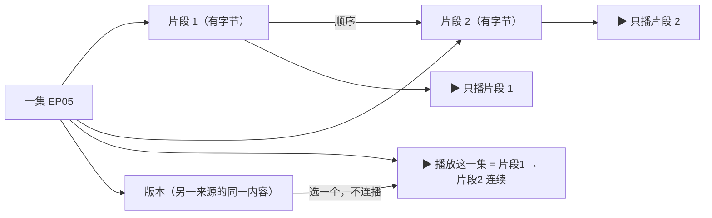
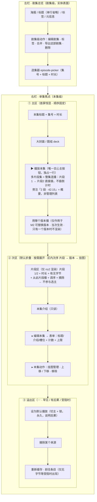

# 剧集内页（单集焦点区）信息架构 PRD

> 类型：简单 PRD（无竞品分析 / 无市场调研）
> 输入：产品决策人对剧集内页的集中批评（问题 2、问题 3）
> 产出：问题拆解 → 需求池 → 信息架构草图 → 待拍板项
> 边界：只写产品需求与期望形态，**不改源码**；问题 3 涉及后端数据模型，**待后端勘察结论确认**，本文不臆断可行性、不写表结构

---

## 0. 用户原话与现状基线

### 0.1 用户原话（照抄）

> 2. 剧集内问题最多：来源混乱（要的是切换视频，实际混乱），主次混乱（主要是播放，编辑是一次性的，主次倒置），编辑混乱（标题、内容大小多少需要有一个提前预估了解，按钮排版、位置需要有基础认知，全都没有），功能分布混乱，标签编辑导出都是实现。
> 3. 剧集内设计缺乏，比如一集分为 2 个视频，那对应的 2 个片段，当前完全无法处置。

### 0.2 现状基线（必须先对齐的事实）

**⚠️ 剧集内页当前存在两套实现，其中一套是孤儿代码：**

| 实现 | 位置 | 状态 |
|---|---|---|
| 左右主从（**活**） | `SeriesDetail.tsx`（787 行，`MediaLibraryPanel.tsx:1020` 渲染；验收脚本 `verify_series_master_detail.cjs`） | **这是用户实际看到的界面** |
| 手风琴（**死**） | `EpisodeBoard.tsx` / `EpisodeRow.tsx` / `EpisodeExpanded.tsx` | 全仓无任何 import（`SeriesDetail.tsx:88-89` 注释：「原手风琴形态由本形态取代」） |

**后果**：不先处置孤儿实现，本轮对「剧集内」的任何改动要么改在死代码上，要么同一套问题改两遍。→ 见 P0 **R6**。

**⚠️ 连带影响（已同步架构师）**：架构师 `episode-segment-model-2026-09-29.md` 的 §6.4 / T04 / §8 把片段区的前端落点写在 **`EpisodeExpanded.tsx`**，该组件正是上述孤儿代码；且 §12 判定「多源面板在 `SeriesDetail.tsx`、片段区在 `EpisodeExpanded.tsx`，相邻不重叠」——按当前代码**不成立**：两个设计的 UI 最终都落在**同一个活面板**（`SeriesDetail.tsx` 右栏）上，必须一起排布（次序见 §4.2 与 §6）。片段区落点应改为 `SeriesDetail.tsx`（或先按 R6 处置孤儿）。

本文证据以**活实现 `SeriesDetail.tsx` 为主**，同时给出手风琴实现的对应行号（它承载了同一批缺陷，且是后续若恢复该形态时的对照物）。

---

## 1. 产品目标（可验证）

| # | 目标 | 验收判据 |
|---|---|---|
| G1 | **播放是剧集内页的第一任务**：主操作一眼可见、位置固定，不看内容长短都能在同一处找到 | 单集焦点区首屏内可见「播放本集」；滚动/换集后其相对位置不变；编辑表单默认不占屏 |
| G2 | **「这次播哪个视频」是一次性选择，不是改数据**：用户换一个视频看，不需要承担永久后果 | 选另一个视频/片段播放后，剧集数据（主版本）不变；刷新页面回到默认项 |
| G3 | **编辑可预估**：动手前知道要写多长、会截断多少、改了会影响哪里 | 标题/介绍有字数计数与上限；超限在提交前被拦下并说明（不静默截断） |
| G4 | **一集多个视频是「顺序片段」而不是「主备版本」**：能整体播、单独播、调顺序 | 一集挂 2 个片段时，界面呈现为「片段 1 / 片段 2」而非「主版本 / 备用源」；可整体连续播放（模型 draft 见 `docs/design/episode-segment-model-2026-09-29.md`，**待 D1/D2/D3 拍板**） |
| G5 | **功能分布可预期**：同层级的动作在同一处，库级 / 剧集级 / 本集级作用域在界面上可辨 | 本集级动作只有一处；库级与剧集级导出分别标明作用域；剧集内点「导出」看不到全库清单 |

---

## 2. 问题拆解：四个「混乱」逐条落地

### 2.1 来源混乱 —— 要的是"切换这次播放哪个视频"，给的是"永久改数据"

| # | 现状缺陷（代码位置） | 用户怎么被卡住 |
|---|---|---|
| A1 | 多源区唯一动作是「切换主版本」（`SeriesDetail.tsx:573-580`；死实现 `EpisodeExpanded.tsx:176-183`），它调 `switchEpisodeSource`（`api/media.ts:494-499`）= **永久改数据**；按 `docs/design/episode-multi-source-design-2026-09-22.md:267`，切主还会置 `primary_locked=1`，据该文档 §3.3 闸①，此后自动选主被永久短路 | 用户只想"换一个试试看"，点完就把一次试探写成了永久决定，且再也不会被自动纠正回来 |
| A2 | **备用源根本不可播**：播放序列由 `episodesToItems` 生成，只用 `e.itemId`（`MediaLibraryPanel.tsx:297-315`）；播放按钮走 `playEpisode(cur)` → `props.onPlay(detail.episodes.indexOf(ep))`（`SeriesDetail.tsx:678-688`、`153-155`） | 「用上第二个视频」的唯一路径就是切主。用户想播 B，系统只提供"把 B 变成主"这一条路 —— 这正是"要的是切换视频，实际混乱" |
| A3 | **两种语义被塞进同一个容器**：`sources` 的语义是「同一集的其他缓存来源」（`api/media.ts:113-114`）= 同内容的不同版本；而"一集被切成 part1/part2"是**顺序片段**，无处可去也只能挤进 `sources`，界面把它渲染成「主版本 / 备用源 / 设为默认播放」 | 用户看到"主版本 + 设为默认播放"，心想"这两段是一集啊，我要按顺序看完"，对不上 —— 来源混乱的根因之一 |
| A4 | 多源区**常驻**：`SeriesDetail.tsx:543-593`（死实现 `EpisodeExpanded.tsx:153-196`）只要有备用源就恒显一整块，与标题、介绍同级 | 把"这一集有几个缓存"的实现事实放在内容信息的位置上。按产品铁律（实现约束 ≠ 产品信息），它只应在用户正要选/正受阻时出现 |

### 2.2 主次混乱 —— 播放是一次 11px 小按钮，编辑是常驻展开的大表单

| # | 现状缺陷（代码位置） | 用户怎么被卡住 |
|---|---|---|
| B1 | 右栏块序（活实现 `SeriesDetail.tsx:470-739`）为：头(478) → 图组(497) → 介绍(516) → 多源(543) → **编辑本集(596)** → **操作(676，播放在这)** → 溯源(725)。编辑在播放**之前** | 首屏先遇到编辑表单，播放要往下滚 |
| B2 | `EpisodeEditPanel` **无条件恒显**：`SeriesDetail.tsx:612-619` 渲染完整表单（标题 + 介绍 + 季号/集号/结束集号 + 保存/取消），占屏远大于播放 | 一次性任务常驻占据主区，高频任务被挤到次屏 —— 主次倒置的硬证据 |
| B3 | 播放按钮 `SeriesDetail.tsx:678-688` 为 `h-7 px-2.5 text-[11px]`，与「挂图」(689-698)、「前往条目」(699-707)、「重缓存」(708-721) 同排同尺寸，唯一区别是实心 `variant` | 高频主任务与低频动作视觉等价，用户无法从形态判断"哪个是这个页面的正事" |
| B4 | 死实现同构且更糟：操作区 8 个按钮平铺，播放夹在「移除」之后（顺序：编辑/挂图/上移/下移/移除/**播放**/前往条目/重缓存，`EpisodeExpanded.tsx:198-287`） | 见上（该实现已死，但缺陷同源，若恢复形态必须一并纠正） |
| B5 | **假按钮**：「编辑介绍」(`SeriesDetail.tsx:528-539`) 与「编辑」(`601-610`) 的 onClick **只做 `scrollIntoView`**，没有打开/聚焦任何编辑态 | 用户点"编辑"后页面可能毫无变化（目标块已在视口内），以为按钮坏了 —— 用户说的"按钮排版、位置需要有基础认知，全都没有" |

### 2.3 编辑混乱 —— 没有长度预期、没有上限、按钮位置无规律

| # | 现状缺陷（代码位置） | 用户怎么被卡住 |
|---|---|---|
| C1 | 标题 `textarea rows={2}`（`EpisodeEditPanel.tsx:119-127`）、介绍 `textarea rows={2}`（`167-174`），**无 `maxLength`、无计数、无"保存前还剩多少"** | 用户不知道该写多长、写多了会怎样 —— 原话「标题、内容大小多少需要有一个提前预估了解……全都没有」 |
| C2 | 同一字段三处不同高度：单集介绍 `rows={2}`（`EpisodeEditPanel.tsx:172`）、剧集介绍 `rows={4}`（`SeriesEditPanel.tsx:125`）、条目介绍 `rows={4}`（`ItemEditDialog.tsx:163`） | 同一个"介绍"在不同入口形态不同，用户建立不了稳定的预期 |
| C3 | 无上限提示、无截断说明：提交前只校验集号与标题非空（`EpisodeEditPanel.tsx:59-66`），超长直接发到后端，截断/报错行为未知 | 保存前不知道会截断多少，保存后才发现文字被吃掉 |
| C4 | 保存/取消在**底部**（`EpisodeEditPanel.tsx:176-194`），而三个 number input（季号/集号/结束集号 + `→` + 说明）挤在同一行（`132-165`） | 长表单里找不到提交位；三个数字挤一行时无法判断哪个框是"结束集" |
| C5 | 归一化提示走**错误通道**：结束集号 ≤ 起点时按单集处理，却用 `onError(endHint)` 提示（`EpisodeEditPanel.tsx:88-90`、`105`） | 用户分不清"保存失败"还是"保存成功但被改了" |
| C6 | 改写范围说明只有一行小字（`EpisodeEditPanel.tsx:117`），而标题/介绍**写穿到所指向的条目** | 用户不知道改完这一集，媒体库卡片与播放页的名字会一起变 |

### 2.4 功能分布混乱 —— 同层动作分家、作用域错乱、"标签/导出"是半成品

| # | 现状缺陷（代码位置） | 用户怎么被卡住 |
|---|---|---|
| D1 | 同一集的动作被切成两块：「编辑本集 + 上移/下移/移除」在 `SeriesDetail.tsx:596-673`，「播放/挂图/前往条目/重缓存」在 `676-722` | "移除本集"和"播放本集"不在同一处，每次都要找 |
| D2 | **剧集内「导出预览」打开的是全库导出**：`SeriesDetail.tsx:387-398` → `MediaLibraryPanel.tsx:1053 onExport={() => setExportOpen(true)}` → `1221-1226` 渲染 `ExportPreviewDialog series={series}`（全库），默认全选（`ExportPreviewDialog.tsx:36`） | 在某一部剧集里点"导出"，出来的是全库剧集校验清单 —— 作用域错乱，正是"导出都是（凑出来的）实现" |
| D3 | **剧集内标签「保存」不提交**：`SeriesDetail.tsx:271-279` 的保存按钮 onClick **只 `setEditingTags(false)`**；真正写库的是 `setSeriesTags`，只在 `SeriesEditPanel.tsx:83` 被调用 | 用户勾了标签点保存，面板关了，标签一个都没变 —— "标签编辑……都是实现" |
| D4 | 剧集层打标签有两条路径：总览卡「标签」(`SeriesDetail.tsx:363-375` → 内联 TagPicker `263-290`，即 D3 那条无效的) 与剧集编辑面板内 TagPicker（`SeriesEditPanel.tsx:161-169`） | 两个入口、一个不生效，用户不知道该用哪个 |
| D5 | 库级与实体级同名不同义：工具栏「导出」/`media-export-preview`（`MediaLibraryPanel.tsx:961-965`）与剧集卡「导出预览」（`SeriesDetail.tsx:387-398`）是**同一个对话框**；工具栏「🏷 标签管理」(`966-974`) 与剧集卡「标签」是两种作用域 | 用户无法从按钮名判断"这个按钮作用于全库还是这一部" |
| D6 | 条目层对照：`MediaCard.tsx:432 item-edit` / `419 item-delete`、标签在 `ItemEditDialog.tsx:167-173` | 全库视角下同类操作在卡片上，剧集内却分散在两块 → 分布不一致 |
| D7 | 疑似违反「实现约束 ≠ 产品信息」：`MediaLibraryPanel.tsx:986-1003` 来源离线横幅常驻 | 「某个来源暂时不可用」被渲染成常驻页面构件（本条列为待确认，见 §6 备注） |

---

## 3. 用户故事（P0 视角）

1. 作为**想看这一集的人**，我想在单集区的固定位置一眼看到「播放本集」，而不是先滚过一个编辑表单 —— 这样我点开剧集就能开始看。
2. 作为**发现这一集有两个视频的人**，我想在播放前选择"这次播哪个"（片段 1/2 或版本 A/B）并立刻播放，而不必把某个视频永久设成主版本 —— 这样我只是换一次，不改写我的库。
3. 作为**要按顺序看完一集的人**（该集被切成 2 段），我想让这一集的两段连着播完，也能单独看其中一段、调整它们的顺序 —— 这样"一集 2 个视频"是完整的一集而不是两个互相竞争的版本。
4. 作为**要改本集标题的人**，我想在输入时就知道建议长度、已写多少、超限会被拦下而不是被悄悄截断 —— 这样我保存前就知道结果。
5. 作为**要整理这一集的人**，我想在同一处找到这一集的全部动作（播放/挂图/移动/移除/前往条目），并按重要程度区分主次 —— 这样我不用在两个区块之间来回找。
6. 作为**要给这部剧集打标签/导出的人**，我想点下去的按钮明确作用于"这一部剧集"，并且保存真的写库 —— 这样我不会白做一遍。

---

## 4. 需求池

### 4.1 【必须先回答的产品问题】「来源」语义的正解

**现状**：只有一个动作 —— 永久切主（`switchEpisodeSource`，带锁）。
**用户要的**：临时切换这次播放哪个视频。
**结论：两者都要，但必须是两个动作、两种表达，不能混在一个按钮里。**

**前提（与架构师 `episode-segment-model-2026-09-29.md` §1.1 对齐）**：一集挂多个视频有**两种正交语义**，界面必须分开呈现，不能混成一个列表：

| | M2 备用源（版本） | M3 片段（Part1/Part2） |
|---|---|---|
| 可替换 | **可**（切主即换掉） | **不可**（换掉 = 少了内容） |
| 顺序 | 无意义 | **有意义且唯一** |
| 基数 | 0..n（0 = 正常） | **1..n**（0 = 异常） |
| 是否参与「选哪个播」 | **参与** | **不参与**（不存在"选哪个片段播"，只有"整集连播"与"从某段开始"） |

⇒ 因此**「播哪个」只作用于 M2 版本**；M3 片段的默认动作是**整集连播**（播放本集 = 片段 1 直接接片段 2，中间**不插**「下一集」5 秒倒计时，否则造成"一集被切成两集"的错觉；跨集才走既有倒计时）。

| 方案 | 形态 | 代价 |
|---|---|---|
| ① 只做临时切换 | 「播哪个」选择只影响当次 | 长期偏好无法沉淀：用户每次都要重选；从全库卡片/播放页进入时带不进选择 |
| ② 只做永久切主（**现状**） | 「设为默认播放」= 切主 + 锁 | 一次性试探被写成永久决定并锁死自动选主；且"备用源"在切换前**根本不可播**（`MediaLibraryPanel.tsx:297-315`）。这就是"实际混乱" |
| ③ **两者都要（推荐）** | 主区：当次选择「播哪个」；次区/溢出：「设为默认播放」（永久，带锁，需明确后果） | 播放入口需要支持"从指定 item 起播"（现状 `episodesToItems` 只用 `e.itemId`，需传入选中项）；"当次选择"只作用于 M2 版本，与 M3 片段的连播互不干扰（分表后无语义争用）。改动可控，收益是消除"试探即锁死" |

**产品判据**：当次选择是**高频、可逆、无后果**的，应放在主区；永久切主是**低频、不可逆、有后果**的，必须收进次区并说明后果。二者在文案上必须可区分（例如「播这个」vs「设为默认播放」），禁止再出现"切换主版本"这种实现语言。

### 4.2 主次层级方案（具体形态）

```
单集焦点区（右栏）
├─ 主区（第一屏，恒显，顺序固定）
│   ├─ 本集标题 + 集号 + 时长
│   ├─ 大封面 / 图组（deck）
│   ├─ ▶ 播放本集          ← 唯一实心主按钮，独占一行，位置随集不变
│   │                         多片段集 = 整集连播（片段1 → 片段2 直接接，不插倒计时）
│   │                         旁注「2 段 · 42:15」= 概要，不是管理列表
│   └─ 用哪个版本播        ← 仅作用于 M2 可替换版本，当次生效；**只有一个版本时不渲染**
├─ 次区（默认折叠，按需展开；区内次序：片段 → 版本 → 挂图）
│   ├─ 片段区（**仅 n ≥ 2 时渲染**：片段 1/2 + 时长 + 有无字节 + 从此片段播 + 调序 + 摘除）
│   ├─ 本集介绍（只读）
│   ├─ ▸ 编辑本集（展开后才是表单：标题 / 介绍 / 槽位 + 计数 + 上限）
│   └─ ▸ 本集动作：挂图管理 · 上移 / 下移 · 移除
└─ 溢出区（⋯ 菜单 / 仅在受阻时出现）
    ├─ 设为默认播放（切主 + 锁，永久，需说明后果）
    ├─ 摘除某个来源
    └─ 重新缓存 / 前往条目（**仅在无字节等受阻情形出现**，符合铁律：能力边界只在被它挡住时出现）
```

**两条防污染规则**：
- **片段区在 n = 1 时不渲染**。绝大多数集只有一个视频，给它们凭空挂一块「1 个片段」是常驻化实现细节（违反铁律 1）。单片段集的主区只有「播放本集」，不带片段列表。
- **本轮不做续播**。全仓不存在任何播放进度存储（`play_pos` 零命中），续播依赖尚未存在的前置能力，不写进本 PRD，也不得在实现阶段顺带画饼。

**层级规则**：
- **一级（主）** = 播放。实心按钮、独占一行、位于标题与图组之后，不随介绍长度/挂图数量漂移。
- **二级（次）** = 编辑与整理。默认折叠为一行入口，展开后才占屏；一次性任务不得常驻展开。
- **三级（溢出）** = 永久改数据/破坏性/罕见动作。收进 `⋯`，且破坏性动作需二次确认。
- 禁止"点了只滚动"的假按钮（B5）；每个按钮必须有可观察的即时结果。

### 4.3 需求池明细

| ID | 档 | 改什么 | 改成什么样 | 为什么 |
|---|---|---|---|---|
| **R1** | P0 | 「来源」语义拆分 | 主区新增「播哪个」（当次生效，不影响数据）；「设为默认播放」（永久 + 锁）移入溢出区并说明后果；删除界面上的"切换主版本/主版本/备用源"实现语言 | 用户要的是切换视频，不是改数据（A1/A2/A4） |
| **R2** | P0 | 主次层级 | 播放升为唯一主操作（实心、独占一行、位置固定）；编辑改为默认折叠；破坏性/永久动作收进溢出 | 播放高频、编辑一次性，现状倒置（B1/B2/B3） |
| **R3** | P0 | 编辑可预估性 | 标题/介绍给出建议长度 + 实时计数 + 硬上限；**超限时在提交前拦下并说明**，禁止静默截断；同字段跨入口形态统一 | 原话"提前预估了解……全都没有"（C1/C2/C3） |
| **R4** | P0 | 功能分布归一 | 本集级动作合并为**一处**（播放/播哪个/挂图/移动/移除/前往条目），按主次排布；删除跨块分裂 | 同层动作分家（D1） |
| **R5** | P0 | 修掉假入口与错作用域 | ① 「编辑」/「编辑介绍」落到实处（打开编辑态，而非只滚动）；② 剧集内标签保存**真的写库**；③ 剧集内导出只作用于这一部（库级导出留在工具栏并标明作用域） | 点了没反应、勾了没保存、点导出出全库（B5/D2/D3/D5） |
| **R6** | P0 | 单一实现 | 处置孤儿手风琴实现（`EpisodeBoard.tsx` / `EpisodeRow.tsx` / `EpisodeExpanded.tsx`，全仓无引用）：删除或显式标注废弃，并同步 `verify_series_detail_rows.cjs` 等依赖旧 testid 的脚本 | 两套实现并存会让本轮改动改两遍/改错地方（§0.2） |
| **R7** | P1 | **一集多片段（问题 3）** | 一集可下挂多个**顺序片段**（M3）：整体连续播放（片段间**不插**倒计时）、单独播放、调序、移除单个片段；界面呈现为「片段 1 / 片段 2」而非「主版本 / 备用源」；**片段不参与选主**；**n = 1 时不渲染片段区**；**本轮不做续播**（无进度存储）。模型 draft 见架构师 `docs/design/episode-segment-model-2026-09-29.md`（推荐方案 A：新增 `media_episode_segment`，0 ALTER），**待其 D1/D2/D3 拍板** | 原话"一集分为 2 个视频 → 2 个片段，当前完全无法处置"（A3/§5） |
| **R8** | P1 | 来源区降级 | 多源信息从常驻块移出；仅在用户正要选（播放选择内）或正受阻（无字节）时出现；单视频时完全不渲染 | 实现约束不是产品信息，常驻化 = 把缺陷当卖点（A4/D7） |
| **R9** | P1 | 播放入口支持指定条目 | 「播哪个」选择的结果传入播放序列（现状 `episodesToItems` 只用 `e.itemId`）；默认选中已有字节者，无字节者可选但按铁律只作过渡兜底 | 否则当次选择无法落地（A2） |
| **R10** | P1 | 编辑面板形态 | 字段分组（标识 / 槽位 / 正文）、提交按钮位置固定、三个数字框不再挤一行、提示不再走错误通道（区分"失败"与"已接受并归一化"） | 按钮排版与位置没有基础认知（C4/C5） |
| **R11** | P1 | 作用域可辨 | 库级 / 剧集级 / 本集级动作在文案与位置上可区分（如「导出全库」vs「导出这部剧集」） | 同名不同义（D5） |
| **R12** | P2 | 编辑前预览 | 改动后在提交前显示"卡片/播放页会变成什么样" | 改写范围不可见（C6） |
| **R13** | P2 | 可撤销 | 切主 / 移除 / 片段调序提供一次性撤销 | 永久动作不可逆（A1） |
| **R14** | P2 | 层级可达性 | Tab 序与视觉层级一致：主操作先于次操作先于溢出；折叠区可键盘展开 | 层级只在视觉上成立不算成立 |

**统计**：P0 = 6 条（R1–R6）、P1 = 5 条（R7–R11）、P2 = 3 条（R12–R14）。

---

## 5. 问题 3：一集 = 2 个视频 → 2 个片段（产品期望形态）

> **本节只写产品需求与期望形态，不写表结构。**
> **数据模型**：架构师已交付 draft `docs/design/episode-segment-model-2026-09-29.md`（推荐方案 A：新增 `media_episode_segment`，0 条 ALTER，与 `media_episode_image` 同构），**待其 D1（存储形态）/ D2（连播接法）/ D3（旧库回填）拍板**。本文按该 draft 的 M2/M3 正交划分写产品形态，不臆断可行性。

**用户需要的能力**：
1. 一集下挂 **N 个有顺序的片段**（part 1、part 2 …）。
2. **整体播放**：点这一集的「播放」，N 段按顺序连续播完，用户感知为"一集"而非"跳了 N 次"。
3. **单独播放**：能只播其中一段（从「播哪个」选择进入）。
4. **调整顺序**：片段顺序错了可改；片段可单独移除，不影响这一集的编目。
5. **与"多版本"区分**：片段是**同一集被切开的前后段**（要连着看）；版本是**同一内容的不同来源**（选一个看）。二者不可混用同一个容器（这正是现状 A3 的混乱根因）。

**现状为何"完全无法处置"**：`MediaEpisode` 只有单个 `itemId` 承载字节（`api/media.ts:82-116`），`sources` 的语义是同内容多版本（`api/media.ts:113-114`），`episodeNoEnd`（`api/media.ts:111-112`）表达的是"一个视频装多集"（方向相反）。因此一个被切成 2 段的集，只能要么拆成两集（占两个集号、顺序靠 `moveEpisode` 手维护），要么把第二段塞进 `sources` 当"备用版本"（被误读为另一个清晰度，且不可连播）—— 两种都不是用户要的。



**产品侧的三条硬约束（写入实现）**：
1. **片段区仅 n ≥ 2 时渲染**。绝大多数集只有一个视频，给它们挂一块「1 个片段」= 常驻化实现细节（违反铁律 1）。
2. **整集连播不插「下一集」倒计时**（同集片段之间插 5 秒倒计时 = 把一集切成两集的错觉）；跨集才走既有倒计时通路。
3. **本轮不做续播**：全仓无播放进度存储，续播依赖尚未存在的前置能力 —— 不写进需求，也不得在实现阶段顺带承诺。

**待确认**：片段归属本集后，落盘失败仍应只标记 `absent` 并给重试入口，不毁编目（产品语义，铁律 4）。

---

## 6. 信息架构草图（重新分层后的剧集内页）



**层级判据**：主区 = 高频、可逆、无后果；次区 = 一次性、按需；溢出区 = 永久改数据 / 破坏性 / 仅受阻时出现。任何新增元素在落地前自问：**它回答的是用户此刻的疑问，还是我在替实现道歉？**（后者一律不做常驻构件。）

---

## 7. 待确认问题（≤3，按"挡住用户使用"优先）

> 「提案 ≠ 需求」：以下每项只问**立 / 不立**，本文不代用户做决定。

1. **【来源语义】是否把「临时切换这次播放哪个视频」立为 P0，与「设为默认播放」并存为两个独立动作？**
   现状只有永久切主一条路（且切主会锁死自动选主），用户"换一个看看"必须承担永久后果；备用源在切主前根本不可播。若不立，请确认接受"要换视频只能永久改数据"。

2. **【问题 3 · 一集多片段】是否把「一集下挂多个顺序片段（整体连播 / 单独播放 / 调序）」纳入本轮范围？**
   数据模型已有 draft（架构师 `episode-segment-model-2026-09-29.md`，推荐方案 A：新增独立表、0 条 ALTER），**"能不能做"基本有答案，剩下的是范围问题**；该 draft 的 D1/D2/D3 需一并裁定。若暂不立，请确认过渡形态：接受现状绕法"拆成两集 + 集号手动维护顺序"（代价：集号被挤占、集数虚高、连播中间弹"下一集"倒计时），还是先只做"整体连播"的最小形态。

3. **【导出作用域】是否立「剧集内导出只作用于这一部剧集」？**
   现状在剧集内点「导出预览」打开的是全库导出清单（`SeriesDetail.tsx:387-398` → `MediaLibraryPanel.tsx:1053` → 全库 `ExportPreviewDialog`），用户点"这一部的导出"看到全库结果，等于该入口不可用。

**备注（不在拍板额度内，供参考）**：D7 的来源离线常驻横幅是否属于"实现约束常驻化"，按铁律应收敛为受阻时出现；R6 的孤儿实现处置属于工程卫生，不需要产品拍板，但必须与本轮改动同批完成。
