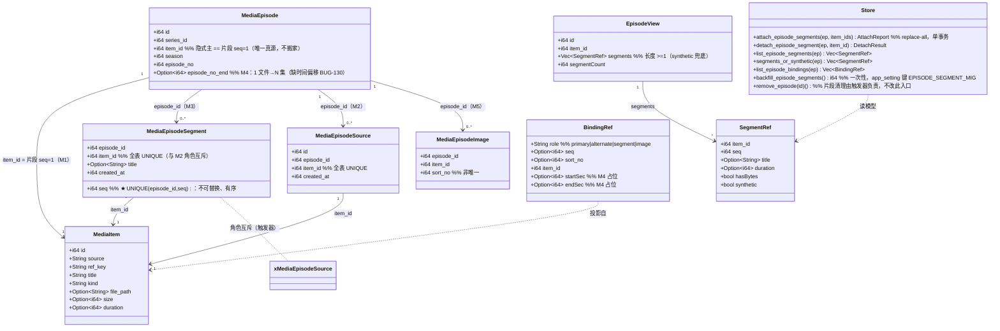
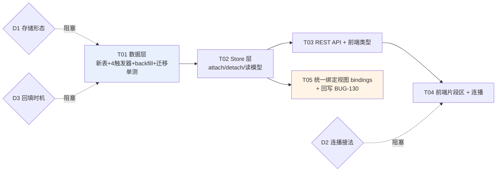

# 一集多片段（Part1 / Part2…）数据模型设计

> **上游**：`docs/design/episode-multi-source-design-2026-09-22.md`（单集多**版本**，本设计的正交兄弟）。
> **上游**：`docs/bugs/BUG-130.md`（合集：一个视频含多集，**open**）、`docs/bugs/BUG-153.md`（区间终点可编辑，fixed）。
> **用户原话（2026-09-29）**：「剧集内设计缺乏，比如一集分为 2 个视频，那对应的 2 个片段，当前完全无法处置。」
> **标记约定**：**【现状】**= 已复核事实（附 file:line）；**【改动】**= 本设计提出；**【待拍板】**= 需裁定。
> **口径**：判据宁看实质不看措辞 —— 下文所有结论以**表列与端点**为准，不看表名/函数名。

---

## 0. 取证结论（本设计的事实基底）

### 0.1 现状表结构（逐列复核，非转引）

| 表 | 列 | 证据 |
|---|---|---|
| `media_episode` | `id, series_id, item_id, season, episode_no, title` + `UNIQUE(series_id, season, episode_no)` | `media.rs:250-258` |
| `media_episode` | ALTER 补列：`description, origin_series_title, origin_episode_no, episode_no_end` | `media.rs:279-338` |
| `media_episode_source` | `id PK, episode_id, item_id INTEGER NOT NULL UNIQUE, created_at, UNIQUE(episode_id,item_id)` | `media.rs:367-377` |
| `media_episode_image` | `episode_id, item_id, sort_no DEFAULT 0, created_at, PRIMARY KEY(episode_id,item_id)` | `media.rs:389-395` |
| `media_item` | `id, source, ref, title, kind, file_path, poster, size, duration, width, height, added_at` + `description` | `media.rs:224-238`、`:345-352` |

**F1（关键）**：`media_episode_source.item_id` 是 **UNIQUE（全表）** —— 一个文件在全库只能是一集的备用源。
**F2**：`media_episode_source` 的语义由触发器钉死为「**同集内容的备用版本**」——
`trg_media_episode_source_video_only_ins/upd` 只接受 `kind='video'`，但**没有顺序列、没有角色列**（`media.rs:542-556`）。
**F3**：`media_episode_image` 已经有 `sort_no`，且**不唯一** —— 「一集挂 N 个有序文件」的**表结构先例已存在**（BUG-168，`media.rs:389-396`）。
**F4**：`media_episode.episode_no_end`（BUG-039/BUG-153）解决的是 **1 文件 → N 集**（合集区间），
方向与本需求**相反**；且**没有时间偏移**（全仓 `start_sec` / `offset` 零命中，BUG-130 缺口 1，仍 `open`）。
**F5**：现有 REST 端点只有
`POST /api/media/episodes/:id/sources`、`POST .../sources/primary`、`DELETE .../sources/:item_id`
（`orig-tg/src/routes.rs:132-140`、`:3700-3727`）与
`POST .../images`、`DELETE .../images/:item_id`（`:145-150`、`:3747-3782`）。**没有任何片段端点。**
**F6**：**活**的剧集内页是 `SeriesDetail.tsx`（左右主从，由 `MediaLibraryPanel.tsx:1020` 渲染）；
其右栏「多源/来源」区（`:542-593`）仍是**两个裸按钮**（`episode-source-switch` / `episode-source-detach`），
**没有片段区**；`api/media.ts:125` 只有 `EpisodeSourceRef`。
**F12（★ 前端落点纠错，2026-09-29 由 PM 许清楚指出并经我复核）**：
`EpisodeExpanded.tsx` / `EpisodeBoard.tsx` / `EpisodeRow.tsx` / `EpisodePhotoGrid.tsx` / `SeriesHero.tsx`
是**全仓零 importer 的孤儿实现** —— `EpisodeExpanded` 只被 `EpisodeBoard` import，而 `EpisodeBoard`
**自身零 importer**（`grep -rn "from './EpisodeBoard'" tauri-shell/src` 无命中）。
`SeriesDetail.tsx:88-89` 注释原话：「原手风琴形态（PRD 方案 A）由本形态取代」。
⇒ **本设计一切前端落点必须在 `SeriesDetail.tsx`，不得落在 `EpisodeExpanded.tsx`**（否则加进死组件，验收脚本
`verify_series_master_detail.cjs` 根本拍不到）。
**F13（★ 复核中发现的活代码缺陷，与 BUG-149 直接相关）**：`SeriesDetail.tsx:581-588` 的「摘除」按钮
调的是 `detachImage`（`:221-222` → `detachEpisodeImage`），**不是** `detachEpisodeSource`；
而 `detachEpisodeSource`（`api/media.ts:502`）**全仓零调用**，`SeriesDetail.tsx:39` 的 import 清单里也**没有**它。
⇒ 「摘除备用源」这个能力在迁入活面板时**接错了线**：点了会去摘**同 itemId 的挂图**（挂图是 photo、
备用源是 video，itemId 不同 ⇒ 实际表现为点了没反应/摘错对象）。这是 BUG-149「重构不是删能力的授权」
的实质违反 —— 能力在，但接错了。
**F7**：`media_episode.item_id` 是**隐式主**（= 播放入口 = 封面来源），这一条在 2026-09-22 设计 §2.2 被再次确认为**唯一真源**。
**F8**：**全仓不存在任何播放进度存储** —— `play_pos` / `playPos` / `watchProgress` 在 `download-engine/` 与
`tauri-shell/src/` **零命中**（2026-09-22 设计 §D3 提议的 `play_pos_ms` 至今未落）。
**F9**：`app_setting(key,value)` 表存在，且已有「一次性迁移键」先例 `EPISODE_TEXT_MIG`（`media.rs:28/77/213`）。
**F10**：`VideoPlayer` 已有**跨集连播**通路：`NextUpInfo { title, poster, episodeNo }` + `onPlayNext` + 5s 倒计时浮层
（`VideoPlayer.tsx:41-47/60-64`，BUG-035 实现）。**没有片段级连播**。
**F11**：投递唯一通路是 `/api/media/items/:id/raw` → `serve_local_file`（BUG-031/033 铁律）。

### 0.2 由 F1–F13 直接推出的结论

1. **「一集 = N 个顺序片段」在现有 schema 中不可表达**：`media_episode` 与 `media_item` 是 `N:1`
   （一集只有一个 `item_id`）；唯一能挂多文件的两张表，一张被触发器钉成「备用版本」（无顺序），
   另一张被钉成「图片浏览位」（photo-only）。
2. **用户的现状绕法是「把 Part1/Part2 编成两集」**（E1/E2），代价：集号被挤占、与真实集号错位、
   连播会在中间弹「下一集」倒计时、剧集集数虚高。这就是「完全无法处置」的实质。
3. **不是「多源没做完」**：2026-09-22 那份设计解决的是「同一集内容的**多个可替换版本**」，
   与「同一集内容的**多个不可替换、有序、缺一不可的部分**」是**两个正交语义**，
   前者落地也救不了后者（详见 §2.3）。

---

## 1. 「集 ↔ 文件」的四种绑定形态（统一视角）

> 用户问：「一集拆成多个视频」与既有「合集区间」是不是同一个「集 ↔ 文件」多对多关系的两端？
> **是。且本设计按「一个关系、四种角色」来建模，而不是再加一个孤立特例。** 见 §1.2 与 §3 的明确表态。

### 1.1 四种形态

| # | 形态 | 基数 | 语义 | 现状载体 | 状态 |
|---|---|---|---|---|---|
| **M1** | 主版本 | 1 集 → 1 文件（唯一） | 播放入口 / 封面源 | `media_episode.item_id` | 【现状】F7 |
| **M2** | 备用源（多清晰度 / 多版本） | 1 集 → N 文件 | **可互相替换**的同一内容 | `media_episode_source` | 【现状】F2 |
| **M3** | **片段（Part1/Part2…）** | 1 集 → N 文件 | **不可替换、有序、缺一不可** | **无** | 【改动】本设计 |
| **M4** | 合集区间（一个文件含 E3-E4） | 1 文件 → N 集 | 一个文件承载多集 | `media_episode.episode_no_end` | 【现状】F4，**缺时间偏移（BUG-130 缺口 1，open）** |
| **M5** | 挂图（浏览位） | 1 集 → N 文件 | 永不进播放序列 | `media_episode_image` | 【现状】F3 |

**M2 与 M3 的分界线（决定性的实质差别，不是措辞差别）**：

| 判据 | M2 备用源 | M3 片段 |
|---|---|---|
| 可替换性 | **可**（切主即换掉） | **不可**（换掉 = 少了内容） |
| 顺序 | **无意义**（无列） | **有意义且唯一**（`seq`） |
| 缺省容忍 | 摘掉任意一个不影响「能不能看」 | 缺一个 = **看不全** |
| 数量语义 | 0..n（0 = 单版本，正常） | **1..n（1 = 单片段，正常；0 = 空集，异常）** |
| 选主是否参与 | **参与**（2026-09-22 设计 §3.1 分层选主） | **不参与**（不存在「选哪个片段播」） |

> 这两行决定了：**M2 与 M3 不能共用一张表** —— 一张表无法同时表达「可替换、无序、可为空」
> 与「不可替换、有序、不可为空」两个**互斥的不变量**（§2.3 给代价表）。

### 1.2 本设计的立场（明确表态）

> **立场 1**：M3（片段）与 M4（合集区间）**是同一个「集 ↔ 文件」多对多关系的两端**，
> 用户判断正确；本设计**不**把 M3 当成孤立特例。
>
> **立场 2**：但「统一」应落在 **读模型 + 端点层**（一个 `bindings` 视图把 M1/M2/M3/M5 合成一张角色表，§6.4），
> **不**落在存储层（不把 `media_episode_source` + `media_episode_image` + 新表并成一张大表）。
> 理由见 §2.3 代价对比：**存储层统一的代价是重写 BUG-039 与 BUG-168 两条刚落地的能力，
> 收益只是「表少两张」**，而调用方真正需要的统一视图在 DTO 层就能拿到。
>
> **立场 3**：M4 的时间偏移（`start_sec`/`end_sec`）**不是本设计的范围**，但本设计把列位留出来
> （§4.1 的可选列 + §6.4 的 `bindings` 已带 `startSec`/`endSec` 占位），使 BUG-130 缺口 1 将来
> **不必再改表**即可补齐。这是「统一模型」的**实质兑现**，不是口号。

---

## 2. 方案对比与推荐

### 2.1 四个候选

| 方案 | 做法 |
|---|---|
| **A（推荐）** | 新增 `media_episode_segment(episode_id, item_id UNIQUE, seq UNIQUE(episode_id,seq), title)` — 与 `media_episode_image` 同构 |
| **B** | 建统一边表 `media_episode_binding(episode_id, item_id, role, seq, start_sec, end_sec)`，**一次性吸收** M2 + M3 + M5，迁移既有两张表 |
| **C** | 复用 `media_episode_source`，加一个 `kind` 列（`alternate` \| `segment`）+ `seq` 列 |
| **D** | 不做（用户继续把 Part1/Part2 编成两集） |

### 2.2 代价对比表

| 维度 | A 新增 `media_episode_segment` | B 统一 `media_episode_binding` | C 复用 source 加类型列 | D 不做 |
|---|---|---|---|---|
| **迁移成本** | **低**：`CREATE TABLE IF NOT EXISTS` 单独 `execute`（同 `media.rs:367` 写法），**零 ALTER、零既有表改动** | **高**：需把 `media_episode_source`（历史 0 行，实测 §0.1 F2 全库 `episodes_with_sources=0`）与 `media_episode_image`（**BUG-168 已落地、有真实数据**）搬进新表 + 改 6 个触发器 + 改 `routes.rs` 4 个端点 + 改 `api/media.ts` 与 3 个组件 | **中**：2 列 ALTER（`kind`/`seq`）+ 改 3 个既有端点的 WHERE | **0** |
| **不变量强度** | **强**：`UNIQUE(episode_id, seq)` 由表结构保证顺序唯一；`video_only` / 角色互斥 / 级联清理由触发器保证 | **强**（但 `role` 相关的部分唯一约束在 SQLite 需部分索引，表达力下降） | **弱**：`seq` 只对 `kind='segment'` 的行有意义，但 UNIQUE 约束无法限定子集 ⇒ **备用源行会占用 seq 号段**；「至少 1 片段」完全无法表达 | — |
| **查询复杂度** | 低：`JOIN media_episode_segment` 单表 | 低（1 表）但每次都要 `WHERE role='segment'` | **高**：现有 `get_series` 的 sources 查询（`media.rs:1260-1288`）、`attach/detach/switch` 三个 Store 函数、**2026-09-22 设计的分层选主 `PrimaryPicker`** 全部要加 `AND kind='alternate'` 分支，**漏一处即把片段当版本切主** | — |
| **与既有触发器的关系** | **零冲突**：新表 + 4 个新触发器，不动 `trg_media_episode_source_*` / `trg_media_episode_image_*` | **冲突**：`trg_media_episode_source_video_only_*` 与 `trg_media_episode_image_photo_only_ins` 语义相反（一个要 video、一个要 photo），并表后必须由 `role` 分支重写，且**旧的 `IF NOT EXISTS` 定义不会自我失效**（BUG-044 教训，需显式 DROP） | **直接冲突**：`trg_media_episode_source_video_only_ins` 只判 kind，不判角色 ⇒ 片段行与备用行共享同一约束，将来任何「片段允许 X」的放宽都会**顺带放宽备用源** | — |
| **与 2026-09-22 设计的冲突** | **无**：那份设计的 `media_episode.item_id = 隐式主` 与 `PrimaryPicker` 完全不碰 | 有：那份设计 §2.2 的「读模型含主的全量列表」建立在 source 表之上，需重写 | **有**：那份设计 §6.4 的 5 个端点全部要加类型参数 | — |
| **回归风险** | **低**（纯增量） | **高**（重动 BUG-039 + BUG-168 两条刚落地能力） | **中高**（改既有写路径语义） | 无新增 |
| **对 M4（合集）的铺垫** | 中：bindings 读模型已留 `startSec`/`endSec` 占位 | 高：列位天然具备 | 低 | 无 |

### 2.3 推荐：**A**，理由三条（按重要性排序）

1. **先例可循，纪律现成**：`media_episode_image`（BUG-168）就是「一集挂 N 个有序文件」的独立表，
   含 `PRIMARY KEY(episode_id,item_id)` + `sort_no` + 两个 cleanup 触发器。**照抄它的形制 = 零新纪律**，
   工程师不需要学新套路。
2. **不变量可表达**：M3 需要「顺序唯一 + 至少 1 个 + 只收 video + 与备用源角色互斥」四条约束。
   独立表能用表约束（前两条中的第一条）与**专属触发器**（后三条）逐条钉死；
   **方案 C 一条都钉不死**（`UNIQUE` 无法限定 `kind` 子集），方案 B 需要靠部分索引绕，表达力反降。
3. **不惊动既有能力**：本轮**零 ALTER、零既有表/端点语义变更**，
   回归面只有「新增的表 + 新增的端点」，与 BUG-032（旧库迁移）的风险面最小。

> **对方案 B 的诚实说明**：B 在**长期**是对的（真正消灭特例）。但它要求在同一轮里
> 重写 BUG-039（多源）与 BUG-168（挂图）两条**刚落地/正在落地**的能力，
> 而 2026-09-22 那份多源设计**至今 7 天未落地**（活的 `SeriesDetail.tsx:542-593` 仍是裸按钮 ——
> 注意：**不是** `EpisodeExpanded.tsx:153-196`，那个是死代码，见 F12）。
> **在一个未落地的设计之上再叠加一次重构 = 把两轮风险叠在一起。**
> 本设计把 B 作为 **D1 的实质选项**交给决策人，不替他决定（§13 D1）。

---

## 3. 与「合集区间」（M4）的关系 —— 统一模型的具体兑现

| 维度 | M4 合集（1 文件 → N 集） | M3 片段（1 集 → N 文件） |
|---|---|---|
| 方向 | `media_episode.episode_no_end` 表达 **集号区间** | `media_episode_segment.seq` 表达 **文件顺序** |
| 现有缺口 | **时间偏移缺失**（BUG-130 缺口 1）：点 E4 仍从文件头播 | 本设计补齐 |
| 是否同一关系 | **是** —— 都是「集 ↔ 文件」多对多 | **是** |

**统一的三条落地（本设计交付，不是口号）**：

1. **统一读模型**：新增 `GET /api/media/episodes/:id/bindings`，
   把 M1（主）/ M2（备用源）/ M3（片段）/ M5（挂图）合成**一个有序列表**，
   每项带 `role: 'primary' | 'alternate' | 'segment' | 'image'`、`seq`、`startSec`/`endSec`（M4 占位，本期恒 null）。
   ⇒ 前端只需要认**一个**结构，不必再区分「这是 source 还是 segment」。
2. **统一角色互斥不变量**：一个文件在全库**只能有一种角色**
   （不能既是 A 集的片段又是 B 集的备用源）——由触发器 `trg_media_episode_segment_role_exclusive` 表达（§4.2）。
   这条不变量**同时**约束 M2 与 M3，是「统一关系」在数据层的实质体现。
3. **为 M4 留列位不留表**：`bindings` 响应里的 `startSec`/`endSec` 与 §4.1 的可选列，
   使 BUG-130 缺口 1 将来只需**填值 + 改播放侧**，**不必再改表结构**。

> **明确不做的**：本设计**不**给 `media_episode_segment` 加 `start_sec`/`end_sec`
> （片段是**整文件**顺序播放，没有偏移概念；偏移只属于 M4）。把两者混为一列会在将来
> 造出「片段内再切段」的伪需求。

---

## 4. 表变更（SQL）

### 4.1 新表（**单独 `execute`，绝不进建表批** —— BUG-032 铁律）

```sql
-- 旧库兼容写法：不进 execute_batch 建表批（media.rs:222-278），
-- 单独 execute，与 media_episode_source（media.rs:367）/ media_episode_image（:387）同款。
CREATE TABLE IF NOT EXISTS media_episode_segment (
    episode_id INTEGER NOT NULL,
    item_id    INTEGER NOT NULL UNIQUE,   -- 全表唯一：一个文件只能是一集的一个片段
    seq        INTEGER NOT NULL,          -- 顺序号，1 起，集内唯一
    title      TEXT,                      -- 片段标题（如「Part 1」）；NULL = 沿用集标题
    created_at INTEGER NOT NULL,
    PRIMARY KEY (episode_id, item_id),
    UNIQUE (episode_id, seq)              -- ★ M2 没有、M3 独有的不变量：顺序不可重复
);
CREATE INDEX IF NOT EXISTS idx_media_episode_segment_item ON media_episode_segment(item_id);
```

**最小字段集的裁定（每个字段都回答「凭什么要」）**：

| 字段 | 凭什么要 | 凭什么**不要**别的 |
|---|---|---|
| `episode_id` | 归属 | — |
| `item_id` | 指向文件；**UNIQUE** 与 M2 同纪律（F1），保证一个文件不会被两集同时当片段 | — |
| `seq` | **M3 的定义性字段**：没有它就无法表达「先播哪个」 | 不用 `sort_no` 宽松列（image 的做法）——片段顺序**必须唯一**，否则两片段同序 = 播放顺序不确定 |
| `title` | 用户要能区分「Part 1 / 上」；可空（默认沿用集标题） | 不落 `duration`/`width`/`height`：**从 `media_item` 派生**（BUG-080「多存一份会漂移的真值」） |
| `created_at` | 与 `media_episode_source` 同形制，供「无信号时的稳定兜底排序」 | — |

**刻意不落的字段**：`duration`（派生自 `media_item.duration`）、`is_primary`（片段没有主次，只有先后）、
`playable`（= `media_item.kind='video'` ∧ `file_path IS NOT NULL`，派生）、`start_sec`/`end_sec`（属 M4，§3）。

### 4.2 触发器（**先 DROP 再 CREATE** —— BUG-044 纪律；`IF NOT EXISTS` 不刷新旧定义）

```sql
-- ① 片段只收 video（与 trg_media_episode_source_video_only_* 同形制）
DROP TRIGGER IF EXISTS trg_media_episode_segment_video_only_ins;
CREATE TRIGGER trg_media_episode_segment_video_only_ins
    BEFORE INSERT ON media_episode_segment
    FOR EACH ROW
    WHEN (SELECT kind FROM media_item WHERE id = NEW.item_id) IS NOT 'video'
    BEGIN
        SELECT RAISE(ABORT, 'episode segment item must be a video item');
    END;

DROP TRIGGER IF EXISTS trg_media_episode_segment_video_only_upd;
CREATE TRIGGER trg_media_episode_segment_video_only_upd
    BEFORE UPDATE OF item_id ON media_episode_segment
    FOR EACH ROW
    WHEN (SELECT kind FROM media_item WHERE id = NEW.item_id) IS NOT 'video'
    BEGIN
        SELECT RAISE(ABORT, 'episode segment item must be a video item');
    END;

-- ② 角色互斥（§3 统一不变量 2）：一个文件不能既是备用源又是片段
DROP TRIGGER IF EXISTS trg_media_episode_segment_role_exclusive;
CREATE TRIGGER trg_media_episode_segment_role_exclusive
    BEFORE INSERT ON media_episode_segment
    FOR EACH ROW
    WHEN EXISTS (SELECT 1 FROM media_episode_source WHERE item_id = NEW.item_id)
    BEGIN
        SELECT RAISE(ABORT, 'item is already an alternate source; detach it first');
    END;

-- ③ 级联清理（BUG-110/124/168 纪律：用触发器，不逐入口补 DELETE）
DROP TRIGGER IF EXISTS trg_media_episode_segment_cleanup_episode;
CREATE TRIGGER trg_media_episode_segment_cleanup_episode
    AFTER DELETE ON media_episode
    FOR EACH ROW
    BEGIN
        DELETE FROM media_episode_segment WHERE episode_id = OLD.id;
    END;

DROP TRIGGER IF EXISTS trg_media_episode_segment_cleanup_item;
CREATE TRIGGER trg_media_episode_segment_cleanup_item
    AFTER DELETE ON media_item
    FOR EACH ROW
    BEGIN
        DELETE FROM media_episode_segment WHERE item_id = OLD.id;
    END;
```

**⚠️ 一条刻意的偏离（必须记录，别当疏漏）**：本设计**不**用触发器表达「一集至少 1 个片段」。

- **为什么不做**：它与触发器 ③ 直接冲突 —— 删掉某集**唯一的片段文件**时，级联清理会把它删空，
  而 SQLite 的 `BEFORE DELETE` 触发器**无法判定删除是由谁引发的**，加 `WHEN count()<=1 THEN ABORT`
  会把「删条目」这条正常路径**锁死**（这是 BUG-124 那类「好心触发器把正常路径拒了」的重演）。
- **改成什么**：① API 层 `DELETE .../segments/:item_id` 在「摘后为空」时返回 **422 + 可读文案**
  「这是《X》第 N 集的唯一片段，要删请直接移除该分集」（引导到既有「移除分集」，而非 ABORT 一串 SQL 英文）；
  ② 读模型兜底（§5.2）保证「片段被删空」不会让集变得不可播；③ 单测守护（T02）。
- **这不是违反 BUG-110 纪律**：BUG-110 反的是「用逐入口 DELETE 补**数据层**不变量」；
  「至少 1 片段」是**产品规则**（它需要给用户的文案与替代动作），不是数据层完整性约束。

### 4.3 旧库迁移与回填

| 项 | 做法 |
|---|---|
| 新表 | `CREATE TABLE IF NOT EXISTS` 单独 `execute` ⇒ **旧库自动获得该表**，无 ALTER，无失败面 |
| 新列 | **0 条**（本设计不 ALTER 任何既有表） ⇒ **BUG-032 的风险面为零** |
| 回填 | 见 D3 待拍板。推荐 **A：migrate 期一次性回填**，每条 `media_episode` 插一行 `(episode_id, item_id, seq=1)`，`INSERT OR IGNORE` 幂等，用 `app_setting` 一次性键 `EPISODE_SEGMENT_MIG` 记录已完成（先例 `EPISODE_TEXT_MIG`，F9） |
| **强制单测** | 「旧库 → 新代码」：造**旧 schema（无 segment 表）+ 旧数据** → `Store::open` 成功 → 数据仍在 → segment 表已建 → 回填行数 = 分集行数 → 每集 `segments` 长度 = 1（AGENTS.md §5 迁移与启动 / BUG-032 硬性） |

---

## 5. 读模型与播放侧

### 5.1 片段 1 与 `media_episode.item_id` 的关系（**唯一真源不搬家**）

- **`media_episode.item_id` 恒等于 `seq = 1` 的片段的 `item_id`**（M1 与 M3 的交点）。
- **为什么不让片段表吃掉主位置**：`media_episode.item_id` 是封面源、播放入口、
  `episodesToItems` 的投影键、2026-09-22 设计的隐式主 —— 动它 = 动全仓。
  **保持它 = `seq=1`** 使「零片段行」的旧库与新库**同一套读路径**。
- **同步责任**：由 `attach_episode_segments`（replace-all，§6.2）在**同一事务**内
  `UPDATE media_episode SET item_id = ?1 WHERE id = ?2`（取新数组第 0 项）。
  单测断言：任意操作序列后 `e.item_id == (SELECT item_id FROM segment WHERE episode_id=e.id AND seq=1)`。

### 5.2 读模型兜底（`segments_or_synthetic()`）

```
segments(ep) = SELECT ... FROM media_episode_segment WHERE episode_id = ep.id ORDER BY seq ASC
               若为空 ⇒ [{ seq: 1, itemId: ep.item_id, title: null, synthetic: true }]
```

**一个函数同时服务两种场景**：① 未回填的旧库（D3 选 B 时）；② 片段被级联删空的集。
⇒ 前端**永远**拿到长度 ≥1 的数组，不需要判空分支。

### 5.3 播放侧（**不新增任何投递端点** —— BUG-031/033 铁律）

| 场景 | 做法 | 依据 |
|---|---|---|
| **投递** | 每个片段就是一个普通 item，走既有 `GET /api/media/items/:id/raw` → `serve_local_file` | F11 / BUG-031/033。**本设计零新增投递端点** |
| **单片段播放** | 点某个片段 → 直接以该 `itemId` 起播（不经过片段 1） | 与现有点集播放同路径 |
| **整集连播** | 复用 `VideoPlayer` 的**既有连播通路**（F10）：`nextUp = { title: '片段 2/2', immediate: true }`，`onPlayNext` 由上层把 `src` 切成片段 2 的 raw URL | **新增 `NextUpInfo.immediate?: boolean`**（`true` = 跳过 5s 倒计时直接接，因为同集片段之间不该插倒计时）。改动面 = `VideoPlayer.tsx` 一个字段 + 一处 `if` |
| **顺序推进的状态放哪** | 上层（`SeriesDetail` / `MediaViewer`）持有 `segmentIndex`，与既有 `episodeIndex` 同层；**不进 `useStore` 的 SSE 合并路径** | BUG-026（流畅优先）：片段索引是播放期局部状态，进全局 store 会引发整面板重渲染 |
| **进度如何记** | **本轮不落库**。全仓**不存在任何进度存储**（F8），为本需求新增 `play_pos_ms` 属于范围外扩，列为 D2 之外的独立项。整集连播的续播能力**依赖**进度存储 ⇒ **本轮只做「从头连播」，不做「跨会话续播」** | 如实承认，不画饼 |
| **UI 呈现** | 片段区在「多源区」**之上**（片段是内容本体，源是版本替换）；每行：`seq` 徽标 + 标题 + 时长（派生）+ 有/无字节 + 「上移/下移/摘除」+ 「从此片段播放」 | §6.5 |
| **n = 1 不渲染**（PM 裁定，采纳） | **片段数 = 1 时不渲染片段区**。现实是 n=1 占绝大多数，给所有单视频集凭空挂一块「1 个片段」= 把实现细节常驻化，违反「实现约束 ≠ 产品信息，只在用户正受阻时出现」。单片段集在主区只有「播放本集」 | §6.5 |
| **单版本不渲染**（PM 裁定，采纳） | 「播哪个版本」在备用源 = 0 时不渲染 —— **无选择即无控件**，与 n=1 同一条产品原则 | §6.5 |

> **为什么连播复用 `nextUp` 而不是新加 `onSegmentEnd`**：`nextUp` 通路（BUG-035）已经解决
> 「播完 → 弹浮层 → 切源 → 自动播放」的全套时序与自绘控件联动；新加一个平行回调会造出
> **第二条连播通路**，与 AGENTS.md 投递契约「禁止两条投递路径分叉」（BUG-031）是同一类错误。

---

## 6. API 增删清单

### 6.1 总览

| 方法 | 路径 | 状态 | 说明 |
|---|---|---|---|
| GET | `/api/media/series/:id` | **改** | `episodes[].segments: EpisodeSegmentRef[]`（长度 ≥1，§5.2）+ `segmentCount` |
| GET | `/api/media/episodes/:id` | **改** | 同上（单集读路径） |
| **POST** | `/api/media/episodes/:id/segments` | **新增** | **replace-all** 语义：`{ itemIds: number[] }`，数组下标即 `seq`。与 `POST .../images`（BUG-168）同形制。空数组 → **422** |
| **DELETE** | `/api/media/episodes/:id/segments/:item_id` | **新增** | 摘单个片段；摘后为空 → **422** + 可读文案（§4.2） |
| **GET** | `/api/media/episodes/:id/bindings` | **新增** | §3 统一绑定视图：`role` + `seq` + `startSec`/`endSec`（占位） |
| — | （其余播放/投递端点） | **不动** | 片段走既有 `/api/media/items/:id/raw` |

**端点数：新增 3 个，改 2 个。零投递端点、零改既有端点语义。**

### 6.2 `POST .../segments` 的语义裁定（replace-all 而非增量）

| 为什么 replace-all | 为什么不是增量 append |
|---|---|
| 顺序是**数组下标** ⇒ 一次请求表达全序，无歧义 | 增量 append 需要额外 `seq` 参数与重排端点（多 1 个端点 + 一类并发冲突） |
| 与 `POST .../images`（BUG-168）**同形制**，前端「上移/下移」= 重排数组后重发 | — |
| 幂等：同数组连发两次结果一致 | — |

**写路径（单事务）**：`DELETE FROM media_episode_segment WHERE episode_id=?` →
逐条 `INSERT`（`seq = idx+1`）→ `UPDATE media_episode SET item_id = arr[0]` → COMMIT。
冲突（`item_id` 已被别集占用 / 非 video / 已是备用源）**如实记入 `report.skipped` 并整批回滚**，
**绝不静默丢弃**（BUG-103 判据）。

### 6.3 类型（`tauri-shell/src/api/media.ts`）

```ts
export interface EpisodeSegmentRef {
  itemId: number
  seq: number                 // 1 起
  title?: string | null
  duration?: number | null    // 派生自 media_item.duration
  hasBytes: boolean           // file_path IS NOT NULL
  synthetic?: boolean          // true = 由 episode.item_id 合成（§5.2），前端只读不写
}

export interface EpisodeBindingRef {   // GET .../bindings
  role: 'primary' | 'alternate' | 'segment' | 'image'
  seq: number | null      // segment 有值；alternate/image 为 null（无序）
  sortNo: number | null   // image 用
  itemId: number
  title?: string | null
  startSec: number | null // M4 占位，本期恒 null
  endSec: number | null   // M4 占位，本期恒 null
}
```

### 6.4 前端改动点

> **⚠️ 落点纪律（F12）**：**一切**前端改动落在 `SeriesDetail.tsx`（活的剧集内页）。
> `EpisodeExpanded.tsx` / `EpisodeBoard.tsx` / `EpisodeRow.tsx` / `EpisodePhotoGrid.tsx` / `SeriesHero.tsx`
> 是**零 importer 的孤儿实现**，**严禁**往里加片段区 —— 加了等于白做（验收脚本
> `verify_series_master_detail.cjs` 拍不到，组件根本不会被挂载）。
> 孤儿组件本身的处置（删除 or 复活）归属 PM 的 P0 R6，本设计不越权决定。

| 文件 | 改动 |
|---|---|
| `tauri-shell/src/api/media.ts` | 新增 `EpisodeSegmentRef` / `EpisodeBindingRef` / `attachEpisodeSegments` / `detachEpisodeSegment` / `getEpisodeBindings`；`MediaEpisode` 加 `segments` |
| `tauri-shell/src/components/media/SeriesDetail.tsx` | ① 在既有「多源/来源」区（`:542-593`）**上方**新增片段区：有序列表 + 上移/下移（调 replace-all）+ 摘除 + 「从此片段播放」；② `n = 1` 时**不渲染**该区；③ `playEpisode`（:153-155）改为传 `segmentIndex`；④ 连播推进 |
| `tauri-shell/src/components/media/SeriesDetail.tsx:583`（**附带修复**） | 「摘除」按钮由 `detachImage` 改回 `detachEpisodeSource`（F13）；`:39` 补 import。这是**独立于片段需求**的既有缺陷修复，但**必须**在动同一区块时一并修（否则片段区与多源区的「摘除」会继续接错线） |
| `tauri-shell/src/components/media/VideoPlayer.tsx` | `NextUpInfo` 加 `immediate?: boolean`（:41-47）+ 倒计时分支（:60-64 附近） |
| i18n | `media.episode.segmentsTitle` / `segmentMoveUp` / `segmentMoveDown` / `segmentDetach` / `segmentPlayFrom` |

---

## 7. 类图



---

## 8. 程序调用流

```mermaid
sequenceDiagram
    participant UI as SeriesDetail.tsx（★活面板，非 EpisodeExpanded）
    participant API as routes.rs (orig-tg)
    participant S as Store (media.rs)
    participant DB as SQLite
    participant VP as VideoPlayer.tsx

    Note over UI,DB: ① 挂载片段（replace-all，顺序 = 数组下标）
    UI->>API: POST /episodes/:id/segments {itemIds:[22,23]}
    API->>S: attach_episode_segments(ep, [22,23])
    S->>DB: BEGIN IMMEDIATE
    S->>DB: DELETE FROM media_episode_segment WHERE episode_id=?
    loop idx, itemId in [22,23]
        S->>DB: INSERT (episode_id, item_id, seq=idx+1)
        Note right of DB: trg_..._video_only_ins 校验 kind='video'<br/>trg_..._role_exclusive 校验非备用源<br/>UNIQUE(episode_id,seq) 校验顺序
    end
    S->>DB: UPDATE media_episode SET item_id=22 (== seq 1)
    S->>DB: COMMIT
    S-->>API: AttachReport {attached:2, skipped:[]}
    API-->>UI: JSON
    UI->>UI: 片段区渲染 [1] Part1 [2] Part2

    Note over UI,DB: ② 整集连播（片段1 → 片段2）
    UI->>VP: src=/api/media/items/22/raw, nextUp={title:'片段 2/2', immediate:true}
    VP->>VP: ended
    alt nextUp.immediate
        Note right of VP: 跳过 5s 倒计时（同集片段之间不插倒计时）
        VP->>UI: onPlayNext()
        UI->>UI: segmentIndex = 1
        UI->>VP: src=/api/media/items/23/raw, autoPlay=true
    else 无更多片段
        VP->>UI: onEnded() → 走既有「下一集」逻辑
    end

    Note over UI,DB: ③ 摘除唯一片段（产品规则，非数据层）
    UI->>API: DELETE /episodes/:id/segments/22
    API->>S: detach_episode_segment(ep, 22)
    S->>DB: SELECT COUNT(*) FROM media_episode_segment WHERE episode_id=?
    alt 摘后为空
        S-->>API: DetachResult::WouldEmpty
        API-->>UI: 422 「这是《X》第 N 集的唯一片段，要删请直接移除该分集」
    else 还有其它片段
        S->>DB: BEGIN IMMEDIATE; DELETE; 重排 seq 连续; UPDATE episode.item_id=新 seq1; COMMIT
        API-->>UI: 200
    end

    Note over S,DB: ④ 删分集（触发器级联，不逐入口补 DELETE）
    S->>DB: DELETE FROM media_episode WHERE id=?
    DB->>DB: trg_media_episode_segment_cleanup_episode → DELETE segments
    DB->>DB: trg_media_episode_cleanup_sources（BUG-124）→ DELETE sources
```

---

## 9. 任务分解（有序，5 个任务）

| ID | 任务名 | 源文件 | 依赖 | 优先级 |
|---|---|---|---|---|
| **T01** | 数据层：新表 `media_episode_segment` + 4 个触发器 + backfill + 旧库迁移单测 | `download-engine/crates/orig-tg/src/media.rs` | — | **P0** |
| **T02** | Store 层：`attach/detach/list/segments_or_synthetic` + `get_series` 读模型扩 `segments` + 单测 | `media.rs` | T01 | **P0** |
| **T03** | REST API + 前端类型 | `orig-tg/src/routes.rs`、`tauri-shell/src/api/media.ts` | T02 | **P0** |
| **T04** | 前端：片段区 + 连播 + 附带修 F13 | `SeriesDetail.tsx`（**唯一活落点**，F12）、`VideoPlayer.tsx`、`api/media.ts`、i18n | T03 | **P0** |
| **T05** | 统一绑定视图 `bindings` + 回写 BUG-130/153 | `media.rs`、`routes.rs`、`api/media.ts`、`docs/bugs/BUG-130.md` | T02（**不依赖 T03/T04**） | **P1** |

### T01 明细 —— 数据层（P0）
1. §4.1 建表（**单独 `execute`，不进 `execute_batch` 建表批**，BUG-032）。
2. §4.2 四个触发器，**先 DROP 再 CREATE**，`CREATE TRIGGER` 语句单独 `execute_batch`（同 `media.rs:387-428`）。
3. `backfill_episode_segments()`：`INSERT OR IGNORE INTO media_episode_segment(episode_id,item_id,seq,created_at)
   SELECT id, item_id, 1, <now> FROM media_episode`，`app_setting` 键 `EPISODE_SEGMENT_MIG`（D3 批准 A 时）。
4. **单测（强制）**：
   - **旧库→新代码**：旧 schema（无 segment 表）+ 旧数据 → `Store::open` 成功 + 数据仍在 + 表已建 + 回填行数 = 分集行数（BUG-032 硬性）。
   - 触发器：`kind != 'video'` 插入 ABORT；`item_id` 已是备用源时 ABORT；删分集后悬空片段行 = 0（跨进程重启后仍成立）。
   - `UNIQUE(episode_id, seq)` 命中重复 seq 报错。
   - **守护**：`e.item_id == seq=1 的片段`（任意操作序列后）。

### T02 明细 —— Store 层（P0）
1. `attach_episode_segments(ep, item_ids)`：单事务 replace-all，冲突**整批回滚 + 如实回报** `skipped`（BUG-103 判据）。
2. `detach_episode_segment(ep, item_id)`：摘后为空 → `WouldEmpty`（422）；否则重排 `seq` 连续并同步 `episode.item_id`。
3. `list_episode_segments(ep)` / `segments_or_synthetic(ep)`（§5.2）。
4. `get_series` / `get_episode`：读模型加 `segments` / `segmentCount`（一次 JOIN 补齐，**不进 N+1**）。
5. **单测**：replace-all 幂等；上移/下移后 `seq` 连续且 `item_id` 同步；`synthetic` 兜底；删条目级联不残留。

### T03 明细 —— API + 类型（P0）
1. `routes.rs`：注册 3 个新端点（§6.1）；改 2 个读端点响应。
2. `api/media.ts`：`EpisodeSegmentRef` / `EpisodeBindingRef` + 3 个函数 + `MediaEpisode.segments`。

### T04 明细 —— 前端（P0）
1. `SeriesDetail.tsx`：在既有「多源/来源」区（`:542-593`）**上方**新增片段区（**不是** `EpisodeExpanded.tsx`，F12），
   上移/下移走 replace-all；**`n = 1` 时不渲染该区**；「播哪个版本」在备用源 = 0 时不渲染（PM 裁定，§5.3）。
2. `VideoPlayer.tsx`：`NextUpInfo.immediate` + 跳过倒计时分支。
3. `SeriesDetail.tsx`：整集连播推进（§5.3），**不进 `useStore` SSE 路径**（BUG-026）。
4. i18n 5 条文案。
5. **附带修 F13**：`:583` 的「摘除」由 `detachImage` 改回 `detachEpisodeSource` + `:39` 补 import。
   **单测/验收**：点「摘除」后该备用源从列表消失且**挂图不受影响**（断言 `images` 长度不变）。

### T05 明细 —— 统一绑定视图（P1）
1. `list_episode_bindings(ep)`：合成 M1/M2/M3/M5（§6.3），`startSec/endSec` 恒 null（M4 占位）。
2. `GET /api/media/episodes/:id/bindings`。
3. 回写 `docs/bugs/BUG-130.md`：缺口 1 的落点已预留（填 `startSec/endSec` 即可，不必再改表）。

### 任务依赖图



> T05 只依赖 T02，可与 T03/T04 并行。T01 被 D1 与 D3 挡住，T04 被 D2 挡住。

---

## 10. 共享知识（跨任务约定）

- **M1/M2/M3/M5 是「集 ↔ 文件」一个关系的四种角色**：M1 主 = `media_episode.item_id`；M2 备用源（可替换/无序/可空，参与选主）；M3 片段（不可替换/有序/1..n，**不参与选主**）；M5 挂图（photo-only，永不进播放序列）。
- **片段 1 == `media_episode.item_id`**。任何写路径改片段顺序必须**同事务**同步 `item_id`。
- **新增表一律** `CREATE TABLE IF NOT EXISTS` 单独 `execute`；**新列一律** `pragma_table_info` 探测 + `ALTER TABLE ADD COLUMN`；**绝不进** `execute_batch` 建表批（BUG-032）。
- 表变更必须配「旧库 → 新代码」迁移单测。
- **触发器先 DROP 再 CREATE**（BUG-044）；删分集/删条目的级联清理**用触发器，不逐入口补 DELETE**（BUG-110/124/168）。
- **不新增任何投递端点**：片段播放走既有 `/api/media/items/:id/raw` → `serve_local_file`（BUG-031/033）。
- **不派生落库**：`duration`/`hasBytes` 从 `media_item` 读；多存一份 = 多一份会漂移的真值（BUG-080）。
- 冲突/跳过**如实回报**，绝不静默丢弃（BUG-103）。
- 片段索引是播放期局部状态，**不进 `useStore`**（BUG-026）。
- **本轮不落播放进度**（全仓无进度存储，F8）；不做跨会话续播。
- 提交信息全英文、LF（AGENTS.md §2）。

---

## 11. 回归风险

| # | 风险 | 触发 | 缓解 |
|---|---|---|---|
| R1 | 新表塞进建表批 ⇒ 旧库整批失败 ⇒ `Store::open` 回落空库 ⇒ **用户数据全没了** | T01 写法错 | 单独 `execute`（§4.1）；**强制**迁移单测（BUG-032） |
| R2 | 触发器未先 DROP，旧定义残留 | T01 | `DROP TRIGGER IF EXISTS` 前置（BUG-044）；单测断言触发器在册 |
| R3 | 「至少 1 片段」若误写成无条件 `BEFORE DELETE` 触发器 ⇒ **删条目路径被锁死** | T01 | §4.2 刻意不做；改 API 层 422 + 单测覆盖「删条目 → 成功」 |
| R4 | `item_id` 全表 UNIQUE ⇒ 挂载冲突（已是别集片段 / 已是备用源） | T02 | `report.skipped` 如实回报 + 整批回滚（BUG-103 判据） |
| R5 | `episode.item_id` 与 `seq=1` 漂移 | T02 | 同事务同步 + 单测守护 |
| R6 | 连播绕过背压（BUG-033） | T04 | **零新增投递端点**；仍走 `serve_local_file` |
| R7 | 片段区引入高频重渲染（BUG-026） | T04 | 片段列表只在展开时挂载，不进轮询；`segmentIndex` 不放全局 store |
| R8 | 第二条连播通路分叉（BUG-031 同类错误） | T04 | 复用 `nextUp` 通路，只加 `immediate` 字段 |
| R9 | backfill 失败阻塞启动 | T01 | 单事务 + 显式报错，**禁止回落 `:memory:`**（AGENTS.md §5） |
| R10 | 与 2026-09-22 多源设计抢语义（把片段当版本切主） | T02 | 分表 ⇒ 结构隔离；`PrimaryPicker` 完全不碰 segment 表 |
| R11 | `sources` 与 `segments` 在前端混用 | T03/T04 | 类型分离 + `bindings` 统一视图给 `role` 显式标注 |
| **R12** | **片段区加进死组件**（`EpisodeExpanded.tsx` 等零 importer 孤儿）⇒ 功能做完但**永远不会被挂载**，验收脚本 `verify_series_master_detail.cjs` 拍不到，表现为「做了等于没做」 | T04 | F12 落点纪律写进 §6.4 与 T04；**单测/验收必须走活面板路径**（`MediaLibraryPanel.tsx:1020` → `SeriesDetail`） |
| **R13** | 沿用 F13 的错线「摘除」 ⇒ 片段区摘除调成摘图 | T04 | T04 第 5 项附带修 + 断言「摘源后 `images` 长度不变」 |

---

## 12. 与 2026-09-22「单集多视频源」设计的关系（防止误读）

| 项 | 2026-09-22 设计 | 本设计 | 是否冲突 |
|---|---|---|---|
| 表 | `media_episode_source` | `media_episode_segment`（新表） | **不冲突**：正交语义，分表 |
| 隐式主 | `media_episode.item_id` | 沿用，且 = `seq=1` | **不冲突**：本设计强化它 |
| 选主 `PrimaryPicker` | 分层选主 | **片段不参与选主** | **不冲突**：选主只扫 source 表 |
| `primary_locked` / `quality_label` 两列 | 【改动】新增 | **本设计不新增这两列**（与本需求无关） | 不冲突；若两设计同期落地，**一次迁移覆盖全部新列**更省 |
| 前端消费点 | `SeriesDetail.tsx:542-593` 多源区 | **`SeriesDetail.tsx` 同一右栏**（在多源区**上方**） | **不是**「相邻不重叠」，见下方更正 |

### 12.1 更正（2026-09-29，PM 许清楚指出并经复核）

> 本表「前端消费点」一行**原写「系列多源在 `SeriesDetail.tsx`、片段区在 `EpisodeExpanded.tsx`，相邻不重叠」是错的。**
> 按 F12，`EpisodeExpanded.tsx` 是**零 importer 的孤儿**，两份设计的 UI 最终都落在
> **同一个活面板**（`SeriesDetail.tsx` 右栏，多源区现已在 `:542-593`）上。
> ⇒ 二者是**必须一起排布**的关系，不是各占一处。**次序已与 PM 对齐**：
>
> | 层 | 内容 |
> |---|---|
> | **主区** | 播放本集（多片段 = 整集连播）+ 「用哪个版本播」（备用源 = 0 时**不渲染**） |
> | **次区** | **片段区**（n=1 时**不渲染**）→ 介绍 → 编辑 → 版本管理 → 挂图管理 |
> | 溢出区 | 其余动作 |
>
> 该次序以 `docs/design/episode-internal-ia.md`（PM）为准；本设计只约束
> **片段区在版本管理之前**（片段是内容本体，版本是替换选项）与**两条不渲染规则**。

> **落地顺序建议**：2026-09-22 那份设计**已 draft 7 天未落地**，其 D1/D2/D3 亦未裁定。
> 若决策人希望两件事一起做，T01 的 `migrate()` 应把两份设计的新列/新表放在**同一次提交**里，
> 只需**一份**「旧库→新代码」迁移单测（省一次迁移、省一轮回归）。此为执行细节，工程师自决。

> **附带**：T04 需一并修 F13（多源区「摘除」接错 `detachEpisodeImage`）——
> 不修的话片段区与多源区会共用同一个错线的「摘除」处理函数。

---

## 13. 待拍板清单

### D1. 片段的存储形态：新增独立表，还是并进统一绑定表，还是复用 source 加类型列？

- **问题**: 「一集 = N 个顺序片段」用哪种存储形态承载 —— A 新增 `media_episode_segment`（与 `media_episode_image` 同构）、B 建统一 `media_episode_binding` 一次性吸收源/片段/挂图、还是 C 复用 `media_episode_source` 加类型列？
- **现状与代价**: 现状**完全无法表达**：`media_episode` 与 `media_item` 是 N:1（`media.rs:250-258`），唯一能挂多文件的两张表分别被触发器钉成「备用版本」（无序列，`media.rs:367-377` + `:542-556`）与「图片位」（photo-only，`:389-428`）。用户的绕法是把 Part1/Part2 编成两集 ⇒ 集号被挤占、与真实集号错位。不定的代价：T01（建表）无法开工，整个需求停在纸面。
- **设计锚点**: `docs/design/episode-segment-model-2026-09-29.md` §2.2（代价对比表）、§2.3（推荐理由）
  - 冲突: 与 `docs/design/episode-multi-source-design-2026-09-22.md` §2.2 若选 **C** 会冲突 —— 那份设计把 `media_episode_source` 的语义钉为「备用版本」，选 C 会让其 `PrimaryPicker` 必须处处加 `AND kind='alternate'` 分支，漏一处即把片段当版本切主。
- **请求**: 选 A（我的建议）、B，还是 C？

**A. 新增 `media_episode_segment` 独立表（推荐）**
- 涉及: `download-engine/crates/orig-tg/src/media.rs`（建表 + 4 触发器 + backfill）、`download-engine/crates/orig-tg/src/routes.rs`（3 新端点）、`tauri-shell/src/api/media.ts`、`tauri-shell/src/components/media/SeriesDetail.tsx`（★活落点，F12）、`tauri-shell/src/components/media/VideoPlayer.tsx`
- 量化: 1 张新表、4 个新触发器、**0 条 ALTER**、新增 3 个端点 / 改 2 个读端点、5 个文件；1 次迁移（新表），1 份迁移单测
- 回归风险: **低** —— 纯增量，零既有表/端点语义变更；与 BUG-039（多源）、BUG-168（挂图）两条刚落地能力零重叠
- 后果: 片段能力可用；表数量 +1（与 `media_episode_image` 同形制，无新纪律）。可逆（删表即回到现状，数据无损失）

**B. 建统一 `media_episode_binding` 一次性吸收源 + 片段 + 挂图**
- 涉及: `download-engine/crates/orig-tg/src/media.rs`（新表 + 迁移 `media_episode_source` 与 `media_episode_image` + 重写 6 个触发器）、`download-engine/crates/orig-tg/src/routes.rs`（4 个既有端点改语义）、`tauri-shell/src/api/media.ts`、`tauri-shell/src/components/media/SeriesDetail.tsx`（★活落点，F12）
- 量化: 1 张新表 + 2 张表的数据搬迁、6 个触发器重写、5 个改端点、6 个文件；迁移 1 次但覆盖面 = 两条已落地能力
- 回归风险: **高** —— 直接重动 BUG-039（多源，历史 0 行）与 BUG-168（挂图，**有真实数据**）两条刚落地能力；`video_only` 与 `photo_only` 两个语义相反的触发器并表后必须由 `role` 分支重写，且旧的 `IF NOT EXISTS` 定义不会自我失效（BUG-044 需显式 DROP）
- 后果: 长期消灭特例（表少两张），但本轮回归面扩到挂图与多源；若 BUG-168 尚未稳定，挂图能力会一起被拖进风险区。可逆性差（数据已搬迁）

**C. 复用 `media_episode_source` 加 `kind` + `seq` 两列**
- 涉及: `download-engine/crates/orig-tg/src/media.rs`（2 列 ALTER + 改 `attach/detach/switch_episode_source` + 改 `get_series` 的 sources 查询 `:1260-1288`）、`download-engine/crates/orig-tg/src/routes.rs`（3 个既有端点加类型参数）、`tauri-shell/src/components/media/SeriesDetail.tsx`
- 量化: 2 列 ALTER、改 3 个 Store 函数 + 5 个端点、4 个文件；**0 张新表**
- 回归风险: **中高** —— `UNIQUE` 无法限定 `kind` 子集 ⇒ 备用源行会占用 `seq` 号段；「至少 1 片段」与「顺序唯一」两条不变量**都无法表达**；`trg_media_episode_source_video_only_ins` 不判角色，将来任何「片段允许 X」的放宽会顺带放宽备用源
- 后果: 表不增加，但两种互斥语义挤在一张表 ⇒ 每次查询都要带 `AND kind=...`，漏一处即错。可逆（加得回列，但语义已污染）

**D. 不做（维持现状）**
- 涉及: 无
- 量化: 0 改动
- 回归风险: 无新增（但既有问题保留）
- 后果: 用户继续把 Part1/Part2 编成两集 ⇒ 集号被挤占、剧集集数虚高、整集连播会在 Part1 与 Part2 之间弹「下一集」5 秒倒计时（把一集切成两集的错觉）。只要用户还有「一集两个视频」的内容，就会反复撞到；届时仍需付同样的建模成本

---

### D2. 整集连播的播放器接法：复用既有 `nextUp` 通路，还是上层切 src 不动播放器？

- **问题**: 片段 1 播完自动接片段 2 —— 是在 `VideoPlayer` 的既有连播通路上加一个 `immediate` 开关，还是完全由上层切 `src`、播放器零改动？
- **现状与代价**: `VideoPlayer` 已有跨集连播（`NextUpInfo { title, poster, episodeNo }` + `onPlayNext` + 5s 倒计时，`VideoPlayer.tsx:41-47/60-64`，BUG-035 实现）。片段连播与它只差「**不要倒计时**」（同集片段之间插 5 秒倒计时 = 把一集切成两集的错觉）。不定 ⇒ T04（前端）无法开工。
- **设计锚点**: `docs/design/episode-segment-model-2026-09-29.md` §5.3（播放侧）
  - 冲突: 无。但注意 AGENTS.md §5「投递契约」记下的 BUG-031 教训 —— 「两条投递路径分叉」是同类错误，故**不**新增平行连播回调。
- **请求**: 选 A（我的建议）还是 B？

**A. 给 `NextUpInfo` 加 `immediate?: boolean`，复用既有连播通路（推荐）**
- 涉及: `tauri-shell/src/components/media/VideoPlayer.tsx`（:41-47 加字段、:60-64 附近加一处 `if`）、`tauri-shell/src/components/media/SeriesDetail.tsx`（连播推进 +「从此片段播放」+ 附带修 F13，★活落点）
- 量化: 1 个可选字段 + 1 处分支、3 个文件；播放器其余逻辑零改动
- 回归风险: **低** —— `immediate` 默认 undefined，既有「下一集」行为逐字不变；不新增第二条连播通路
- 后果: 片段之间直接接播（无倒计时），跨集仍是 5s 倒计时浮层。可逆（删字段即回退）

**B. 上层切 `src`，播放器零改动**
- 涉及: `tauri-shell/src/components/media/SeriesDetail.tsx`（持有 `segmentIndex`，`onEnded` 时重设 `src` + `autoPlay`）、`tauri-shell/src/components/media/MediaViewer.tsx`（若播放态在其上）
- 量化: 播放器 0 改动、2 个文件；但 `VideoPlayer` 的 `onEnded` 语义是「播完且**没有**下一集」，上层需额外判断「本集还有片段 / 走下一集」两条分支
- 回归风险: **中** —— `onEnded` 现有语义被复用成两种含义，将来「连播到下一集」与「接下一片段」的优先级要在上层硬编码；且倒计时的「取消」入口（用户点「不看了」）在片段场景无处安放
- 后果: 播放器零改动（表面最省），但连播的时序判断散落到上层两个组件，与 BUG-027「多源并行派发」同类复杂度。可逆

**C. 不做（本轮不做片段连播，只做单片段播放）**
- 涉及: 无
- 量化: 0 改动
- 回归风险: 无新增
- 后果: 数据模型与片段区都做完了，但用户播片段 1 结束后要**手动点**片段 2 —— 与「一集两个视频」的诉求只完成一半。若用户反馈「还是不连贯」，会被迫回头补，届时播放器与上层都要再改一次

---

### D3. 旧库的片段回填：migrate 期一次性回填，还是读时合成不落库？

- **问题**: 旧库里每个 `media_episode` 都**没有**片段行 —— 是 migrate 期一次性插 `(episode_id, item_id, seq=1)`，还是读时用 `episode.item_id` 合成单片段、永不落库？
- **现状与代价**: 现有库有真实分集数据（2026-09-22 实测：6 剧集 / 43 分集量级）。不回填 ⇒ 旧集的 `segments` 全是合成值，「上移/下移」要落库时才首次 INSERT；回填 ⇒ 存储层不变量「每集 ≥1 片段」成立、读路径零分支，但 migrate 多一步（失败会阻塞启动）。不定 ⇒ T01 的 backfill 分支无法定稿。
- **设计锚点**: `docs/design/episode-segment-model-2026-09-29.md` §4.3（旧库迁移与回填）、§5.2（`segments_or_synthetic`）
  - 冲突: 无。但必须遵守 AGENTS.md §5「迁移与启动」：migrate 失败必须显式失败，**禁止回落 `:memory:`**。
- **请求**: 选 A（我的建议）还是 B？

**A. migrate 期一次性回填 + `app_setting` 一次性键（推荐）**
- 涉及: `download-engine/crates/orig-tg/src/media.rs`（`backfill_episode_segments()` + `app_setting` 键 `EPISODE_SEGMENT_MIG`，先例 `EPISODE_TEXT_MIG` 在 `:28/77/213`）
- 量化: 1 个函数 + 1 个设置键、1 个文件；回填行数 = 分集行数（量级 43 行，实测）
- 回归风险: **低** —— `INSERT OR IGNORE` 幂等；一次性键保证不重跑；单事务 + 失败显式报错（不回落空库，BUG-032）。既有分集数据**零改动**
- 后果: 存储层不变量「每集 ≥1 片段」立即成立；读路径**零分支**（不必判空）。可逆（删行即可，无语义损失）

**B. 读时合成，不落库**
- 涉及: `download-engine/crates/orig-tg/src/media.rs`（`segments_or_synthetic()`）、`tauri-shell/src/api/media.ts`（`synthetic` 字段语义变为常态而非兜底）
- 量化: 0 行回填、2 个文件；但每个读路径都要经过合成函数
- 回归风险: **低** —— 无写路径；但「合成」从兜底变成常态，将来任何想直接 `SELECT` 片段表的代码（导出、统计、合并剧集搬运）都会漏掉未回填的旧集
- 后果: migrate 更快更省；但「每集 ≥1 片段」这条不变量在库里不成立 ⇒ 跨集搬运（`merge_series`，`media.rs:1391-1627`）将来必须记得搬片段，而「搬不存在的行」不会报错 —— 静默漏数据。可逆

**C. 不做（完全不迁移，旧集没有片段区）**
- 涉及: 无
- 量化: 0 改动
- 回归风险: 无新增
- 后果: 用户打开旧剧集**看不到片段区**（`segments` 为空数组或缺失），只有新建/重新挂载片段的集才有 —— 表现为「新旧剧集能力不一致」。用户会认为功能没做完。届时仍需付 A 或 B 的成本

---

> **依赖顺序**：D1 的结论决定 T01 的表形态；D3 依赖 D1 选 A/B（若选 C 复用 source 表，回填语义不同）；
> **D2 与 D1/D3 独立**，可并行裁定。
