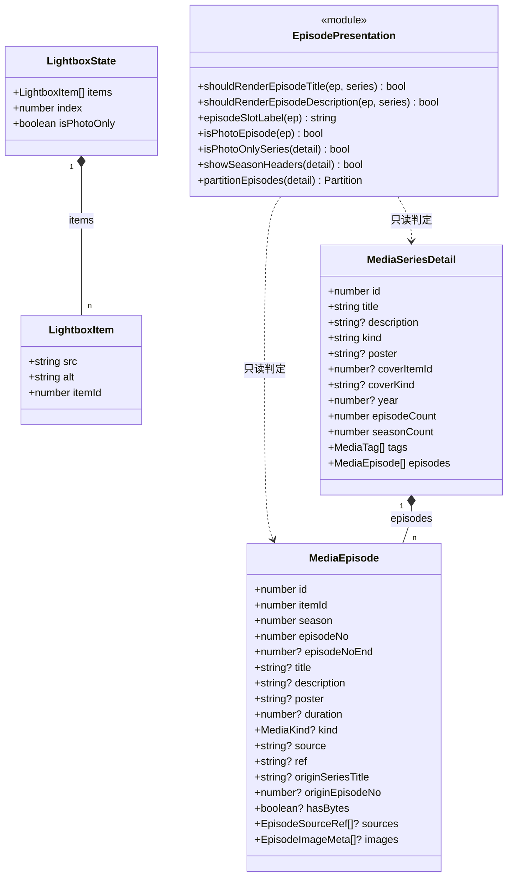
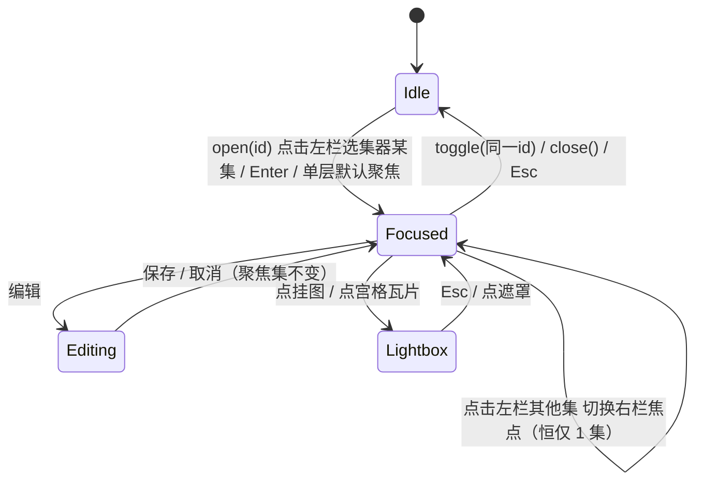
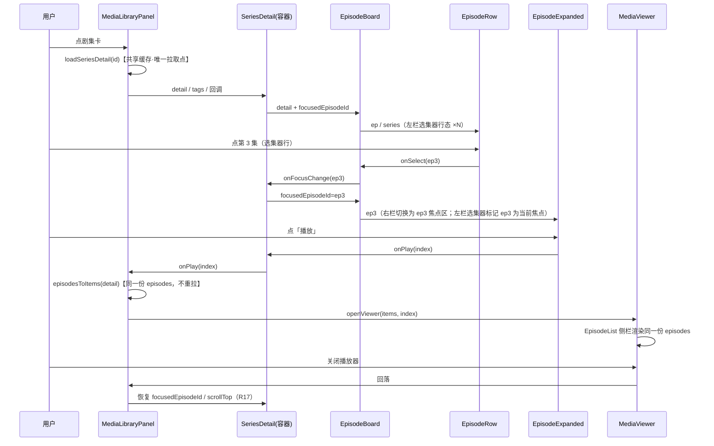

# 媒体库展示重排 · 排版设计与任务分解

- 日期: 2026-09-28
- 作者: 高见远（架构师）
- 状态: draft（待用户审 Q5 / 待工程师实施）
- 上游: `docs/design/media-library-layout-prd-2026-09-28.md`（许清楚，PRD；本文所有 R* 编号均引自 PRD §5）
- 范围: 仅 `tauri-shell/src` 前端展示层重排；**本文不改代码、不改后端**
- 关联缺陷: BUG-171（去重 + Hero 海报比例）、BUG-060 / BUG-168 / BUG-044（图片归属）、BUG-080 / BUG-132（字节态）、BUG-113 / BUG-130（多源）、BUG-118 / BUG-119（封面归属）、BUG-120（编辑面板）、BUG-149（重构 ≠ 删能力）

> **与任务书的一处偏差（需知会）**：任务书示例把去重工具放在 `src/util/episodePresentation.ts`，
> 但本仓库**没有 `util/` 目录**，纯函数工具统一在 `src/lib/`（`poster.ts` / `tgmedia.ts` / `mediaSources.ts` / `utils.ts`）。
> 本文统一放 **`src/lib/episodePresentation.ts`**，沿用现有约定，不新增目录层级。

---

## 1. 架构总览

三层模型一句话：**列表层选「哪一部」→ 剧集详情页以 master-detail（左选右看）呈现：左栏回答「这部剧是什么」（全剧概览区，常驻）+ 选集器（常驻），右栏回答「这一集是什么」（单集焦点区 = 显示 + 编辑，同时只呈现 1 集）**。

| 维度 | 决策 |
|------|------|
| 组件分层策略 | `SeriesDetail` 从「1424 行单体」拆为**容器 + 两栏**：`SeriesHero`（左栏全剧概览区，常驻）+ `EpisodeBoard`（左栏选集器 + 右栏焦点区，W master-detail）。容器只做「拉数据 + 编排对话框 + 转发回调」，不含任何信息位渲染 |
| 状态归属原则 | **渲染态归叶子、业务态归容器**：聚焦集 / 键盘焦点 / 介绍折叠 = 局部 `useState`；编辑中 / 挂图中 / 灯箱 / 标签编辑 = 容器 `SeriesDetail`（因为这些都要弹对话框、要 `onChanged()`）；跨组件共享的只有 `detail` 与 `tags`，由 `MediaLibraryPanel` 下发 |
| 数据拉取原则 | 单一拉取点 = `MediaLibraryPanel.openSeries()` → `loadSeriesDetail(id)`（走 `lib/fetchCache` 共享缓存）。`SeriesHero` / `EpisodeBoard` / `EpisodeRow` **一律不得自行 fetch** |
| 去重原则 | 去重 = **判定归属**，不是隐藏。判定下沉到纯函数（`lib/episodePresentation.ts`），渲染层只问「该不该渲染文本」，**编辑入口从不问这个函数** |
| 能力守恒原则 | 每个被移除的 DOM 节点必须在本文中写出**继承它的新节点**（见 §11 落位表、§13 改名对照表）。无继承者 = 不允许移除 |

---

## 2. 组件结构与数据流

### 2.1 组件树

```
MediaLibraryPanel.tsx                      （列表层 · 唯一拉取点）
├── 工具条: 搜索 / 排序 / 类型 Tab / 仅未归集 / 导入 / 标签管理 / 导出预览
├── 批量条: 全选本页 / 批量删除·编辑·导出      [有选中时]
├── SeriesCard[]  ──点击──▶ openSeries(id)
├── MediaCard[]   ──点击──▶ playItems()
├── SeriesDetail.tsx（重构为容器）            （左栏全剧概览区 + 左栏选集器 + 右栏焦点区 · W master-detail）
│   ├── SeriesHero.tsx            [新] 左栏全剧概览区（常驻）
│   │   ├── 海报块（poster 容器 self-start · 16:9）
│   │   └── 内容列: 标题 / 元信息 / 标签 / 介绍块（可折叠）/ 返回
│   │   └── 操作区: 编辑 / 标签 / 合并到… / 导出预览 / 删除
│   ├── EpisodeBoard.tsx          [新] 左栏选集器 + 右栏焦点编排（W master-detail）
│   │   ├── 季分组头（门控: seasonCount > 1 && episodeCount > 1）
│   │   ├── EpisodeRow.tsx        [新] 选集器行 × N
│   │   ├── EpisodeExpanded.tsx   [新] 右栏焦点区（显示+编辑）× 1
│   │   │   ├── 大封面 / 本集介绍（R2 门控）/ 挂图区 / 多源区
│   │   │   └── 操作区（编辑·挂图·上移·下移·移除·播放·前往条目）/ 来源·溯源
│   │   └── EpisodePhotoGrid.tsx  [新] photo-only / album 宫格（= 图册位）
│   ├── SeriesEditPanel.tsx       [新] 剧集编辑面板（R10 合并，含 Q5 封面）
│   ├── EpisodeEditPanel.tsx      [新] 单集编辑面板（R11 合并）
│   ├── EpisodeImagePickerDialog.tsx [迁出] 挂图选择（原 SeriesDetail 内联）
│   ├── Lightbox.tsx              [新] 统一图片灯箱（收敛到本集 / 本组）
│   └── MergeSeriesDialog / ExportPreviewDialog（沿用，接线不变）
└── MediaViewer.tsx（播放页）
    └── EpisodeList.tsx（侧栏 · 复用同一份 episodes，不重复拉）
```

### 2.2 组件契约

| 组件 | 职责 | props（关键） | state / hooks |
|------|------|--------------|---------------|
| `SeriesDetail` | 容器：编排两区 + 所有对话框 + 转发回调 | `detail`, `tags`, `onPlay`, `onRemoveEpisode`, `onDeleteSeries`, `onMerge`, `onBack`, `onChanged`, `onError`, **`onGotoItem(itemId)`**（新增，跳条目） | `focusedEpisodeId`, `editingSeries`, `editingEpisodeId`, `attachingImagesToEpisodeId`, `editingTagsForSeries`, `lightbox` |
| `SeriesHero` | 全剧层全部信息位 + 剧集级操作 | `detail`, `tags`, `onEditSeries`, `onEditTags`, `onMerge`, `onDeleteSeries`, `onExport`, `onBack`, `onOpenCover` | `descExpanded`（介绍 > 3 行折叠） |
| `EpisodeBoard` | 左栏选集器 + 右栏焦点切换状态机（W master-detail）+ 季分组 + 键盘可达 + 图册宫格 | `detail`, `focusedEpisodeId`, `onFocusChange`, `onPlay`, `onEditEpisode`, `onAttachImages`, `onRemoveEpisode`, `onMove`, `onRecache`, `onOpenImages`, `onGotoItem` | `activeIndex`（键盘焦点，roving tabindex） |
| `EpisodeRow` | 行态：位置 + 标识 + 关键状态 | `ep`, `series`, `focused`, `expanded`, `onToggle`, `onPlay`, `onOpenImages` | 无（纯展示） |
| `EpisodeExpanded` | 展开态：这一集的全部信息位 + 全部操作 | `ep`, `series`, `onEdit`, `onAttachImages`, `onRemoveImage`, `onMove`, `onRemove`, `onPlay`, `onSwitchSource`, `onDetachSource`, `onRecache`, `onGotoItem`, `onOpenLightbox` | 无（纯展示） |
| `EpisodePhotoGrid` | photo-only / album 宫格瓦片 | `eps`, `onOpenLightbox`, `onRemoveEpisode` | 无 |
| `Lightbox` | 图片灯箱（范围 = 传入数组） | `items: LightboxItem[]`, `index`, `isPhotoOnly`, `onIndexChange`, `onClose`, `onDetach?` | 内部 `Esc / ← / →` window 监听 |
| `SeriesEditPanel` | 剧集编辑：title / description / kind / year / tags（+ Q5 封面） | `series`, `tags`, `onClose`, `onSaved`, `onError`, `onCreateTag` | 五个字段草稿 + `busy` |
| `EpisodeEditPanel` | 单集编辑：season / episodeNo / episodeNoEnd / title / description | `ep`, `series`, `onClose`, `onSaved`, `onError` | 五个字段草稿 + `busy` |

### 2.3 数据结构（新增的两个类型）



`LightboxItem.src` 取值规则（两处一致，不各自兜底）：`img.poster ?? mediaItemUrl(img.itemId)` / `ep.poster ?? mediaItemUrl(ep.itemId)`。

### 2.4 状态机（聚焦态）



| 状态 | 类型 | 归属 | 说明 |
|------|------|------|------|
| `focusedEpisodeId` | `number \| null` | `SeriesDetail` | 右栏焦点集的单一真源；`null` = 右栏未显示焦点集（未选集） |
| `activeIndex` | `number` | `EpisodeBoard` | 键盘焦点（roving tabindex），与 `focusedEpisodeId` 可不同 |
| `editingEpisodeId` | `number \| null` | `SeriesDetail` | 单集编辑面板 |
| `editingSeries` | `boolean` | `SeriesDetail` | 剧集编辑面板（R10） |
| `attachingImagesToEpisodeId` | `number \| null` | `SeriesDetail` | 挂图选择对话框 |
| `editingTagsForSeries` | `boolean` | `SeriesDetail` | 标签面板（沿用 `TagPicker`） |
| `lightbox` | `LightboxState \| null` | `SeriesDetail` | 统一灯箱 |

**单层默认聚焦的实现**：`EpisodeBoard` 挂载时 `if (detail.episodeCount === 1 && playEps.length === 1) onFocusChange(playEps[0].id)` —— 由 `detail.id` 变化触发，切剧集时重算（R7）。

### 2.5 数据流（一次点击播放的完整链路）



---

## 3. 两层骨架的具体 DOM 与 CSS

> 以下类名是**推荐基线**（工程自决项），语义与层级关系是**设计约束**（不可改）。

### 3.0 排版选型对比结论（定稿依据）

团队负责人用 headless Edge + CDP 真实渲染了 5 个候选方案（舞台宽度可切、去重开关可切），
DOM 取事实 + 10 张截图，以 12 项判据（两层骨架 / 去重 / 单层契约 / 海报比例 / 能力可达 /
窄屏溢出 等）逐方案打分。**结论：方案 A 在「概览块内部排版」维度 12/12 全绿，按 A 的概览块定稿；页面级形态另定为 W（左选右看 master-detail）。**

> **关键澄清（方案 A 的「左右分栏」指什么 / W 与方案 A 的关系）**：
> 方案 A 所述的「左右分栏」**仅指 `SeriesHero` 概览块内部**的排版（海报 320px 固定列 + 内容列），
> **不是**页面级布局。页面级形态由本团队拍板为 **W（master-detail）**：左栏 = 全剧概览区（即复用方案 A 的 `SeriesHero` 概览块）+ 常驻选集器；右栏 = 单集焦点区（显示 + 编辑，图组/介绍/多源/编辑表单/操作 5 块）。
> 也就是说，**W 在页面级上位/细化了方案 A**：方案 A 解决「概览块怎么排」，W 解决「整页怎么分栏」——左栏概览块沿用方案 A，右栏承载被选中集的全部信息位（方案 A 原稿中「下方全宽分集行就地展开」的草图，在 W 下被改写为右栏单一焦点集，而非全宽手风琴）。
> 静态原型 `verify_shots/layout_v3/` 即按 W 实现，用户已拍板采纳。

| 方案 | 形态 | 实测结果 | 判据 |
|------|------|---------|------|
| **A 概览块左右分栏**（页面级形态另定为 **W master-detail**，见上方澄清） | `SeriesHero` 概览块内部：海报 320 固定列 + 内容列（**仅指概览块，非页面级**）；页面级形态定为 **W master-detail**（左栏 = 概览块 + 选集器，右栏 = 单集焦点区） | **12/12 全绿（概览块维度）**：海报恒 16:9（BUG-171 根因 2 不复现）；概览块有位置放标题/元信息/标签/介绍/剧集操作 | **采用（概览块）** |
| B 上下堆叠（横幅） | 海报 `aspect-ratio: 21/6` 铺满整宽，下方悬内容 | **海报被横切**：真实数据 S101/S80 封面为竖版人物图，横幅裁切后只剩躯干局部（`shot_B_full.png`） | **否决**（见 §3.1.1 硬规则） |
| C 宫格优先 | 分集压成缩略格 | **能力无处安放**：时长 / 来源 / 多源 / 挂图 / 编辑入口全无位可放 → 22 项落位表中 **#11 / #14 / #16 / #17 / #18 共 5 项不可达** | **否决**（违反 P4 / R8） |
| D 剧集层压条 | 剧集层压成一条（仅标题 + 计数） | **组织级操作全消失**：标签 / 合并 / 导出 / 删除无入口 → 直接违反 P4；且「剧集(总)全部内容」是用户原话的明确要求，D 与需求正面冲突 | **否决** |
| E 备选 | 单列纵向流（Hero 块 → 分集块），无分栏 | 可用但「剧集 × 单集」的**对照比例**弱于 A —— 用户要的是「两者的关系」，纵向流把两层拉成先后关系而非并置关系 | 保留为**降级实现**：§3.1.2 的 `< 900px` 单列堆叠即 E 的窄屏形态，故 E 已被 A 吸收，不单独实现 |

**选型对设计的影响（已回写）**

1. §3.1.1 新增「海报宽高比不得 < 16:9 强制裁切」硬规则（否掉 B 的确切原因）+ 回归判据 R-A/R-B/R-C。
2. §3.1.2 窄屏退化点由 `< 720px 隐藏海报` 改为 **`< 900px` 单列堆叠且保留海报**。
3. §3.2 右栏块顺序**确认固定**（W 右栏单一焦点集 ⇒ 右栏是单集唯一焦点，块序不可随布局漂移）。
4. §4 去重逻辑经独立证伪：同一段 113 字简介，去重开 = 页面出现 **1** 次、关 = **2** 次 —— `trim` 后逐字全等的判定**实测正确**。
5. §11 零丢失核对表的必要性由 C 的失败点印证（5 项能力无处安放即 FAIL），D 印证 P4 的硬约束地位。

> 对比页在 `verify_shots/layout_ab/`（ignored，不入库），**不属于交付物**；本设计文档是唯一定稿依据。

### 3.1 `SeriesHero` —— 全剧概览区（BUG-171 的正面答案）

> **排版选型已定稿**：页面级形态为 **W（左选右看 master-detail）**，概览块内部沿用**方案 A 的左右分栏**（`SeriesHero`：海报 320px 列 + 内容列）。方案 A 与 W 的关系见 §3.0 上方澄清。

| 块 | 语义 | 推荐基线 | 为什么 |
|----|------|---------|--------|
| 容器 | 两列：海报 / 内容 | `grid grid-cols-[320px_1fr] gap-6`；**`< 900px` → `grid-cols-1`（单列堆叠：海报上、内容下），海报保留** | grid 天然不做 stretch，**从根上消除 `align-items:stretch` 把 16:9 顶掉的可能**（BUG-171 根因 2） |
| 海报容器 | 剧集封面 | `self-start` + `aspect-video w-full max-w-[320px] overflow-hidden rounded-lg` | `self-start` 是双保险：即使外层某天改回 flex，也不会被拉高。**不得用 flex stretch 撑高度** |
| 海报图 | — | `${coverFit(detail.coverKind)}` | 沿用 `lib/tgmedia.ts` 的单一判定点（photo → `object-contain`，其余 → `object-cover`） |
| 内容列 | 标题 / 元信息 / 标签 / 介绍 | `flex flex-col gap-3` | 纵向信息流 |
| 介绍块 | 剧集介绍（**非空恒渲染**，R4 禁止首集兜底） | `max-w-prose whitespace-pre-wrap text-[13px] leading-relaxed`；> 3 行折叠，给「展开/收起」 | 换行照原文、不截成单行 |
| 介绍空态 | `description` 为空 | 「添加介绍」可编辑空位（`series-desc-edit`） | R4：**绝不用首集介绍填充** |
| 操作区 | 编辑 / 标签 / 合并到… / 导出预览 / 删除 | 一行 `flex flex-wrap gap-2` | 位置在任何宽度下稳定 |

#### 3.1.1 海报宽高比硬规则（实测收紧，回归点）

**剧集海报容器不得使用宽高比 < 16:9 的强制裁切。** 宽高比窄于 16:9（如 `21/6` 横幅）会把**竖版源图横向裁掉大半**——实测方案 B（上下堆叠横幅，`aspect-ratio: 21/6` 铺满）在真实数据下（series S101 / S80 的封面均为竖版人物图）只剩躯干局部（`verify_shots/layout_ab/shot_B_full.png`）。

| 规则 | 内容 |
|------|------|
| R-A | 海报容器宽高比 **≥ 16:9**（`aspect-video` 或更高），不得更扁 |
| R-B | 竖版源图必须能 **`object-contain`**（`coverFit('photo')` 已保证 photo 走 contain）或保持比例；**禁止对竖版图做 `object-cover` + 横幅容器**的组合 |
| R-C | 判据：「海报 img 的 `naturalWidth/naturalHeight < 1` 时，渲染后 `object-fit === 'contain'`，且容器宽高比 ≥ 16/9」——写入验收脚本（TL-21） |

> 这条**不是**视觉偏好，是「不丢内容」的同一原则在封面上的落地（与 `coverFit` 的 photo → contain 同源）。

#### 3.1.2 窄屏退化（实测敲定到 900px）

| 宽度 | 布局 | 海报 | 依据 |
|------|------|------|------|
| `≥ 900px` | `grid-cols-[320px_1fr]` 两列 | 320px 固定宽，16:9 | 桌面壳 `tauri.conf.json` 的 `minWidth` = 900，这是**真实可达的最窄窗口** |
| `< 900px` | `grid-cols-1` 单列堆叠（海报上、内容下） | **保留**，降为 `w-full max-w-[320px]` 的 16:9 全宽 | 实测 760px 下两列横向吃紧；但**隐藏海报会丢掉剧集唯一视觉标识**，故改为堆叠而非 `hidden` |

> 原设计 `< 720px` → `hidden` **已废止**：720 在真实产品里不可达（壳最小宽度 900），且隐藏海报等于删掉一个信息位。

#### 3.1.3 封面回退链（R12，单点收敛到 `lib/episodePresentation.ts`）

> **字段来源已核实**（团队负责人提出 `media_series` 无 `cover_item_id` / `cover_kind` 列的疑点，查证结论如下）：
> - 表列确实**只有** `id, title, description, kind, poster, year, created_at, updated_at, source_key`——`cover_*` **不是表列**；
> - 它们是 `list_series_filtered` 的 **SQL 聚合结果**（`download-engine/crates/orig-tg/src/media.rs:1432-1449`）：优先任一 **photo 分集**（免抽帧）、回退首集，取该条目的 `item_id` 与 `kind`；
> - `poster` 列在序列化时已被后端改写为 `explicit.or(cover_poster)`（`media.rs:1467`）——即**显式封面优先，否则回退首集 poster**；
> - `SeriesDetail` 用 `#[serde(flatten)]` 展开 `SeriesView`（`media.rs:872-876`），故 `GET /api/media/series/:id` **确实下发** `coverItemId` / `coverKind`（与 `GetSeries` 同构）。
>
> 结论：`coverItemId` / `coverKind` **是后端 API 层聚合出的派生字段，真实存在、可用**，但**无「用户显式指定封面」的存储**（`patchSeries(poster)` 写的是 `poster` 列，是显式封面位）→ 这正好支撑 Q5「让用户指定封面」的可行性。

```
coverKind === 'photo' && coverItemId ? mediaItemUrl(coverItemId)
  ?? detail.poster
  ?? playEps[0]?.poster
  ?? null（占位图标）
```

> 现状这条链在 `SeriesDetail`（:185-190）与 `SeriesCard`（:1357-1360）**各写了一遍**，已出现「列表卡与剧集头两种结果」的隐患（R12 判据）。本次收敛为一个 `resolveSeriesCover(detail)`，**两处都调它**。

### 3.2 `EpisodeBoard` —— 左栏选集器 + 右栏焦点区（W master-detail）

| 块 | 语义 | 推荐基线 |
|----|------|---------|
| 季分组头 | 「第 N 季」（仅左栏选集器内按季分组） | 门控 `showSeasonHeaders(detail)` = `seasonCount > 1 && episodeCount > 1`（R7 + PRD §2.3）。**用一个函数门控，不散写三元** |
| 选集器 | 左栏常驻，每集一行；点击切右栏焦点 | **自定义状态（不用 `<details>`）**：焦点集单一真源 `focusedEpisodeId` 上抛容器，点击其他集即切换右栏，右栏恒仅显示 1 集 |
| 行容器 | `episode-row-{id}`（选集器内一行） | `grid grid-cols-[auto_160px_1fr_auto] gap-3 items-center` |
| 行态封面 | 内容指代 | `aspect-video w-40 shrink-0`（沿用现状 160×90，已被验收脚本断言 ≥150×84） |
| 无字节占位 | 异常态（P3：常态不显） | `episode-nobytes`：`border border-dashed` + `CloudOff` + 文案 + `episode-recache` 按钮 |
| 右栏焦点容器 | `episode-expanded`（右栏 = master-detail 右列） | `flex flex-col gap-4`（自下而上块组合），渲染在**左栏选集器右侧**（另开一列，非行内就地展开） |

**右栏焦点区块顺序**（自上而下，固定不重排）：大封面 → 本集标题（R5 门控）→ 本集介绍（R2 门控）→ 挂图区 → 多源区 → 操作区 → 来源 / 溯源。

| 右栏焦点区块 | 内容 | 门控 |
|---------|------|------|
| 大封面 | `ep.poster ?? mediaItemUrl(ep.itemId)` | 恒显；`kind==='photo'` → `object-contain` |
| 本集标题 | `ep.title` | `shouldRenderEpisodeTitle(ep, series)` |
| 本集介绍 | `ep.description` | `shouldRenderEpisodeDescription(ep, series)` |
| 挂图区 | 横滚条，瓦片 `88×120` | `images.length > 0` |
| 多源区 | 主版本 + 备用源 | `sources.length > 0` |
| 操作区 | 编辑 / 挂图 / 上移 / 下移 / 移除 / 播放 / 前往条目 | 恒显（无字节时「播放」禁用 + `title` 说明，Q4） |
| 来源 / 溯源 | `source` + `ref`；`originSeriesTitle` / `originEpisodeNo` | `ref` 非空 / 溯源非 null |

### 3.3 photo-only / album 形态

| 维度 | 决策 |
|------|------|
| 触发 | `isPhotoOnlySeries(detail)`：`detail.kind === 'album'` **或** 全部分集 `kind === 'photo'` |
| 呈现 | `EpisodePhotoGrid`：**宫格瓦片**，`grid grid-cols-3 gap-1`（列数复用 `lib/tgmedia.ts` 的 `albumGridClass(n)`，与 TG 相册同规则，**不另写一套**） |
| 差异 | 无集号行、无播放入口（P6：图片永不进播放序列）、无右栏焦点态；点击 = 开灯箱 |
| 保留能力 | 瓦片右上角 × = `onRemoveEpisode`（**继承现状 `series-gallery-remove` 的「从剧集移除」能力**） |
| 混合剧集 | photo 分集不进播放行；以「图册 · N」小标题 + 宫格的形式出现在**单集层末尾**（仍属单集层，不是全剧层横滚行） |

---

## 4. 去重规则的实现位置

新增 `src/lib/episodePresentation.ts`：

| 函数 | 签名 | 判定逻辑 |
|------|------|---------|
| `shouldRenderEpisodeTitle` | `(ep: MediaEpisode, series: MediaSeriesDetail) => boolean` | `epTitle = (ep.title ?? '').trim()`；`epTitle.length > 0 && epTitle !== (series.title ?? '').trim()` |
| `shouldRenderEpisodeDescription` | 同上 | `epDesc = (ep.description ?? '').trim()`；`epDesc.length > 0 && epDesc !== (series.description ?? '').trim()` |
| `episodeSlotLabel` | `(ep) => string` | `S{season}E{episodeNo}`，`episodeNoEnd > episodeNo` 时追加 `-{end}` |
| `isPhotoEpisode` | `(ep) => boolean` | `ep.kind === 'photo'` |
| `isPhotoOnlySeries` | `(detail) => boolean` | `kind==='album'` 或 `episodes.every(isPhotoEpisode)` |
| `showSeasonHeaders` | `(detail) => boolean` | `detail.seasonCount > 1 && detail.episodeCount > 1`（**只信后端聚合字段**，PRD §2.3） |
| `resolveSeriesCover` | `(detail) => string \| null` | §3.1 回退链（R12 单点） |
| `partitionEpisodes` | `(detail) => { playEps, photoEps }` | 现状 `photoEps/playEps` 两个 `useMemo` 的收敛版 |

**硬规则**

1. **只判 trim 后逐字全等**，不做模糊 / 包含 / 相似度匹配 —— 模糊匹配会误杀真有独立内容的集（PRD §3.2）。
2. **多集时逐集独立判定**：第 1 集与剧集介绍相同 → 只第 1 集不渲染；第 2 集不同 → 照常渲染。
3. **去重是渲染期规则，不是写入期规则**：绝不因为两层相同就去改数据（会毁 P5 单一真源、丢用户数据）。
4. **编辑入口永不问这个函数**：`episode-edit` / `episode-slot` / 面板内 `description` 字段恒在、恒可读写（R3）。

**调用点（全量，仅此 3 处）**：`EpisodeRow`（行态标题）、`EpisodeExpanded`（展开态介绍）、`EpisodePhotoGrid`（不调用，宫格无文案位）。

> 现状 `SeriesDetail.tsx:705-707` 已有一条内联的 `showEpDesc`（BUG-171 修复痕迹）。本次**把它搬进纯函数并补上标题去重（R5）**，判定逻辑一字不改，只换位置 —— 保证已修复的行为不回退。

---

## 5. 图片归属实现

| 项 | 决策 |
|----|------|
| `series-gallery` 节点 | **移除**。它是 BUG-060 的症状（合并多剧后不同视频的图混在一条横滚行里，看不出归属） |
| 集级挂图 | `ep.images[]` 在**展开态挂图区**渲染（横滚瓦片 88×120）；行态保留「张数 + 前 3 张缩略」指示（`episode-images` / `episode-image-open` / `episode-image-remove` 节点名**全部沿用**） |
| 图册成员 | photo 分集在 `EpisodePhotoGrid` 以宫格瓦片呈现（§3.3） |
| 灯箱翻页范围 | **收敛到传入数组**：集级挂图 = `ep.images`；图册 = 本组 photo 分集。PRD R6 判据「A 集 3 图 / B 集 2 图 → 灯箱页数分别为 3 / 2」由此成立 |
| 灯箱实现 | `Lightbox.tsx` **统一一个**，取代现状的两个（`series-photo-viewer` + `episode-image-viewer`）。能力守恒：两者都是「图片放大浏览」，合并为一个组件不减能力 |
| `isPhotoOnly` | `true` 时灯箱内**不显示「摘除」按钮**（图册成员是一个分集，摘除语义是「从剧集移除」，在宫格瓦片上，不在灯箱里） |
| 未归属图片 | 归入单集层「未分组」位，**不得丢弃、不得进播放序列**（P6） |

`LightboxState`：

```
{ items: LightboxItem[]; index: number; isPhotoOnly: boolean }
```

打开来源只有两处：① 展开态挂图区点某张图（`items = ep.images`）；② 宫格瓦片点击（`items = 本组 photo 分集`）。

---

## 6. 单层剧集（1 集）契约（R7）

| 维度 | 规则 |
|------|------|
| `SeriesHero` | **不变**。承载标签 / 合并 / 导出 / 删除等组织级能力（Q2：绝不降为条目视图，那会直接丢能力，违反 P4） |
| 季分组头 | 不渲染（门控 `showSeasonHeaders` 的 `episodeCount > 1` 分支） |
| 右栏焦点 | 唯一集**默认在右栏显示**（`EpisodeBoard` 挂载时按 `episodeCount === 1` 触发一次 `onFocusChange`） |
| 标题 / 介绍 | `shouldRenderEpisodeTitle/Description` **照常生效** —— 单层正是「两者逐字全等」的高发场景（实测 series 101，120 字相同），去重规则在这里必须生效，否则 R7「各出现 1 次」不成立 |
| 剧集头操作 | 全部保留（改名并入「编辑」面板后仍是一个入口） |
| 播放入口 | **只在单集层**；剧集头不放播放按钮（避免两个入口指向同一内容） |

---

## 7. 状态机与键盘可达

| 键 | 行为 | 实现位置 |
|----|------|---------|
| `↑` / `↓` | 在集间移动**键盘焦点**（不改变展开态）；边界处不回绕（回绕会让「跳到第一集」变成误操作） | `EpisodeBoard` 容器 `onKeyDown` |
| `Enter` / `Space` | 展开当前焦点行（= `open(id)`） | 同上 |
| `Esc` | ① 有展开 → 关闭展开（焦点不动）；② 无展开 → 不处理（交给对话框/灯箱） | 同上 |
| `←` / `→` | 灯箱翻页（仅灯箱打开时） | `Lightbox` window 监听 |
| `Tab` | roving tabindex：只有焦点行 `tabIndex=0`，其余 `-1` | `EpisodeRow` |

- 焦点环用 `focus-visible:ring-*` 表达，**不改变行高/布局**（避免焦点移动时整页跳动）。
- **焦点恢复（R17）**：从播放页返回 → `MediaLibraryPanel` 用 `lib/seriesViewMemory.ts`（模块级 `Map<seriesId, { focusedEpisodeId, scrollTop }>`）恢复聚焦集与滚动位置，并把焦点 `focus()` 回该行。
- 记忆写在**模块级 Map** 而非 store：它是「视图瞬时上下文」，进 store 会引发无谓重渲染。

---

## 8. 字节态与重试入口（BUG-080 / R13）

| 项 | 规则 |
|----|------|
| 唯一入口 | `hasMediaBytes(ep)`（`lib/tgmedia.ts`，经 `lib/mediaSources.ts` 再导出）。判据优先级：`tg`+`photo` → true；`bytesPresence`；`hasBytes`；`filePath` 兜底。**不得新增第二套判据** |
| 行态 | 无字节 → 虚线占位 `episode-nobytes` + 「重新缓存」`episode-recache`。**有字节不渲染任何字节文案**（P3：把正常态当卖点也是噪音） |
| 展开态 | 操作区再给一次 `episode-recache`（同一 handler）；`canRecacheFromSource(ep.source)` 为 false 时按钮不渲染，占位块 `title` 给「文件已丢失」（`media.fileMissingHint`） |
| 播放入口 | 无字节 → **禁用 + `title` 说明**（Q4 推荐答案：不让长得能点的按钮去 404）。禁用控件的 `title` 正是 P2 允许的三处说明位置之一 |
| 全剧层 | **不常驻**完整度条 / 百分比。缺字节集清单**只在「播放 / 导出被阻断」的失败反馈里聚合列出**，点击缺失项跳到该集（`onFocusChange`） |
| 重新缓存失败 | 信息出现在**失败反馈内**（`onError` toast），**不是**常驻横幅（R15） |

---

## 9. 多源可管理（R14）

展开态多源区，数据来自 `ep.itemId`（主版本）+ `ep.sources[]`（备用源，主版本不在其中）：

| 位 | 内容 | 交互 |
|----|------|------|
| 主版本行 | `ep.title ?? #ep.itemId`，标 `episode-source-primary`（i18n：`media.episode.sourcePrimary`） | 无操作（它就是当前主版本） |
| 备用源行 × N | `s.title ?? #s.itemId` | 「切主」`episode-source-switch` → `switchEpisodeSource(ep.id, s.itemId)`；「摘除」`episode-source-detach` → `detachEpisodeSource(ep.id, s.itemId)` |
| 行态徽标 | `{N+1} 源`（含主版本）或 `{N} 备用源` | 点击 → 展开本集并滚到多源区（`episode-source-count`） |

- 现状行态那个「点一下就把 `sources[0]` 切为主」的隐式行为**保留为徽标点击的展开动作，不再隐式切主** —— 隐式改数据会让用户「只想看看有几个源」却改了主版本。切主改为多源区里的显式按钮。
- 两个 API 现状都已存在（`api/media.ts:493 / :501`），**不需要后端改动**。

---

## 10. 编辑面板合并（R10 / R11）

### 10.1 剧集编辑面板 `SeriesEditPanel`

| 字段 | 来源 | 提交 |
|------|------|------|
| `title` | `detail.title` | `patchSeries(id, { title })`（空值前端先拦：标题是主标识） |
| `description` | `detail.description` | `patchSeries(id, { description: 值 \|\| null })`（空 = 显式清空，后端 `Option<Option<String>>`） |
| `kind` | `detail.kind` | `patchSeries(id, { kind })` — `series / collection / album` |
| `year` | `detail.year` | `patchSeries(id, { year })` |
| `tags` | `detail.tags` | `setSeriesTags(id, ids)` + 就地新建（`createTag`，沿用 `TagPicker` 的 `onCreate`） |
| `poster`（Q5） | `detail.poster` | `patchSeries(id, { poster })` —— **接口已就绪**，见 §10.3。写入的是 `media_series.poster` **列**（显式封面位），与后端的封面回退链不冲突（显式优先） |

**移除独立的「改名」铅笔**（`series-title-edit`）：PRD R10 判据 = 「剧集头中『改名』类独立入口数 == 0」。改名能力**并入「编辑」面板**，不删除。

### 10.2 单集编辑面板 `EpisodeEditPanel`

| 字段 | 提交 | 备注 |
|------|------|------|
| `season` | `patchEpisode(epId, { season })` | ≥ 1 整数 |
| `episodeNo` | `patchEpisode(epId, { episodeNo })` | ≥ 1 整数；槽被占用时后端对调，前端不拦重复 |
| `episodeNoEnd` | `patchEpisode(epId, { episodeNoEnd: n \| null })` | **恒定下发**（省略 = 后端「不改」，清空区间就永远生效不了）；留空 = 单集（传 `null`）；`<= 起点` → 归一化为单集并内联提示（BUG-153 既有语义，**逐字保留**） |
| `title` | 同上 | 空值前端先拦 |
| `description` | 同上（`值 \|\| null`） | 后端写穿到所指向的条目（P5） |

**面板顶部说明**（muted 小字，i18n `media.episode.editAffectsAll`）：
「标题 / 介绍取自内容本身，修改将影响引用该内容的所有位置。」

- 位置：**仅在面板内**（R11 判据：出现在行态即违反 P2，FAIL）。
- 提交契约**完全复用现状 `saveEp`**（`SeriesDetail.tsx:274-331`，含 `endHint` 归一化提示），只换容器，不改逻辑。

### 10.3 Q5（待用户审）

PM 推荐答案：**做，排 P1 末位**。本文按推荐答案设计，`SeriesEditPanel` 预留「设封面」入口（复用现有图片选择对话框，从本剧已有图片中挑一张），并在任务表列为 `TL-23`，**前置条件是 Q5 经用户确认**；未确认前该入口不渲染。

---

## 11. 22 项能力落位（P4 零丢失核对表）

> 「状态」列：`沿用` = 本次不动；`迁移` = 节点改名/换位置，能力不变；`新增` = 现状没有、本次补上。

| # | 既有能力 | 新排版落位（组件 + 节点） | 关键文件 / 函数 | 状态 |
|---|---------|--------------------------|----------------|------|
| 1 | 搜索 | 列表层工具条 `media-search-input` | `MediaLibraryPanel.tsx` | 沿用 |
| 2 | 排序（recent/oldest/title/duration/size） | 列表层工具条 `media-sort-select` | `MediaLibraryPanel.tsx` | 沿用 |
| 3 | 仅未归集筛选 | 列表层工具条（`unassignedOnly`） | `MediaLibraryPanel.tsx:153/839` | 沿用 |
| 4 | 全选本页 | 列表层批量条 `media-select-all` | `MediaLibraryPanel.tsx:910` | 沿用 |
| 5 | 批量删除 / 编辑 / 导出 | 列表层批量条 + `media-export-preview` | `MediaLibraryPanel.tsx` / `ExportPreviewDialog.tsx` | 沿用 |
| 6 | 类型 Tab（all/video/photo/audio） | 列表层工具条 `media-cat-{key}` | `MediaLibraryPanel.tsx` | 沿用 |
| 7 | 标签筛选 | 列表层左栏 `media-tag-list` / `media-tag-chip-{id}` | `MediaLibraryPanel.tsx` | 沿用 |
| 8 | 标签管理（增删改色） | 列表层工具条 `media-tag-manage` → `TagManagerDialog` | `TagManagerDialog.tsx` | 沿用 |
| 9 | 剧集创建 / 加入 | 列表层工具条 `media.newSeries` / 内容卡 `media.addToSeries` | `SeriesDialog.tsx`（`CreateSeriesDialog` / `AddToSeriesDialog`） | 沿用 |
| 10 | 剧集合并到… | **全剧层** `SeriesHero` 操作区 → `MergeSeriesDialog` | `SeriesHero.tsx` + `SeriesDialog.tsx:222` | 迁移（从工具条移到 Hero） |
| 11 | 条目编辑（标题/介绍/标签） | 列表层 `ItemEditDialog`（`item-edit-*`）；**单集层新增「在媒体库中查看该内容」** `episode-goto-item` → 切到内容视图并聚焦该条目 | `EpisodeExpanded.tsx` + `MediaLibraryPanel.onGotoItem` | 迁移 + **新增跳转**（PRD §2.4 要求，现状缺失） |
| 12 | 剧集改名 | **全剧层** `SeriesHero` 操作区「编辑」→ `SeriesEditPanel.title`；**独立「改名」铅笔移除** | `SeriesEditPanel.tsx` | 迁移（`series-title-edit` → `series-edit`） |
| 13 | 剧集删除 | **全剧层** `SeriesHero` 操作区 `series-delete`（带确认 `media.confirmDeleteSeries`） | `SeriesHero.tsx` | 迁移 |
| 14 | 分集上下移 | **单集层** `EpisodeExpanded` 操作区 `episode-move-up` / `episode-move-down` | `EpisodeExpanded.tsx` + `moveEpisode()` | 迁移（从选集器行尾移到右栏焦点区操作区） |
| 15 | 分集移除 | **单集层** `EpisodeExpanded` 操作区 `episode-remove`；photo-only 宫格瓦片 ×（继承 `series-gallery-remove`） | `EpisodeExpanded.tsx` / `EpisodePhotoGrid.tsx` | 迁移 |
| 16 | 分集编辑（季/集/结束集/介绍） | **单集层** 合并面板 `episode-edit` → `EpisodeEditPanel`（`episode-season-input` / `episode-no-input` / `episode-end-input` / `episode-title-input` / `episode-save` 节点名**全部沿用**） | `EpisodeEditPanel.tsx` + `patchEpisode()` | 迁移（两个入口合一） |
| 17 | 集级挂图 / 摘图 | **单集层** `EpisodeExpanded` 挂图区：`episode-attach-images` / `episode-images` / `episode-image-open` / `episode-image-remove` / `episode-images-toggle` + `EpisodeImagePickerDialog`（`episode-image-picker*`） | `EpisodeExpanded.tsx` + `EpisodeImagePickerDialog.tsx` | 迁移（节点名不变） |
| 18 | 多源切主 | **单集层** `EpisodeExpanded` 多源区 `episode-source-primary` / `episode-source-switch` / `episode-source-detach`；行态 `episode-source-count` | `EpisodeExpanded.tsx` + `switchEpisodeSource` / `detachEpisodeSource` | 迁移 + 增强（新增摘除入口；`detachEpisodeSource` 现状已存在未接线） |
| 19 | 重新缓存 | **单集层** `episode-nobytes` + `episode-recache`（选集器行态 + 右栏焦点区操作区各一处，同一 handler） | `EpisodeRow.tsx` / `EpisodeExpanded.tsx` + `recacheFromSource()` | 沿用 + 右栏焦点区补一处 |
| 20 | 图片灯箱 | **单集层** `Lightbox`（唯一），范围 = 本集挂图 / 本组图册 | `Lightbox.tsx`（合并 `series-photo-viewer` + `episode-image-viewer`） | 迁移（两处合一） |
| 21 | 导出预览 | **全剧层** `SeriesHero` 操作区 `media-export-preview`；列表层批量条 | `ExportPreviewDialog.tsx` | 迁移 + 沿用 |
| 22 | 导入本地目录 | 列表层工具条 `media.importDir` | `ImportDialog.tsx` | 沿用 |

**零丢失自检**：22 项中「沿用」8、「迁移」13、「新增」1（#11 的条目跳转）。**没有任何一项被删除**。两个被移除的节点（`series-gallery` 平铺行、`series-title-edit`）分别由 `EpisodePhotoGrid` 瓦片与 `SeriesEditPanel.title` 继承，能力完整。

---

## 12. i18n 键清单

**先 grep 确认现状**（`src/i18n/locales/zh-CN.json` / `en-US.json` 各 507 键，差集为空；`media.*` 共 105 键）。

结论：**以下标 ✅ 的键已存在，直接复用；标 🆕 的才新增。**（BUG-149 教训：i18n 键当年可能只删 UI 不删键，新增前必须 grep，否则制造孤儿键。）

另有**现状硬编码中文**需一并 i18n 化：`SeriesDetail.tsx:45-49` 的 `KIND_LABEL`（剧集/合集/图集）、「返回」「标签」「合并到…」「删除剧集」「改名」「保存」「取消」「编辑」「第 N 季」「图片 · N」「修改季号 / 集号」「重新缓存」「移除」「上移一位…」「查看大图」「收起」「还有 N 张」等。

### 12.1 `media.series.*`

| 键 | zh-CN | en-US | 状态 |
|----|-------|-------|------|
| `media.series.back` | 返回 | Back | 🆕 |
| `media.series.kindSeries` | 剧集 | Series | 🆕 |
| `media.series.kindCollection` | 合集 | Collection | 🆕 |
| `media.series.kindAlbum` | 图集 | Album | 🆕 |
| `media.series.seasonCount` | {n} 季 | {n} seasons | 🆕 |
| `media.series.editMeta` | 编辑 | Edit | 🆕 |
| `media.series.addTags` | 添加标签 | Add tags | 🆕 |
| `media.series.editTags` | 标签 | Tags | 🆕 |
| `media.series.merge` | 合并到… | Merge into… | 🆕 |
| `media.series.delete` | 删除剧集 | Delete series | 🆕 |
| `media.series.descShowMore` | 展开 | Show more | 🆕 |
| `media.series.descShowLess` | 收起 | Show less | 🆕 |
| `media.series.coverOpen` | 查看封面 | View cover | 🆕 |
| `media.series.coverSet` | 设为封面 | Set as cover | 🆕（Q5） |
| `media.series.coverPickFromItems` | 从本剧图片中选择 | Pick from this series' images | 🆕（Q5） |
| `media.series.bytesMissing.partial` | 有 {n} 集缺少字节，无法完成该操作 | {n} episodes are missing bytes; the operation can't complete | 🆕 |
| `media.series.bytesMissing.goto` | 查看缺失的分集 | Go to missing episodes | 🆕 |
| `media.editSeriesDesc` | — | — | ✅ 复用 |
| `media.addSeriesDesc` | — | — | ✅ 复用 |
| `media.descEmptySeries` | — | — | ✅ 复用（如已无引用则保留，不删键） |
| `media.confirmDeleteSeries` / `...Hint` | — | — | ✅ 复用 |
| `media.episodeCount` | — | — | ✅ 复用 |
| `media.tags` / `media.manageTags` | — | — | ✅ 复用 |
| `media.exportPreview` | — | — | ✅ 复用 |

### 12.2 `media.episode.*`

| 键 | zh-CN | en-US | 状态 |
|----|-------|-------|------|
| `media.episode.seasonGroup` | 第 {n} 季 | Season {n} | 🆕 |
| `media.episode.slotRange` | S{s}E{n}-{end} | S{s}E{n}-{end} | 🆕 |
| `media.episode.editMeta` | 编辑本集 | Edit episode | 🆕 |
| `media.episode.editAffectsAll` | 标题 / 介绍取自内容本身，修改将影响引用该内容的所有位置 | Title and description come from the content itself; edits affect every place that references it | 🆕（R11 必需） |
| `media.episode.editSeason` | 季号 | Season | 🆕 |
| `media.episode.editEpisodeNo` | 集号 | Episode | 🆕 |
| `media.episode.editEpisodeNoEnd` | 结束集号（留空 = 单集） | End episode (blank = single) | 🆕 |
| `media.episode.gotoItem` | 在媒体库中查看该内容 | View this content in the library | 🆕（能力 #11） |
| `media.episode.imagesCount` | {n} 张 | {n} images | 🆕 |
| `media.episode.imagesMore` | 还有 {n} 张 | {n} more | 🆕 |
| `media.episode.imagesCollapse` | 收起 | Collapse | 🆕 |
| `media.episode.sourceCount` | {n} 源 | {n} sources | 🆕 |
| `media.episode.sourcesTitle` | 来源 | Sources | 🆕 |
| `media.episode.sourcePrimary` | 主版本 | Primary | 🆕 |
| `media.episode.switchPrimary` | 切为主版本 | Make primary | 🆕 |
| `media.episode.detachSource` | 摘除 | Detach | 🆕 |
| `media.episode.moveUp` | 上移一位（与本季上一集换位） | Move up one (swap with previous episode) | 🆕 |
| `media.episode.moveDown` | 下移一位（与本季下一集换位） | Move down one (swap with next episode) | 🆕 |
| `media.episode.play` | 播放 | Play | 🆕 |
| `media.episode.durationUnknown` | --:-- | --:-- | 🆕 |
| `media.episode.originFrom` | 合并自《{title}》 | Merged from “{title}” | 🆕 |
| `media.episode.originFromUntitled` | 合并自其他剧集 | Merged from another series | 🆕 |
| `media.episode.originEpisode` | 原 E{n} | was E{n} | 🆕 |
| `media.episode.noPlayable` | 本剧集暂无可播放的视频 | No playable video in this series | 🆕 |
| `media.episode.expand` / `collapse` | 展开 / 收起 | Expand / Collapse | 🆕（aria-label） |
| `media.attachImages` | — | — | ✅ 复用（**不新增 `media.episode.attachImages`**，避免同义双键） |
| `media.removeEpisodeImage` | — | — | ✅ 复用 |
| `media.episodeImagesTitle` / `selectedImages` / `noPhotosInLibrary` / `imagePickerCancel` / `imagePickerConfirm` | — | — | ✅ 复用 |
| `media.recache` / `recacheFrom` / `recacheUnavailable` / `notCached` / `fileMissing` / `fileMissingHint` | — | — | ✅ 复用 |
| `media.remove` / `confirmRemoveOne` | — | — | ✅ 复用 |
| `media.fromSource` / `sourceOfflineHint` / `offline` | — | — | ✅ 复用 |
| `media.descEmptyEp` | — | — | ✅ 复用 |
| `media.emptyHint` | — | — | ✅ 复用 |

### 12.3 `media.gallery.*` / `media.lightbox.*`

| 键 | zh-CN | en-US | 状态 |
|----|-------|-------|------|
| `media.gallery.section` | 图册 · {n} | Gallery · {n} | 🆕 |
| `media.gallery.empty` | 还没有图片 | No images yet | 🆕 |
| `media.lightbox.of` | {i} / {n} | {i} / {n} | 🆕 |
| `media.lightbox.close` / `prev` / `next` | 关闭 / 上一张 / 下一张 | Close / Previous / Next | 🆕（aria-label） |

**验收（R9）**：① 新增/改动的组件文件中硬编码中文字面量 0 命中（用 `grep -nP '[\x{4e00}-\x{9fff}]' <新组件>` 扫，仅允许出现在注释里）；② `zh-CN.json` 与 `en-US.json` 键集合差集为空（脚本比对，现状已为空，提交后仍需为空）。

---

## 13. 风险与回归

### 13.1 testid 对照表（能力守恒的机械核对依据）

| 现状节点 | 去向 | 新节点 |
|---------|------|--------|
| `series-gallery` / `series-gallery-item` / `series-gallery-remove` | **移除平铺行** | `episode-photo-grid` / `episode-photo-tile-{itemId}` / `episode-photo-remove-{itemId}` |
| `series-title-edit`（改名铅笔） | **移除** | `series-edit`（编辑面板，含 title） |
| `series-desc-edit` / `series-desc-input` / `series-desc-save` / `series-desc-cancel` | **保留节点名**，改由 `SeriesEditPanel` 承载（`SeriesHero` 只保留「添加/编辑介绍」入口 `series-desc-edit`） | 同名 |
| `episode-slot` | **保留**（集号按钮，仍在右栏焦点区入口上） | 同名 |
| — | 新增行容器 | `episode-row-{id}` |
| — | 新增右栏焦点容器 | `episode-expanded` |
| `episode-cover` / `episode-nobytes` / `episode-recache` / `episode-edit` / `episode-remove` / `episode-move-up/down` / `episode-attach-images` / `episode-images` / `episode-image-open` / `episode-image-remove` / `episode-images-toggle` / `episode-image-picker*` / `episode-season-input` / `episode-no-input` / `episode-end-input` / `episode-title-input` / `episode-save` | **节点名全部沿用** | 同名 |
| `series-photo-viewer` / `episode-image-viewer` | 合并为 `lightbox` | `lightbox` + `lightbox-close` / `lightbox-prev` / `lightbox-next` / `lightbox-position` |
| `media-source-offline-banner` | **降级为上下文态**（R15）：只在①空态 ②动作失败反馈 ③被禁用控件 `title` 出现 | 同名，渲染条件改写 |

### 13.2 已知回归点（工程师必须逐条处理）

| # | 风险 | 影响面 | 处置 |
|---|------|--------|------|
| 1 | `showSeasonHeaders` 门控后，**单季剧集不再有「第 1 季」分组头** | `verify_series_detail_rows.cjs` 断言 5「『第 1 季』存在且早于第一个 `episode-slot`」 | 该断言必须**改挂到多季剧集**（或改为条件断言：`seasonCount > 1` 时才查）。这是本次**必然**触发的脚本改动 |
| 2 | R6 移除 `series-gallery` | `verify_series_detail_rows.cjs:618/643` 引用该节点；`verify_shots/shot_series_photo.cjs:77-78` 引用 | 同步改为 `episode-photo-grid` / `episode-image-open`（`TL-20`） |
| 3 | R2/R5 去重 + Hero `self-start` 回归 | 单层剧集的标题/介绍渲染（R7） | 新增断言覆盖「单集剧集：剧集标题与介绍各出现 1 次」 |
| 4 | 硬编码中文（`KIND_LABEL` 等） | R9 判据「硬编码中文字面量 0 命中」 | 一并 i18n 化，否则 R9 必 FAIL |
| 5 | 改为右栏焦点区后，选集器行内不再常驻「上移/下移/移除」 | 能力 #14/#15 可达性 | 移入右栏焦点区操作区；验收必须在**右栏焦点显示后**再断言这些节点存在（脚本里 `episode-slot` 点击那一步不能省） |
| 6 | 现状 `sources[0]` 隐式切主被改为显式 | 老用户习惯 | 徽标点击改为「展开 + 定位」，切主按钮在多源区。**需在验收脚本里改断言路径** |
| 7 | 「重构 = 删能力」迹象（删入口 / 删 API 调用） | BUG-149 教训 | 任何删除必须在本文件 §11 / §13.1 有继承者登记；否则单独走缺陷档案，**不许混在本次重排里静默删除** |
| 8 | 孤儿 i18n 键 | 现状 `media.episodeFocusLabel` / `media.episodeSwitcher` / `media.descTabEp` / `media.descTabSeries` / `media.descSectionLabel` 疑似上一版聚焦 UI 的残留 | **本次不删键**（BUG-149 教训）；若确认无引用，单独立项清理 |
| **9** | **海报被横幅化裁切**（方案 B 的失败点，§3.0 / §3.1.1） | 竖版人物封面（真实数据 S101 / S80）被 `aspect-ratio < 16/9` 的铺满容器横切，只剩躯干局部 | 海报容器宽高比 **≥ 16:9**、竖版源图必须 `object-contain`；新增验收断言 R-A/R-B/R-C（`TL-21`） |
| **10** | **窄屏隐藏海报丢信息位** | 原设计 `< 720px` → `hidden`，等于删掉剧集唯一视觉标识；且 720 在壳 `minWidth = 900` 下**不可达** | 改为 `< 900px` 单列堆叠 + 海报保留（16:9 全宽）；断点与壳 `minWidth` 对齐（`TL-3`） |
| **11** | **右栏块序漂移** | W 右栏单一焦点集 ⇒ 右栏是单集唯一焦点；若块序随布局变化，用户每次都要重新找「介绍在哪」 | 块序写死为 大封面 → 标题（门控）→ 介绍（门控）→ 挂图 → 多源 → 操作 → 来源/溯源；渲染对比确认成立，工程师**不得调序** |
| **12** | `coverItemId` / `coverKind` 被误当表字段 | `media_series` **无这两列**（实为 `list_series_filtered` 的 SQL 聚合派生值，`media.rs:1432-1449`），但 `SeriesDetail` 经 `serde(flatten)` 会下发 | 前端按派生字段用即可，**不要**假设它们可写；Q5 的 `patchSeries(poster)` 写的是 `poster` 列（显式封面位，优先于回退链） |

---

## 14. 任务列表（按实现顺序）

> 依赖列中的 ID 为前置任务。验收列引 PRD §5 的 R* 编号。文件路径相对 `D:\workspace\project\golang\origadmin\framework\projects\orig-hub\`。

| ID | 描述 | 依赖 | 优先级 | 验收 | 文件 |
|----|------|------|--------|------|------|
| **TL-1** | `lib/episodePresentation.ts`（新）：`shouldRenderEpisodeTitle` / `shouldRenderEpisodeDescription`（trim 后逐字全等）/ `episodeSlotLabel` / `isPhotoEpisode` / `isPhotoOnlySeries` / `showSeasonHeaders` / `resolveSeriesCover` / `partitionEpisodes`。纯函数、无副作用 | — | P0 | R2, R5, R7, R12 | `tauri-shell/src/lib/episodePresentation.ts` |
| **TL-2** | `hooks/useSeriesDetail.ts`：确认三消费者（详情/播放/侧栏）只发 1 次请求；导出 `sortEpisodes` 与形态判定复用入口；补 `loadSeriesDetail` 的注释说明「唯一拉取点」 | — | P0 | R1（性能） | `tauri-shell/src/hooks/useSeriesDetail.ts` |
| **TL-3** | `SeriesHero.tsx`（新）：全剧概览区。海报容器 `self-start` + `aspect-video` + 宽高比 **≥ 16:9**（**禁止横幅化裁切**，§3.1.1）；`< 900px` → 单列堆叠且**海报保留**（不 `hidden`，§3.1.2）；内容列 标题 / 元信息（kind+year+N集+N季）/ 标签 / 介绍块（>3 行折叠，空 → 可编辑空位，**禁止首集兜底**）/ 返回；操作区 编辑·标签·合并·导出预览·删除 | TL-1 | P0 | R1, R4, R7, **BUG-171 根因 2**, §3.1.1, §3.1.2 | `tauri-shell/src/components/media/SeriesHero.tsx` |
| **TL-4** | `EpisodeRow.tsx`（新）：行态。集号 `episode-slot` / 封面 `episode-cover`（160×90，`coverFit`）/ 标题（R5 门控）/ 时长 / 多源徽标 `episode-source-count` / 字节态 `episode-nobytes`+`episode-recache` / 挂图指示 `episode-images` / 溯源（muted） | TL-1 | P0 | R5, R13 | `tauri-shell/src/components/media/EpisodeRow.tsx` |
| **TL-5** | `EpisodeExpanded.tsx`（新）：展开态 `episode-expanded`。大封面 / 本集标题（R5 门控）/ 本集介绍（R2 门控，`episode-edit` 恒在）/ 挂图区（`episode-images*`，点开灯箱）/ 多源区（`episode-source-primary` / `-switch` / `-detach`）/ 操作区（编辑·挂图·上移·下移·移除·播放·`episode-goto-item`）/ 来源·溯源 | TL-1, TL-4 | P0 | R2, R3, R5, R6, R13, R14 | `tauri-shell/src/components/media/EpisodeExpanded.tsx` |
| **TL-6** | `EpisodePhotoGrid.tsx`（新）：photo-only / album 宫格。复用 `albumGridClass(n)`；无集号行、无播放入口；瓦片 × = `onRemoveEpisode`（继承 `series-gallery-remove`）；点瓦片开灯箱 | TL-1 | P0 | R6, P6 | `tauri-shell/src/components/media/EpisodePhotoGrid.tsx` |
| **TL-7** | `EpisodeBoard.tsx`（新）：左栏**选集器** + 右栏焦点切换（W master-detail 的编排层）。选集器状态机（自定义状态，`onFocusChange` 上抛右栏焦点集）/ 季分组头门控 `showSeasonHeaders`（仅选集器内按季分组）/ 单层默认聚焦右栏 / 键盘 ↑↓ Enter Esc（roving tabindex）/ 右栏挂载 `EpisodeExpanded` 作为焦点集显示+编辑 / 图册分组挂载 `EpisodePhotoGrid` | TL-4, TL-5, TL-6 | P0 | R1, R6, R7 | `tauri-shell/src/components/media/EpisodeBoard.tsx` |
| **TL-8** | `Lightbox.tsx`（新）：统一灯箱，取代 `series-photo-viewer` + `episode-image-viewer`。`items` = 本集挂图 / 本组图册；`isPhotoOnly` 时无摘除按钮；Esc/←/→/点遮罩关闭；`lightbox-position` 显示 `{i} / {n}` | TL-1 | P0 | R6 | `tauri-shell/src/components/media/Lightbox.tsx` |
| **TL-9** | `EpisodeEditPanel.tsx`（新）：单集编辑面板。season / episodeNo / episodeNoEnd / title / description 一次提交；顶部 muted 说明 `media.episode.editAffectsAll`（**仅面板内**）；逐字保留现状 `saveEp` 的校验与 `endHint` 归一化（BUG-153） | TL-1 | P0 | R3, R11 | `tauri-shell/src/components/media/EpisodeEditPanel.tsx` |
| **TL-10** | `SeriesEditPanel.tsx`（新）：剧集编辑面板。title / description / kind / year / tags 一次提交（`patchSeries` + `setSeriesTags` + `createTag` 就地新建）；**移除独立「改名」铅笔，改名能力并入此面板** | TL-1 | P0 | R10 | `tauri-shell/src/components/media/SeriesEditPanel.tsx` |
| **TL-11** | `EpisodeImagePickerDialog.tsx`：把现状 `SeriesDetail.tsx:1186-1315` 的内联对话框**原样迁出为独立文件**（逻辑一字不改，只换文件），供 `EpisodeExpanded` 引用 | — | P0 | 能力 #17 不丢 | `tauri-shell/src/components/media/EpisodeImagePickerDialog.tsx` |
| **TL-12** | `SeriesDetail.tsx` 重构为容器（1424 → ≤ 300 行）：`SeriesHero` + `EpisodeBoard` + 编排 `SeriesEditPanel` / `EpisodeEditPanel` / `EpisodeImagePickerDialog` / `Lightbox` / `MergeSeriesDialog` / `ExportPreviewDialog`；持有 §7 全部状态；**移除 `series-gallery` 平铺行与内联编辑态** | TL-3, TL-7, TL-8, TL-9, TL-10, TL-11 | P0 | R1, R6, R7, R8, R10 | `tauri-shell/src/components/media/SeriesDetail.tsx` |
| **TL-13** | `lib/seriesViewMemory.ts`（新）：模块级 `Map<seriesId, { focusedEpisodeId, scrollTop }>`，读写 + 恢复 | — | P1 | R17 | `tauri-shell/src/lib/seriesViewMemory.ts` |
| **TL-14** | `MediaLibraryPanel.tsx` 接线：给 `SeriesDetail` 传新 props（含 `onGotoItem`）；接 `seriesViewMemory` 恢复聚焦集与滚动位置；`onGotoItem` = 切到内容视图 + 定位该条目 + 打开 `ItemEditDialog` | TL-12, TL-13 | P1 | R17, 能力 #11 | `tauri-shell/src/components/MediaLibraryPanel.tsx` |
| **TL-15** | 播放页返回落点：`MediaViewer` 关闭 → 焦点回单集行（`EpisodeRow` 的 `focus()`）；`EpisodeList` 侧栏复用同一份 episodes（现状已复用，本任务只做回归验证 + 补注释） | TL-12, TL-14 | P1 | R17 | `tauri-shell/src/components/MediaViewer.tsx`、`tauri-shell/src/components/media/EpisodeList.tsx` |
| **TL-16** | `media-source-offline-banner` 降级为上下文态（R15）：仅①空态 ②`onError` 失败反馈 ③被禁用控件 `title` 三处渲染；正常浏览时横幅数为 0 | TL-12 | P1 | R15 | `tauri-shell/src/components/MediaLibraryPanel.tsx` |
| **TL-17** | i18n 加键：§12 全部 🆕 键写入 zh-CN + en-US（同批）；`SeriesDetail` 的 `KIND_LABEL` 等硬编码中文全部替换；脚本比对两文件键集合差集为空 | TL-3 ~ TL-12 | P0 | R9 | `tauri-shell/src/i18n/locales/zh-CN.json`、`tauri-shell/src/i18n/locales/en-US.json` |
| **TL-18** | 封面归属单点（R12）：`SeriesCard` 与 `SeriesHero` 都改调 `resolveSeriesCover`；删掉 `SeriesDetail.tsx:185-190` 与 `:1357-1360` 两份重复回退链。**注**：`coverItemId`/`coverKind` 是后端 `list_series_filtered` 的 SQL 聚合派生值（`media.rs:1432-1449`），经 `SeriesDetail` 的 `serde(flatten)` 下发，**前端只读取、不假设可写** | TL-1, TL-12 | P1 | R12 | `tauri-shell/src/components/media/SeriesDetail.tsx` |
| **TL-19** | 全剧层**不常驻**字节完整度：缺字节集清单只在播放/导出被阻断的失败反馈里聚合列出，点击跳该集 | TL-12 | P1 | R13, P2 | `tauri-shell/src/components/media/SeriesDetail.tsx`、`tauri-shell/src/components/media/SeriesHero.tsx` |
| **TL-20** | testid 同步：按 §13.1 对照表改全部节点（`episode-row-{id}` / `episode-expanded` / `episode-photo-*` / `lightbox*` 新增；`series-gallery*` / `series-title-edit` 移除） | TL-12 | P0 | 不破现有验收 | 全部新组件 + `tauri-shell/src/components/media/SeriesDetail.tsx` |
| **TL-21** | `verify_series_detail_rows.cjs` 扩展：①「第 1 季」断言改挂多季剧集（回归点 #1）；②新增 R2 去重反例（series 101，文案出现 == 1）+ 正例（改成不同文本后出现 2 段）；③新增 R5 标题去重；④新增 R7 单层契约（无分组头 / 唯一集展开 / 标题与介绍各 1 次）；⑤新增 R1（W master-detail 不变量：左栏概览区+选集器各唯一；右栏同时仅显示 1 个焦点集；点击选集器切换右栏焦点）；⑥`series-gallery` → `episode-photo-grid`；⑦**新增海报比例断言 R-A/R-B/R-C**（§3.1.1：竖版封面 `object-fit === 'contain'` 且容器宽高比 ≥ 16/9）；⑧**新增窄屏 900px 断点断言**（§3.1.2：`< 900px` 单列、海报仍存在且 `offsetParent !== null`） | TL-12, TL-20 | P0 | R1, R2, R5, R6, R7, §3.1.1, §3.1.2 | `tauri-shell/verify/verify_series_detail_rows.cjs` |
| **TL-22** | 其余验收脚本回归同步：`verify_shots/shot_series_photo.cjs`（`series-gallery` → 新节点）、`verify_card_kind_signal.cjs`、`verify_ui_render.cjs`、`verify_merge_frontend.cjs`、`verify_p5_export_preview.cjs`；`npx tsc --noEmit` + 全量 `verify_*.cjs` 跑通 | TL-21 | P0 | 不破 + BUG-171 不复现 | `tauri-shell/verify/*`、`tauri-shell/verify_shots/*` |
| **TL-23** | Q5 剧集封面指定（**待用户审 Q5 后开工**）：`SeriesEditPanel` 加「设为封面」入口，复用图片选择对话框从本剧图片挑一张 → `patchSeries(id, { poster })` | TL-10，且 Q5 已确认 | P1 | R12, BUG-118/119 | `tauri-shell/src/components/media/SeriesEditPanel.tsx` |

**共 23 条任务**（P0 14 条 / P1 9 条）。

---

## 15. 不在本次范围

- 后端数据模型改动（R18 / R20 / R21 / R22 需后端字段，本次只登记不实施）
- 播放页 `MediaViewer` / `VideoPlayer` 内部排版（除「分集侧栏 ↔ 单集聚焦态」的联动，TL-15）
- 视觉设计稿（色板 / 字号 / 间距）—— 由工程师在 §3 的推荐基线上自决
- 孤儿 i18n 键清理（`media.episodeFocusLabel` 等疑似残留）—— 单独立项，不混在本次重排
- 列表层能力 #1–#9 / #22 的重排（本次只保证它们**不被误删**，布局不动）
