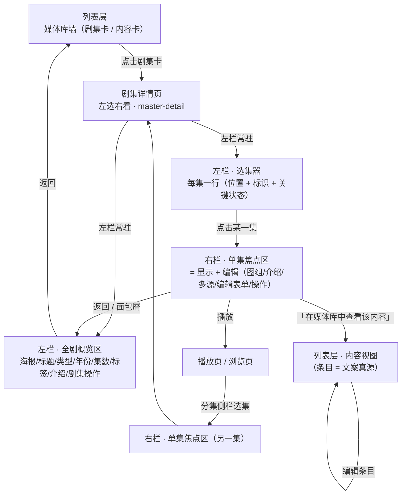

# 媒体库展示重排 PRD：剧集(总) × 每集 的两层排版模型

- 日期: 2026-09-28
- 作者: 许清楚（产品经理）
- 状态: draft（待架构师拆解）
- 范围: 仅 `tauri-shell/src` 前端展示层重排；本 PRD 不改代码
- 原始需求（用户原话）：
  > 「继续媒体库的展示界面设计，从零开始设计排版，考虑 剧集(总)全部内容和每集展示内容的两者的关系和排版，内容包括但不限于标题、内容、标签、图片、视频等等。」

---

## 1. 产品目标

**一句话**：把媒体库的剧集展示从「一条平铺到底的字段列表」重排为 **「全剧概览常驻 + 单集聚焦展开」** 的两层结构，让每一条信息只在它真正归属的层级出现一次。

| # | 目标 | 可观测的达成标志 |
|---|------|------|
| G1 | 建立两层信息模型 | 任意打开一部剧集，用户能一眼分清「哪块说的是整部剧」「哪块说的是这一集」，无需靠位置猜 |
| G2 | 消除同源文案的重复观感 | 同一段介绍/同一个标题在整页中最多出现一次；但两级编辑入口一个不少 |
| G3 | 让图片有归属 | 图片要么挂在某一集下（集级挂图），要么是图集自身的浏览位；不再存在「全剧平铺图册行」 |
| G4 | 零能力丢失 | 现状 22 项能力逐项在新排版中有明确落位（见 §6 落位表） |
| G5 | UI 只在用户受阻时说话 | 能力边界（缺字节、来源离线、降级）只在空态/失败态/被禁用控件上出现；正常态不加任何徽标 |

### 1.1 不可违反的产品原则（硬约束，违反即返工）

| 原则 | 含义 | 在本次重排中的体现 |
|------|------|------|
| P1 编目 ⊥ 落盘 | 条目先入库（编目），再取字节（落盘）。落盘失败不毁编目 | 无字节的集**仍可编辑、仍可挂图、仍可改槽位**；字节态只影响「能不能播」，不影响「能不能管」 |
| P2 实现约束 ≠ 产品信息 | 能力边界只在用户**正因此受阻**时出现：空态、失败态、被禁用控件的 `title` | 不得新增任何常驻 chip / 横幅 / 标题后缀来解释「我们只能做这些」；既有的 `media-source-offline-banner` 降级为上下文态（见 R15） |
| P3 `cached` 是常态 | 有字节是默认事实 | 有字节的集**不显示**"已缓存/本地/可播"之类徽标——把正常态当卖点，和把缺陷当卖点一样是噪音 |
| P4 重构 ≠ 删能力 | 重排只挪位置，不删能力 | §6 落位表逐项覆盖；任一能力在新 UI 中不可达即 FAIL |
| P5 单一真源 | 分集只是**位置**；标题/介绍的唯一真源是条目 | 单集层改标题/介绍 = 改条目；UI 必须在编辑面板内**如实说明**这一影响范围（见 R10） |
| P6 图片规则 | 图片永不进播放序列、永不作为视频分集（数据层触发器强制）；图片的合法归属位是「某一集下的挂图」 | 见 §3.3 |
| P7 双语 | 新增文案 100% 走 i18n | 沿用 `media.*` 命名空间，按层分组 `media.series.*` / `media.episode.*`；zh-CN 与 en-US 同批提交 |

---

## 2. 核心命题：剧集(总) × 每集 的两层关系模型

### 2.1 三层结构总览

```
列表层（媒体库墙）──点击剧集卡──▶ 剧集详情页（master-detail · 左选右看）

   左栏（常驻）                         右栏（常驻）
   全剧概览区(SeriesHero)               单集焦点区（= 显示 + 编辑）
    ├─ 海报/标题/类型/年份/集数           ├─ 图组（挂图区）
    ├─ 剧集标签 / 剧集介绍                ├─ 介绍
    └─ 剧集级操作                         ├─ 多源
   选集器（每集一行，常驻）               ├─ 编辑表单
    └─ 位置 + 标识 + 关键状态             └─ 操作
   点击某集 ───────────────────────▶ 右栏切换为该集焦点（同时只显示 1 集）
```

> **「从零开始设计排版」的落点**：不是把现有 DOM 顺序重新洗一遍，而是把「一个对象」拆成「两个对象」——
> 全剧是一个对象（组织层），单集是另一个对象（位置 + 它指向的内容）。两者各有一套信息位，
> 各自独立渲染，中间用**去重规则**而不是"隐藏"来消除重复。

### 2.2 信息位归属表（本 PRD 的核心）

分类图例：**A** = 只在全剧层；**B** = 只在单集层；**C** = 两层都有但含义不同；**D** = 两层共享同一真源（镜像，非独立字段）

| 信息位 | 归属 | 来源字段 | 说明 |
|--------|------|----------|------|
| 剧集标题 | **A** | `MediaSeries.title` | 组织层展示名，与任何条目无关 |
| 本集标题 | **D** | `MediaEpisode.title`（镜像 `MediaItem.title`） | 与剧集标题无继承关系；同一条目被多集引用时标题必然相同 |
| 剧集介绍 | **A** | `MediaSeries.description` | 组织层文案，独立字段，可单独清空 |
| 本集介绍 | **D** | `MediaEpisode.description`（镜像 `MediaItem.description`） | 渲染受 §3.2 去重规则门控；**编辑入口不受门控** |
| 剧集标签 | **A** | `MediaSeries.tags[]` | 有剧集时 caption 标签挂这里 |
| 条目标签 | **B**（经条目） | `MediaItem.tags[]` | `MediaEpisode` **没有 tags 字段** → 是否暴露见 Q1 |
| 集级挂图 | **B** | `MediaEpisode.images[]`（`media_episode_image`） | 图片的合法归属位；灯箱翻页范围 = 本集挂图 |
| 图集图片 | **B** | photo-only 剧集的分集本体 | 以宫格（瓦片）形态呈现，不是列表行 |
| 视频 | **B** | `MediaEpisode.itemId` → 条目 | 播放入口永远在单集上，不在全剧层 |
| 集号 / 季号 | **B** | `season` / `episodeNo` / `episodeNoEnd` | 位置语义；`episodeNoEnd` 非空 = 合集区间 |
| 季数 / 集数 | **A**（上卷） | `seasonCount` / `episodeCount` | 后端聚合字段，前端不得自行 sum 分集数组 |
| 类型（series/collection/album） | **A** | `MediaSeries.kind` | 决定单集层的渲染形态（见 §3.3） |
| 年份 | **A** | `MediaSeries.year` | 非空才显 |
| 剧集封面 | **A**（回退链含上卷） | `poster` ?? `coverItemId`+`coverKind` ?? 首集封面 | 归属剧集；回退只发生在剧集自己没设封面时 |
| 本集封面 | **B** | `MediaEpisode.poster`（条目镜像） | 归属该集所指的内容 |
| 时长 | **C** | 全剧层 = 各集 `duration` 上卷（P2，见 R19）；单集层 = `MediaEpisode.duration` | 含义不同：**总时长 vs 本集时长**，文案必须能区分 |
| 字节态 | **B**（异常时） | `hasMediaBytes()`（唯一入口） | 有字节 = 常态，不显示；无字节 = 异常，显示占位 + 重新缓存。全剧层**不常驻**完整度条，仅在播放/导出被阻断的失败反馈里聚合列出 |
| 多源 | **B** | `MediaEpisode.sources[]` | 主版本 + 备用源；`sources.length > 0` 才出现 |
| 来源 / 引用 | **B** | `MediaEpisode.source` / `ref` | 分辨重复项的唯一可靠依据（别用标题判重） |
| 合并溯源 | **B** | `originSeriesTitle` / `originEpisodeNo` | 非 null 才出现；是数据事实，不是能力缺陷，可常显（muted 小字） |
| 创建 / 更新时间 | **A** | `createdAt` / `updatedAt` | — |

### 2.3 导航与继承



**下发（全剧层 → 单集层）**

| 下发内容 | 字段 | 用途 |
|----------|------|------|
| 剧集标题 | `series.title` | 面包屑 / 返回上下文；同时作为标题去重规则的比较基准 |
| 剧集类型 | `series.kind` | 决定单集层形态：`series` → 分集行；`album` 或全部分集为 photo → 宫格；`collection` → 区间集号 |
| 剧集介绍 | `series.description` | 作为本集介绍的去重比较基准（§3.2） |
| 季结构 | `seasonCount` | 单集层的分组依据（分组头「第 N 季」仅在 `seasonCount > 1` 时渲染） |

**上卷（单集层 → 全剧层）**

| 上卷内容 | 字段/做法 | 说明 |
|----------|-----------|------|
| 集数 / 季数 | `episodeCount` / `seasonCount` | **只信后端聚合字段**，前端不自行统计（避免与分页/过滤不一致） |
| 剧集封面回退 | `coverItemId` + `coverKind` | 剧集未设封面时，回退到首集封面；**回退链单点收敛到一个 resolver**（R11） |
| 字节完整度 | 聚合 `hasMediaBytes()` | **禁止常驻**。仅在用户触发播放/导出且被字节缺失阻断时，在失败反馈中列出缺失集并给出跳转 |
| 总时长 | `duration` 求和 | P2（R19）。缺失值时显示不确定态，不得显示 0 |

**明确禁止的上卷**

- ❌ **禁止用首集介绍填充空的剧集介绍**（R4）。空就是空，给可编辑空位。
- ❌ **禁止把剧集标签下发给分集**。分集没有标签字段，标签是「剧集级 / 条目级」两级，不是「集级」。

### 2.4 从单集回全剧 / 从单集到条目

- 单集层必须始终存在**回到全剧**的路径（面包屑或返回），且返回后**保留原滚动位置与聚焦集**。
- 单集层必须存在一条**通往条目**的路径（「在媒体库中查看该内容」）。理由：条目是文案真源，用户在单集层改标题/介绍实际改的是条目（P5），必须让他能到真源处核对影响范围。

---

## 3. 排版骨架（信息架构，非视觉稿）

> 具体栅格列数、卡片尺寸、CSS 实现由架构师自决。本节只定义**块的语义、顺序与层级关系**。

### 3.1 剧集详情页 = 左选右看（master-detail）

> **形态已定稿为 W（左选右看 master-detail）**：左栏 = 总览 + 选集器常驻，右栏 = 单集显示 + 编辑；点击左栏选集器某集，右栏切换为该集焦点。本形态由静态原型 `verify_shots/layout_v3/` 确认，用户已拍板采纳。

| 栏 | 是否常驻 | 承载 |
|----|---------|------|
| **左栏 · 全剧概览区** | 常驻（不随右栏焦点变化而消失） | 海报、标题、类型/年份、N季/N集、剧集标签、剧集介绍、剧集级操作 |
| **左栏 · 选集器** | 常驻 | 每集一行（位置 + 标识 + 关键状态），按季分组；点击某集 → 右栏切换焦点集 |
| **右栏 · 单集焦点区** | 常驻；同一时刻只显示 1 集 | 被选中集的全部信息位 + 编辑入口：**图组 / 介绍 / 多源 / 编辑表单 / 操作** 5 块（顺序固定，不重排） |

**为什么是 master-detail 而不是「全部平铺」**：全部平铺会把页面变成长文档，「全剧 × 单集」的对照比例消失，回到 BUG-171 之前「同一段介绍读两遍」的观感。master-detail 保证任何时刻屏幕上都是「左侧一份全剧概览 + 一份选集器列表，右侧一份单集详情」的稳定结构；选集器常驻于左栏，点击即切换右栏焦点，省去手风琴的「展开/收起」状态。

> **与「方案 A」（设计文档 §3.0）的关系**：设计 §3.0 的方案 A 所写的「左右分栏」指的是 **`SeriesHero` 概览块内部**的排版（海报 320px 列 + 内容列），并非页面级布局；W 是**页面级** master-detail 形态——它的左栏概览块即复用方案 A 的 `SeriesHero`，并再叠加一个常驻选集器，右侧为单集焦点区。故 W 在页面级上细化/上位了方案 A 的页面布局。

### 3.2 重复信息的去重规则（本章是 BUG-171 的正面答案）

> **根因回顾**：TG 入库时整段 caption 被**同时**写进 `media_series.description` 和每条 `media_episode.description`（= `media_item.description`），标题同理（= caption 首行）。所以「剧集介绍」与「本集介绍」在数据上常常逐字全等——这不是渲染 bug，是**两份字段存了同一份内容**。

**去重总原则：去重 = 判定归属，不是隐藏。被判定为重复的那一处不再渲染文本，但它的编辑入口必须照常存在（P4）。**

| 信息位 | 去重规则（可机械判定） | 编辑入口 |
|--------|----------------------|---------|
| 本集介绍 | 渲染条件：`epDesc.trim() !== '' && epDesc.trim() !== seriesDesc.trim()`。**只判逐字全等**（trim 后），不做模糊/包含匹配 —— 模糊匹配会误杀真有独立内容的集。多集时**逐集独立判定** | 恒在（不受门控） |
| 本集标题 | 渲染条件：`epTitle.trim() !== seriesTitle.trim()`。全等时该集以**集号**（`S1E1`）为主标识，不重复渲染标题文本 | 恒在 |
| 剧集介绍 | **恒渲染**（非空时）。空 → 可编辑空位，**不得用首集介绍兜底**（R4） | 恒在 |
| 封面 | **不做去重**。剧集封面指代「剧」，集封面指代「这一集的内容」，二者位置不同、对象不同，并存不产生阅读困惑 | 各自可设 |

**去重是「渲染期」规则，不是「写入期」规则**：绝不因为两层相同就去改数据（那会毁掉 P5 单一真源，也会丢用户数据）。

### 3.3 图片的位置（BUG-060 / BUG-168 / BUG-044 的正面答案）

| 图片种类 | 归属层 | 呈现形态 | 灯箱翻页范围 |
|----------|--------|---------|-------------|
| 集级挂图（`media_episode_image`） | **单集层** | 该集展开态内的挂图区；行态给缩略预览 + 张数 | **仅本集挂图** |
| 图集成员（photo-only 剧集 / album） | **单集层**（此时单集层就是浏览位） | 宫格瓦片，非列表行 | 本集 / 本组 |
| 无归属图片 | 单集层 | 归入「未分组」位，**不得丢弃、不得进播放序列** | — |

**全剧层取消「全剧图册平铺行」**（现状 `series-gallery`）。它是 BUG-060 的症状：合并多剧后不同视频的图混在一条横滚行里，看不出归属。取消它不等于丢能力——每张图仍能在它所挂的那一集里被看到，且看得更准。

### 3.4 单层（1 集）与多集的呈现差异

| 维度 | 单层（`episodeCount === 1`） | 多集 |
|------|------------------------------|------|
| 季分组头 | **不渲染**「第 1 季」（无信息量） | `seasonCount > 1` 时按季分组 |
| 右栏焦点 | **唯一那一集默认在右栏显示** | 默认全部行态（左栏选集器态），用户点击才切换右栏焦点 |
| 标题 | 与剧集标题全等 → 单集层不重复渲染标题，以集号标识 | 逐集独立判定 |
| 介绍 | 与剧集介绍全等 → 单集层不渲染介绍块 | 逐集独立判定 |
| 剧集头操作 | **全部保留**（改名/编辑/标签/合并/导出/删除）—— 绝不因为「只有一集」就把剧集降为条目 | 同 |
| 播放入口 | **只在单集层**；剧集头不放播放按钮（避免两个入口指向同一内容） | 每集各自一个 |

---

## 4. 用户故事

| # | 类别 | 用户故事 |
|---|------|---------|
| US-1 | 浏览 | 作为一个刚同步完一批 TG 媒体的用户，我打开一部剧集，希望能先看到「这部剧整体是什么」（标题/类型/年份/多少集/介绍），再决定点哪一集 |
| US-2 | 浏览 | 作为一个在看多季剧集的用户，我希望分集按季分组、组头标明季号，而不是一长条不分季的列表 |
| US-3 | 浏览 | 作为一个**只读一遍**介绍的用户，我希望同一段介绍在剧集页里只出现一次，不要在剧集头和单集行里各读一遍 |
| US-4 | 浏览 | 作为一个合并过多个剧集的用户，我希望每个视频自己的图挂在自己那一集下，点开灯箱只翻这几张，而不是全部图混着翻 |
| US-5 | 查找 | 作为一个媒体库里已有几百条内容的用户，我希望按类型 Tab / 标签 / 关键词 / 排序快速定位，并且看到「库里有多少条、占了多大磁盘」的真实数字 |
| US-6 | 查找 | 作为一个整理者，我希望能筛出「还没归到任何剧集」的内容，把它们批量归集 |
| US-7 | 编辑 | 作为一个想改剧集名的用户，我希望能在一个编辑面板里同时改标题、介绍、类型、年份和标签，而不是点「改名」改完再找另一个入口改别的 |
| US-8 | 编辑 | 作为一个要调整集号的用户，我希望在单集的编辑面板里一次改完季号/集号/结束集号/标题/介绍，并且知道「改标题/介绍会影响引用该内容的所有位置」 |
| US-9 | 播放 | 作为一个要点开就播的用户，我希望**看得出来哪一集现在播不了**，并且能就地重新缓存，而不是点下去才 404 |
| US-10 | 播放 | 作为一个有一集多个缓存来源的用户，我希望能看到有几个来源、哪个是当前主版本，并且能切换主版本 |
| US-11 | 管理 | 作为一个要导出整部剧的用户，我希望先看到完备性报告（缺字节 / 缺简介 / 缺图），缺什么补什么，而不是导出到一半失败 |
| US-12 | 管理 | 作为一个要清理库的用户，我希望能全选本页、批量删除/编辑/导出，并且删除前有明确的确认与影响说明 |

---

## 5. 需求池

> 判据全部写成「可证伪」形式：每条都能写出「如果 X 则 FAIL」。

### 5.1 P0（本次重排必须完成）

| ID | 需求 | 验收判据（可证伪） | 关联缺陷 |
|----|------|-------------------|---------|
| R1 | **两层骨架（W master-detail）**：剧集详情页 = 左栏（全剧概览区 + 选集器，常驻）+ 右栏（单集焦点区：显示 + 编辑，常驻且同一时刻只显示 1 集） | 打开任意多集剧集：① 左栏「全剧概览区」与「选集器」在 DOM 中**各存在且唯一**；② 右栏为单一焦点集显示区，**同时只呈现 1 集**（无「同时展开多集」的概念）；③ 点击左栏选集器第 2 集后，右栏焦点**切换**为该集（原焦点集不再在右栏显示）—— 若右栏同时出现 2 个焦点集则 FAIL | BUG-171 |
| R2 | **介绍去重**：`epDesc.trim() === seriesDesc.trim()` 或为空时，单集层不渲染介绍块 | 构造单集剧集（两者介绍逐字相同，如 series 101）：页面正文中该段文案出现次数 **== 1**（剧集头那份）。把该集介绍改为不同文本并保存 → 出现 2 段且互不相同。若仍出现 2 段相同文案则 FAIL | BUG-171 |
| R3 | **编辑能力不因去重丢失**：`episode-edit` 与槽位编辑入口恒在，不受 R2 门控影响 | 在 R2 的「被隐藏」状态下，`episode-edit` 节点存在且可点开，面板内 `description` 字段可读写并持久化。若面板不可打开或字段只读则 FAIL | BUG-171 |
| R4 | **禁止首集介绍上卷填充剧集介绍**：`series.description` 为空时全剧层显示可编辑空位 | 构造 `description = null` 但其首集 `description` 非空的剧集：全剧概览区**不出现**首集介绍文本，且出现可编辑空位。若出现首集介绍则 FAIL | BUG-171 |
| R5 | **标题去重**：单集标题与剧集标题逐字全等时，单集层以集号为主标识，不重复渲染标题 | 构造「剧集标题 == 单集标题」的数据：该集右栏焦点块中不出现与剧集标题重复的独立标题行，而出现 `S1E1`。把单集标题改成不同值 → 标题行出现。若两处标题同时重复则 FAIL | BUG-171 |
| R6 | **图片归属收敛到集级**：全剧层取消「全剧图册平铺行」；图片只在①集级挂图区 ②photo-only 剧集宫格 出现 | 构造 A 集挂 3 图、B 集挂 2 图：分别打开 A / B 的灯箱，页数分别为 **3** 和 **2** 且逐张命中该集；总数守恒 **5**。若任一灯箱页数为 5 则 FAIL。另：DOM 中 `series-gallery` 节点数 == 0 | BUG-060 / BUG-168 / BUG-044 |
| R7 | **单层剧集呈现契约**：`episodeCount === 1` 时不渲染季分组头、唯一集默认在右栏显示、剧集头不重复该集标题与介绍 | 构造单集剧集：① DOM 中无「第 1 季」分组头；② 唯一分集默认在右栏显示；③ 剧集标题与介绍各自出现 **1** 次。若出现 2 次则 FAIL | BUG-171 |
| R8 | **能力零丢失**：现状 22 项能力全部在新排版中有明确落位并可达 | 以 §6 落位表为核对表逐项走查：每项在新 UI 中可触达**且**可完整完成一次操作。任一项不可达 → FAIL | 硬约束 P4 |
| R9 | **i18n 全覆盖**：新增文案 100% 走 i18n，zh-CN / en-US 同批齐备 | ① 新增/改动的组件文件中硬编码中文字面量 **0** 命中；② `zh-CN.json` 与 `en-US.json` 的键集合**差集为空**。任一条不满足 → FAIL | 硬约束 P7 |

### 5.2 P1（本次应完成）

| ID | 需求 | 验收判据（可证伪） | 关联缺陷 |
|----|------|-------------------|---------|
| R10 | **剧集编辑面板合并**（标题/介绍/类型/年份/标签一个面板），移除独立的「改名」铅笔 | 剧集头中「改名」类独立入口数 **== 0**；「编辑」入口打开后面板含 title/description/kind/year/tags 五项，改标题后刷新仍为新值。若仍存在独立改名入口 → FAIL | BUG-120 |
| R11 | **单集编辑面板合并**（季/集/结束集/标题/介绍一个面板），并在面板内如实说明「标题/介绍取自内容本身，修改会影响引用该内容的所有位置」 | 单集展开块中独立编辑入口 **≤ 1**；面板含 season/episodeNo/episodeNoEnd/title/description 五项，保存后 `GET /api/media/series/:id` 回读一致。若说明文案常驻在行态（非编辑面板内）→ 违反 P2，FAIL | BUG-120 / 硬约束 P5 |
| R12 | **封面归属单点收敛**：剧集封面与集封面各走同一 resolver，回退链唯一 | 构造剧集 `poster` 为空但 `coverItemId` 指向 photo 条目：列表卡 / 剧集头 / 集封面三处取值一致且显示该条目原图。若三处出现两种结果 → FAIL | BUG-118 / BUG-119 |
| R13 | **字节态与重试**：`hasMediaBytes()` 为 false 的集显示占位 + 「重新缓存」；为 true 的集**不显示任何字节相关文案** | 构造 `hasBytes=false` 的集：出现 `episode-nobytes` 与 `episode-recache`。构造 `hasBytes=true` 的集：上述节点**均不存在**，且无「已缓存/本地/可播放」类文案（P3）。若有 → FAIL | BUG-080 / BUG-132 |
| R14 | **多源可管理**：`sources.length > 0` 的集显示源数量，展开可见主版本标记与各源，支持切主/摘除 | 构造 2 源的集：展开后可见 2 个源条目与当前主版本标记；执行切主后回读 `sources` 与 `itemId` 变化一致。若看不到哪个是主版本 → FAIL | BUG-113 / BUG-130 |
| R15 | **UI 铁律合规**：常驻的能力边界说明构件（如 `media-source-offline-banner`）降级为上下文态 —— 只在①空态 ②动作失败反馈 ③被禁用控件的 `title` 三种情形出现 | 逐个遍历：正常浏览剧集（来源离线但本次操作不受阻）时页面**不出现**该横幅；执行「重新缓存」失败时该信息出现在失败反馈内。若正常浏览时横幅仍在 → FAIL。**注意：这是挪位置，不是删信息** | 硬约束 P2 |
| R16 | **占用空间主显磁盘真值**：统计条主数字改为磁盘探测真值，元数据 `SUM(size)` 降为副信息或移除 | 记录当前值 → 清缓存删除若干落盘文件 → 刷新后主数字**下降**。若数字不变 → FAIL | BUG-133 / BUG-125 |
| R17 | **返回/面包屑保留上下文**：从单集返回全剧，或从全剧返回列表，保留原滚动位置与聚焦集 | 展开第 20 集 → 返回剧集墙 → 再点回该剧集：滚动位置与聚焦集与离开前一致。若回到顶部 → FAIL | — |

### 5.3 P2（本次可不完成，但需登记）

| ID | 需求 | 验收判据（可证伪） | 关联缺陷 / 前置 |
|----|------|-------------------|---------|
| R18 | **单集层暴露条目标签**（需后端 `EpisodeView` 补 `tags`） | 后端下发后，单集展开态显示该条目标签且与「内容视图」中该条目标签一致 | BUG-前置：后端字段；见 Q1 |
| R19 | **全剧总时长上卷** | 全剧层显示总时长，且文案与「本集时长」可区分；存在 `duration` 缺失的集时显示不确定态（不得显示 0） | 硬约束：缺失态如实 |
| R20 | **多源质量语义**：`EpisodeSourceRef` 补 `width`/`height`/`size`，单集层可显示画质并据此选主版本 | 构造两个不同分辨率的源：UI 显示各自分辨率且可据此切主 | BUG-113（需后端字段） |
| R21 | **合集时间偏移**：`episodeNo..episodeNoEnd` 区间集支持段内偏移标记（一个文件含多集） | 区间集可标注各子集的起止偏移，播放时按偏移定位 | BUG-130（需后端字段） |
| R22 | **内容寻址去重展示**：同 hash 图片在浏览层只展示一次，其余折叠为「另有 N 处引用」 | 构造 4 条共享 2 个 hash 的图片：浏览层只出现 2 个瓦片 + 折叠计数；总数守恒 | BUG-060 方案修订层（需 `content_hash`） |

---

## 6. 既有能力落位表（P4 零丢失核对表）

| # | 既有能力 | 新排版落位 |
|---|---------|-----------|
| 1 | 搜索 | 列表层 · 工具条（内容视图） |
| 2 | 排序（recent/oldest/title/duration/size） | 列表层 · 工具条（内容视图） |
| 3 | 仅未归集筛选 | 列表层 · 工具条（内容视图） |
| 4 | 全选本页 | 列表层 · 批量条（有选中时） |
| 5 | 批量删除 / 编辑 / 导出 | 列表层 · 批量条 |
| 6 | 类型 Tab（all/video/photo/audio） | 列表层 · 工具条 |
| 7 | 标签筛选 | 列表层 · 左栏标签列表 |
| 8 | 标签管理（增删改色） | 列表层 · 工具条「标签管理」对话框 |
| 9 | 剧集创建 / 加入 | 列表层 · 工具条；内容卡「加入剧集」 |
| 10 | 剧集合并到… | **全剧层** · 剧集级操作 |
| 11 | 条目编辑（标题/介绍/标签） | 列表层 · 内容卡编辑；单集层 · 「在媒体库中查看该内容」 |
| 12 | 剧集改名 | **全剧层** · 合并进「编辑」面板（R10） |
| 13 | 剧集删除 | **全剧层** · 剧集级操作（带确认） |
| 14 | 分集上下移 | **单集层** · 右栏焦点区操作区 |
| 15 | 分集移除 | **单集层** · 右栏焦点区操作区 |
| 16 | 分集编辑（季/集/结束集/介绍） | **单集层** · 合并后的单集编辑面板（R11） |
| 17 | 集级挂图 / 摘图 | **单集层** · 右栏焦点区挂图区 + 挂图选择对话框 |
| 18 | 多源切主 | **单集层** · 右栏焦点区多源区（R14） |
| 19 | 重新缓存 | **单集层** · 无字节时（R13） |
| 20 | 图片灯箱 | **单集层** · 范围收敛到本集（R6） |
| 21 | 导出预览 | **全剧层** · 剧集级操作；列表层 · 批量条 |
| 22 | 导入本地目录 | 列表层 · 工具条 |

---

## 7. UI 信息位清单

### 7.1 全剧层（剧集概览区）

| 信息位 | 内容 | 来源字段 | 显示规则 | 交互 |
|--------|------|----------|---------|------|
| 海报 | 剧集封面 | `poster` ?? `coverItemId`+`coverKind` ?? 首集封面 | 恒显；缺失 → 占位（**保持 16:9，不得被 flex 拉伸**） | 点击 → 大图浏览 |
| 标题 | 剧集展示名 | `title` | 恒显 | 点击 → 编辑面板（R10） |
| 类型 / 年份 | series/collection/album + 年份 | `kind` / `year` | 类型恒显；年份非空才显 | — |
| 规模 | N 季 / N 集 | `seasonCount` / `episodeCount` | 集数恒显；季数仅在 `> 1` 时显 | — |
| 剧集标签 | — | `tags[]` | 非空时显；空 → 给「添加标签」入口 | chip 点击 → 以该标签筛选；编辑 → 标签面板 |
| 剧集介绍 | 组织层文案 | `description` | 非空恒显；空 → 可编辑空位（**禁止首集兜底**） | 点击 → 编辑（支持 `null` 显式清空） |
| 剧集操作 | 编辑 / 标签 / 合并到… / 导出预览 / 删除 | — | 恒显 | 各自对话框 |
| 返回 | 回剧集墙 | — | 恒显 | 保留滚动位置（R17） |
| 字节完整度 | 缺失集清单 | 聚合 `hasMediaBytes()` | **仅在播放/导出被阻断的失败反馈中出现**，不常驻 | 点击缺失项 → 跳到该集 |

### 7.2 单集层（右栏焦点区；左栏选集器为行态列表）

**行态（左栏选集器默认行）**

| 信息位 | 内容 | 来源字段 | 显示规则 | 交互 |
|--------|------|----------|---------|------|
| 集号 | `S1E1` / `S1E1-2` | `season`/`episodeNo`/`episodeNoEnd` | 恒显 | 点击 → 右栏切换为该集焦点 |
| 集封面 | 内容指代 | `poster` | 恒显；无字节 → 虚线占位 | 点击 → 右栏显示该集 |
| 标题 | 条目标题 | `title`（条目镜像） | 与剧集标题逐字全等 → **不渲染**（改以集号标识） | 点击 → 右栏显示该集 |
| 时长 | `fmtDuration` | `duration` | 非空才显 | — |
| 字节态 | 占位 + 重新缓存 | `hasMediaBytes()` | **仅 absent 时显**（P3） | 重新缓存 → 重试落盘 |
| 多源徽标 | N 源 | `sources.length` | `> 0` 才显 | 点击 → 右栏显示该集并定位到多源区 |
| 挂图指示 | 张数 + 缩略预览 | `images.length` | `> 0` 才显 | 点击 → 打开本集灯箱 |
| 溯源 | 来自《X》第 N 集 | `originSeriesTitle`/`originEpisodeNo` | 非 null 才显（muted 小字） | — |
| 剧集标题上下文 | 面包屑 | `series.title` | 恒显（下发） | 点击 → 回到全剧层 |
| 前往条目 | 「在媒体库中查看该内容」 | `itemId` | 恒显 | → 列表层内容视图 |

**右栏焦点态（聚焦，在选集器行态基础上于右栏追加呈现）**

| 信息位 | 内容 | 来源字段 | 显示规则 | 交互 |
|--------|------|----------|---------|------|
| 大封面 | 同 `poster` | `poster` | 右栏显示时显 | 播放 / 浏览 |
| 本集介绍 | 条目介绍 | `description`（条目镜像） | **仅当 trim 后非空且与 `series.description` 不等**（R2） | 编辑面板可读可写（R3） |
| 挂图区 | 本集挂图 | `images[]` | 非空时显 | 单张 ✕ 摘除；点开灯箱（范围 = 本集）；「挂图」按钮 → 选择对话框 |
| 多源区 | 主版本 + 备用源 | `sources[]` + `itemId` | `sources.length > 0` 时显 | 切主 / 摘除（R14） |
| 来源 | `local`/`tg` + `ref` | `source` / `ref` | 多源时显（分辨重复项） | — |
| 操作区 | 编辑 / 挂图 / 上移 / 下移 / 移除 / 播放 | — | 恒显 | 各自动作 |
| 编辑影响说明 | 「标题/介绍取自内容本身，修改将影响所有引用该内容的位置」 | — | **仅在编辑面板内**出现，不得常驻行态 | — |

**photo-only / album 形态**：选集器行态改为**宫格瓦片**，无集号行、无播放入口（图片是浏览位，P6）。

### 7.3 列表层（媒体库墙）

| 信息位 | 内容 | 来源字段 | 显示规则 | 交互 |
|--------|------|----------|---------|------|
| 剧集卡 | 封面 + 标题 + N集/N季 + 类型 + 标签 | `MediaSeries` 全字段 | 剧集视图恒显 | 点击 → 全剧层 |
| 内容卡 | 封面 + 标题 + 类型 + 时长/尺寸 + 字节态 + 标签 | `MediaItem` | 内容视图恒显 | 点击 → 播放/浏览 |
| 类型 Tab | all / video / photo / audio | — | 恒显 | 切换过滤 |
| 标签筛选 | 标签列表 | `listTags()` | 恒显 | 点击筛选；管理入口 |
| 仅未归集 / 搜索 / 排序 | — | — | 恒显（内容视图） | — |
| 批量条 | 全选本页 / 批量删除·编辑·导出 | — | 有选中时显 | — |
| 统计 | N 项 · **磁盘真值** | `LibraryStats` | 恒显（副信息） | — |
| 左栏导航 | 全部剧集 / 剧集列表 / 内容 | — | 恒显 | 切换视图 |

---

## 8. 待确认问题

> 以下均为「影响用户体验或数据模型」的真决策，不含栅格 px / CSS 类等执行细节（那些由架构师自决）。每条附推荐答案与理由。

**Q1. 单集层要不要暴露「条目标签」？**

- 背景：`MediaEpisode` **没有 tags 字段**，要显示需后端在 `EpisodeView` 补 `tags`。标签是两级语义（有剧集挂剧集、无剧集挂条目），不是「集级」。
- **推荐：暂不暴露（R18 降为 P2）。** 理由：① 单集展开态已承载集号/时长/字节/多源/挂图/溯源，再堆标签会把它变成字段清单，损害 G1「一眼分清两层」；② 条目标签在「内容视图」中完整可见，且在单集层有「在媒体库中查看该内容」的直达入口 —— **数据不丢，只是不在这一层显**；③ 需要后端字段，成本应单独评估。

**Q2. 单层剧集（1 集）要不要「降为条目视图」直接展示，省掉剧集头？**

- **推荐：否。保留剧集头 + 用去重规则消除重复。** 理由：① 剧集承载标签、合并、导出、删除等**组织级能力**，降为条目会直接丢掉这些入口（违反 P4）；② 用户明确说过「保留所有数据是核心需求」；③ R5/R7 的去重契约已能消除「读两遍」的观感，代价远小于丢能力。

**Q3. 单集焦点在右栏如何呈现（W master-detail 下已定）？**

- **已定：右栏恒为单一焦点集（master-detail）。** 左栏选集器常驻，点击某集即把右栏切换为该集；右栏同一时刻只显示 1 集，不存在「同时展开多集」的概念，故原「手风琴 ≤1 集」的判据在本形态下由结构天然保证。理由：① 多集同时展开会把页面变成长文档，「全剧 × 单集」的对照比例消失 —— 这正是本次要解决的观感问题；② master-detail 保证屏幕上恒为「左侧一份全剧概览 + 一份选集器列表，右侧一份单集详情」的稳定结构，符合用户要的「两者的关系」；③ 若后续真有「对照两集」的需求，再放开为可配置，成本可逆。

**Q4. 无字节的集：禁用播放入口，还是允许点击后给出失败反馈？**

- **推荐：禁用入口 + 就地给「重新缓存」（现状做法，保留）。** 理由：① BUG-080 的判据明确「不能让一个长得能点的按钮去 404」；② 离线优先下 `cached` 是常态、`absent` 是异常，异常态必须**可见且可修复**，而不是让用户先踩坑再道歉；③ 禁用控件的 `title` 正好是 P2 允许的说明位置，不违反铁律。

**Q5. 剧集封允许用户指定（从本剧已有图片中挑一张）吗？**

- 背景：`patchSeries(poster)` 接口已存在，但 UI 上没有「设封面」入口；`coverItemId`/`coverKind` 只是自动回退。BUG-118/119 反映的正是「封面没有归属层级」。
- **推荐：做，但排 P1 之后（建议 P1 末位）。** 理由：① 让用户指定剧集封面，正是把「封面归属」落到剧集层的最直接手段，正面回答 BUG-118/119；② 接口已就绪，成本主要在挑选 UI（可复用已有的图片选择对话框）；③ 优先级让位给 R1–R9 的骨架与去重，因为「两层关系」是本次的核心命题（用户原话重点），封面归属是它的下一层问题。

---

## 9. 不在本次范围内

- 后端数据模型改动（R18/R20/R21/R22 需后端字段，本次只登记不实施）
- 播放页（`MediaViewer` / `VideoPlayer`）内部排版，除「分集侧栏 ↔ 单集聚焦态」的联动关系外
- 视觉设计稿（色板、字号、间距）—— 由架构师在排版设计阶段自决
