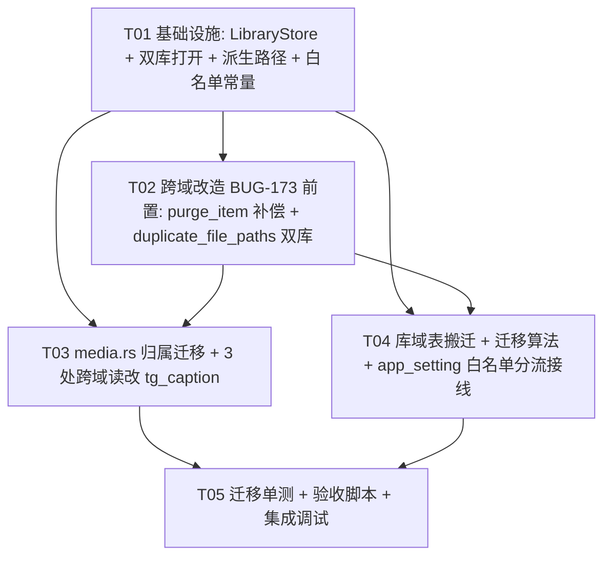
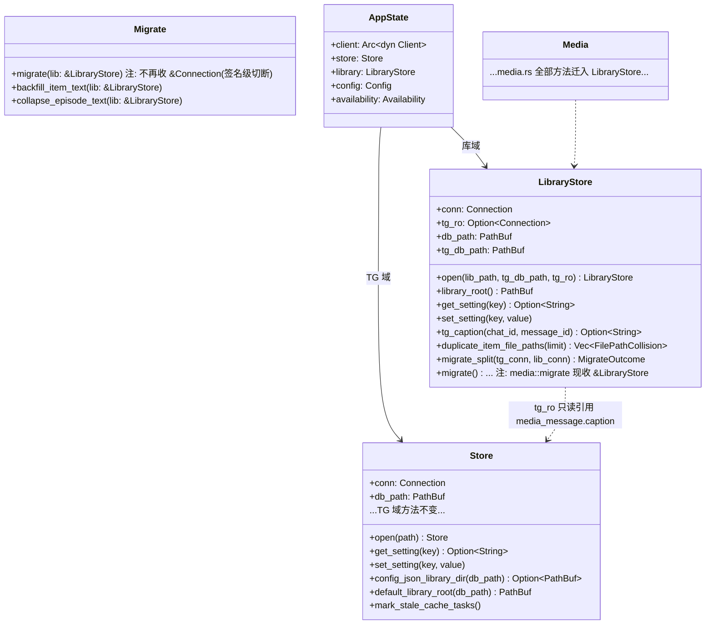
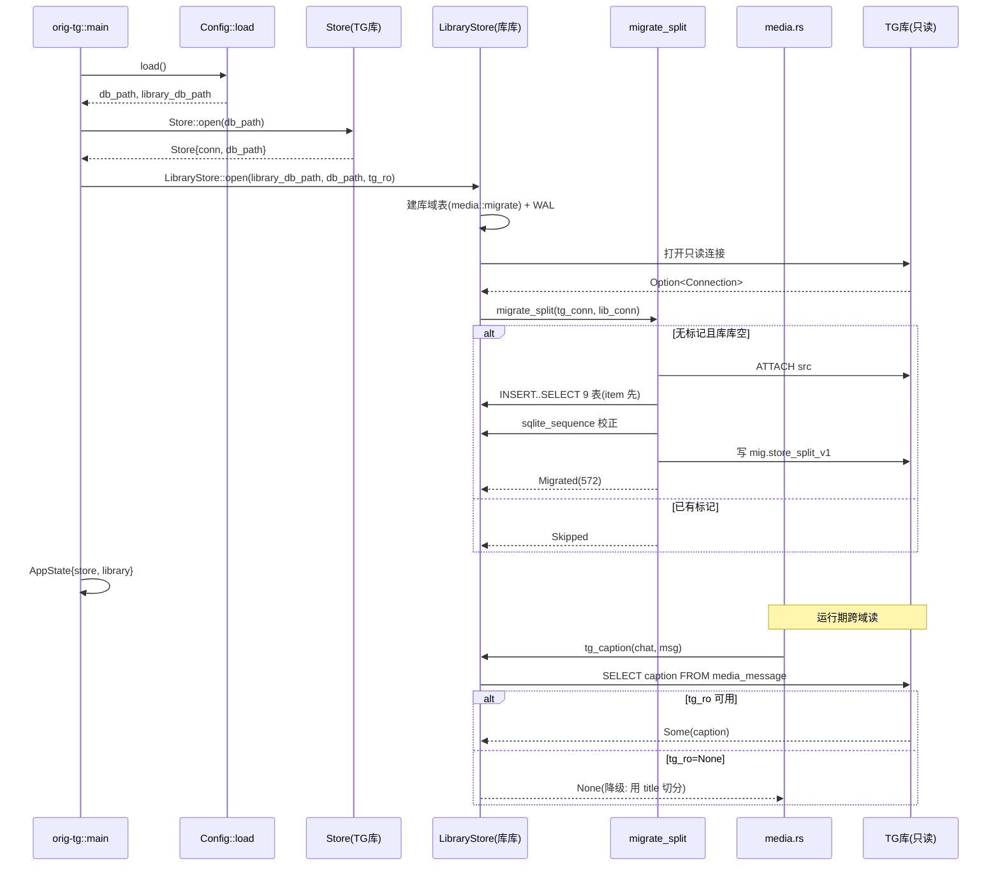

# store.db 拆库实现方案设计（D2-A）

> **版本：v2.1（2026-09-29，吸收 BUG-173 实测的洞一/洞二）**。
> v1 把拆库当纯搬迁，**漏了 5 处「单连接跨两域」的代码路径**（BUG-173 open/critical）。
> v2 吸收：新增 **Part C**（A–E）、§2.1 改判 & 白名单常量、§5.2 D1 解耦、§7/§9 任务重排（T02 前置）。
> **v2.1 补两洞**：**洞一**——`media.rs` 对 `app_setting` 走**裸 SQL**，v2 白名单够不着 → **§2.1.3/§C-F 签名级切断**（`media::migrate` 收 `&LibraryStore`）；**洞二**——`media.rs:209` 清的是 `title` **与** `description` 两列 → 已补入 R3b/A11/T-M9。
> 决策出处：`docs/design/media-service-deployment-decision-2026-09-28.md` D2 选项 **A**（用户 2026-09-28 拍板）。
> 关联缺陷：`docs/bugs/BUG-172.md`（部署形态）、**`docs/bugs/BUG-173.md`**（拆库前置阻塞，本档 v2/v2.1 的直接输入）。
> 定位：本档是**施工图**——给出目标形态、迁移算法、跨域读改造、env 链、验收判据与风险清单。
> **不含实现代码**，只给接口签名、SQL 与伪代码。
> 证据行号基线：`download-engine/crates/orig-tg/src/*`、`download-engine/crates/orig-daemon/src/*`、
> `tauri-shell/src-tauri/src/lib.rs`。

---

## 0. 前置事实复核（对 team-lead 给定事实的核对与更正）

team-lead 给定的事实经逐条核对后**总体成立**，但有 3 处需要精确化/更正，直接影响设计：

| # | 原述 | 核对结果 | 影响 |
|---|---|---|---|
| C1 | 「共享 1 张：`app_setting` … 既有 2 行值分别是 `library_dir` / `download_dir`」 | **部分成立待实测**。仓库内可复核的是：`app_setting` 被读写的 key 只有 `library_dir`（`store.rs:698`、`routes.rs:803`、`cache.rs:1349`）与 `download_dir`（`cache.rs:62`、`routes.rs:732/788/844`），**外加两个内部迁移标记键** `mig.item_text_split_v1`（`media.rs:30`）、`mig.episode_text_to_item_v1`（`media.rs:33`）。存量「2 行」很可能就是 `library_dir`+`download_dir`，**但也可能是其中一个迁移标记**（迁移标记由 `INSERT OR REPLACE` 写入）。→ 迁移算法**必须按 key 白名单分流、对未知 key 兜底**，不能假定只有 2 行。 | 迁移 §3、`app_setting` 分流 §2 |
| C2 | 「库根解析链 `store.rs:692 library_root()`」 | 成立，但**解析第 3、4 级用的是 `self.db_path` 的父目录**（`store.rs:703/706`）当「TG 数据目录」。拆库后 `db_path` 若指向新库，父目录须与原库父目录**相同**，否则 config.json / 默认库根会漂移（见 §2.2）。 | 库根解析 §2.2 |
| C3 | 「`lib.rs` spawn_tg 注入 `ORIG_TG_DB`/`ORIG_TG_SESSION`/`ORIG_TG_DOWNLOAD_DIR`」 | 成立（`lib.rs:428-440`）。但**`lib.rs` 与 `daemon/state.rs` 注入的 db 路径不一致**：`lib.rs:434` = `<app_data>/tg/store.db`；`daemon/state.rs:163` = `tg_data_dir()/tg/store.db`。两处各自算路径，拆库后**新增的库路径 env 必须两处都补**，且须保证两处父目录一致。 | env 链 §5 |

**其余事实（表归属、9+5、572 行、AGENTS.md §5、`EXIT_STORE_FAILED=5`）核对无误，直接采信。**
（注：team-lead 原述「4 处跨域读」经核对为 **3 个函数**，见 §4.2/§C-D；`download_dir` 归属经 v2 改判 → **v2.2 再修正**（见 §2.1.1）：其域为**下载引擎**，不属 TG 库亦不属库库。）

> **一处需要强调的反直觉点**：team-lead 列的第 4 处跨域读为「`media.rs:3465` 邻域（`set_series_tags` 附近）」。核对后：`media.rs:3465 set_series_tags()` **本身不读 `media_message`**（它只操作 `media_series_tag`）。真正读 `media_message.caption` 的是同文件 `media.rs:3488 collect_hash_tags()`（=第 2 处）与 `media.rs:3524 first_caption()`（=第 3 处）。**故实际「函数级」跨域读只有 3 个函数、共 3 条 SQL（`caption_of_ref` / `collect_hash_tags` / `first_caption`）**，不是 4 个。第 4 处「邻域」应理解为本档 §4 的「调用点」计数而非独立 SQL 点。**这使拆库成本比原估更低**（改造面 = 3 条 SQL + 其调用方注入）。

---

## Part A — 系统设计

### 1. 实现路径与目标形态

#### 1.1 核心挑战

1. **不丢数据地物理解耦**：存量单一 `store.db` 需把 9 张库域表的 572 行搬到新库，且 `AGENTS.md` §四要求「保留所有数据」。
2. **`app_setting` 的唯一循环依赖**：`library_dir` 是库域资产，却存放在由 `Store` 持有的设置表里；而库根解析链又反向依赖 `Store`（`store.rs:692`）。拆库必须打破这个「库根 → app_setting → 哪个库 → 库根」的环。
3. **id 连续性与触发器/索引随迁**：`media_item.id` 被 `media_episode.item_id`、`media_episode_source.item_id`、`media_episode_image.item_id` 引用（外键式，非声明式 FK），且 `media_*` 有一批**触发器**（`media.rs:398/405/419/526/534/542/549/580`）与**部分唯一索引**（`media.rs:307`）。搬表必须同批重建。
4. **跨域只读连接的边界**：`media.rs` 的 3 个函数读 `media_message.caption`，拆库后必须建立「库→TG」只读联系，同时不得违反 `MEDIA-DESIGN.md §0` M3 禁区「不依赖 TG 会话」。

#### 1.2 框架/技术选型

| 选型 | 选择 | 理由 |
|---|---|---|
| 数据库 | **libsql 本地后端，两个独立文件** | 现状已用（`store.rs:7/299`），不引入新依赖 |
| 拆库手法 | **新增 `LibraryStore` 类型，与 `Store` 并列**，由 `AppState` 同时持有 | 见 §1.4 类型取舍 |
| 迁移手法 | **`ATTACH DATABASE` + `INSERT INTO … SELECT`**（事务内），迁移后**保留原库** | 见 §3.3 取舍；单事务保证原子性与 id 稳定 |
| 跨域读 | **库侧持一条对 TG 库的只读连接**（`?mode=ro` / libsql read-only），只允许 SELECT `media_message.caption` | 见 §4.2；满足禁区（不依赖 TG **会话/进程**，仅依赖其数据文件，且只读） |

**架构模式**：沿用现有「`Store` 单连接 + `Arc<AppState>` 多线程共享」（`store.rs:7-8`），不引入新的 ORM/仓储层。

#### 1.3 目标库文件：命名与位置

| 库 | 文件名 | 生产绝对路径 | 承载 |
|---|---|---|---|
| TG 库 | **`store.db`**（名称**不变**） | `%APPDATA%/com.origadmin.orighub/tg/store.db`（真值，3.9 MB） | TG 域 5 张 + `app_setting`（TG 侧键）+ 迁移标记键 |
| 库库 | **`library.db`**（新） | `%APPDATA%/com.origadmin.orighub/tg/library.db`（**与原库同目录**） | 库域 9 张 + `app_setting`（库侧键：`library_dir`） |

> **为什么新库叫 `library.db` 且与原库同目录**：
> - 同目录 → `library_root()` 的 `config.json`/默认库根两级（`store.rs:703/706` 取 `db_path.parent()`）在新旧库上解析**结果一致**，规避 C2 的漂移。
> - 名字取 `library.db` 而非 `tg_library.db`：库域**不是** TG 资产（`MEDIA-DESIGN.md §0`：「TG 只是可替换通道」），名字里带 `tg` 会把物理位置与语义所有权挂钩，违背本决策的锚点。物理上它与 TG 库同目录只是「数据目录复用」，不构成语义归属。

**env 变量名**：

| env | 含义 | 默认（未注入时） |
|---|---|---|
| `ORIG_TG_DB`（既有，语义收窄） | **TG 库**路径 | `./tg_store.db`（`config.rs:43`，保持不动以兼容 mock 隔离约束） |
| `ORIG_TG_LIBRARY_DB`（**新增**） | **库库**路径 | 由 `ORIG_TG_DB` 推导：`<ORIG_TG_DB 父目录>/library.db`；若 `ORIG_TG_DB` 为 `:memory:` 则 `:memory:` |

> 默认值推导写在 `Config::load()`（`config.rs`）旁，保证「只注入 `ORIG_TG_DB` 的旧调用方（daemon `state.rs:163`、mock、单测）无需改动也能正确落到 `<同目录>/library.db`」——这正是「拆库不改二进制数量、但改依赖源码集合」的最小面。

#### 1.4 `Store` 拆分：类型设计（**关键取舍**）

**候选方案**：

| 方案 | 描述 | 代价 |
|---|---|---|
| S1 两个 `Store` 实例 | `AppState.{tg_store, lib_store}` 各持一个 `Store` | `Store` 现有 120+ 方法全部面向 TG 域；库域方法在 `media.rs` 中以 `impl Store`（`media.rs:1052` 起 `self.conn`）扩展。两个同型实例会导致 `media.rs` 的 `self.conn` 指向 TG 库——**语义错误**，必须让库域方法只在「库 Store」上出现 |
| S2 一个 `Store` 持两条连接 | `Store { tg_conn, lib_conn }` | 破坏 `store.rs` 现有全部 `self.conn.xxx` 调用点（200+ 处，`store.rs` 内 60+、`media.rs` 内 150+），改造面最大 |
| **S3（采用）新增 `LibraryStore`，`Store` 保有 TG 连接** | `Store` 保持现名承担 TG 域；新增 `LibraryStore { conn, tg_ro: Option<Connection>, db_path }` 承担库域；`media.rs` 的 `impl Store` **整体改为 `impl LibraryStore`**；`AppState` 同时持有二者 | 改造面集中在 `media.rs`（`impl Store` → `impl LibraryStore`）+ `store.rs`（把库域入口外移），`store.rs` 的 200+ `self.conn` **不动** |

**采用 S3，理由**：

- **最小爆炸半径**：`store.rs` 内 TG 域 200+ `self.conn` 调用一字不改；`media.rs` 内 150+ `self.conn` 也一字不改（只是所属类型的 `impl` 头变了，字段名同为 `conn`）。真正的机械替换只有两处 `impl` 声明。
- **类型即边界**：把「库域方法」与「TG 域方法」的**物理归属**编码进类型，正是本决策「逻辑已分、物理未分」的正解。将来 D1 演进到独立 `orig-media` crate 时，`LibraryStore` 可直接整体迁出，不需要再拆。
- **`tg_ro` 只在 `LibraryStore` 上**：跨域只读连接属于「库读 TG」，挂在库侧类型上语义正确。

**类型签名（伪代码）**：

```rust
// store.rs —— 保持现有名称与职责，仅收窄到 TG 域
pub struct Store {
    pub(crate) conn: Connection,   // = TG 库连接（table: monitored_channel/media_message/... + app_setting[TG侧]）
    pub(crate) db_path: PathBuf,   // = TG 库路径（library_root 语义「TG 数据目录」仍由它推导）
}

// store.rs（或新文件 library_store.rs）—— 新增，承担库域
pub struct LibraryStore {
    /// 库库（library.db）的**读写**连接。media.rs 全部 `self.conn` 指向它。
    pub(crate) conn: Connection,
    /// 对 TG 库的**只读**连接，仅服务 media_message.caption 回填（见 §4.2）。
    /// 打开失败时为 None（降级：caption 回填取不到原文，退化为「用 title 自身切分」，
    /// 与 media.rs:112-114 的既有降级完全一致），**不得因它失败而阻断启动**。
    #[allow(dead_code)]
    pub(crate) tg_ro: Option<Connection>,
    /// 库库文件路径（默认库根/相对路径解析用）。
    pub(crate) db_path: PathBuf,
    /// `Store::library_root()` 的解析链依赖的「TG 数据目录」= TG 库 db_path（见 §2.2）。
    pub(crate) tg_db_path: PathBuf,
}

impl Store {
    pub async fn open(path: impl AsRef<Path>) -> libsql::Result<Self>;      // 签名不变，仅建 TG 域表
}

impl LibraryStore {
    /// 打开（不存在则创建）库库并建库域表；同时尝试打开 TG 库只读连接。
    /// `tg_db_path` 用于推导默认库库位置与 library_root。
    pub async fn open(lib_path: impl AsRef<Path>, tg_db_path: impl AsRef<Path>, tg_ro: Option<Connection>) -> libsql::Result<Self>;
    pub async fn library_root(&self) -> PathBuf;                            // 见 §2.2
}
```

**`AppState` 变更**（`state.rs:99`）：

```rust
pub struct AppState {
    pub client: Arc<dyn Client>,
    pub config: Config,
    pub logs: RingLog,
    pub store: Store,            // 保持：TG 域
    pub library: LibraryStore,   // 新增：库域
    pub availability: Availability,
    pub mock: bool,
    // …其余字段不变
}
```

> `AppState::new()` 签名相应增加一个 `LibraryStore` 参数（`state.rs`），`main.rs:178` 与所有单测构造点（`routes.rs:3929/4268`、`state.rs:217`、`cache.rs:1252` 附近）同步。**单测构造点用 `:memory:` 双库**，`tg_ro = None`。

---

### 2. `app_setting` 分流方案

#### 2.1 key 分流表（**v2：已按 BUG-173 实测修正**）

> **BUG-173 实测结果推翻了本档 v1 的一处前提**：本机 `app_setting` **实有 2 行，恰为两个 `mig.*` 键**；
> `library_dir` / `download_dir` **都不在表中**（库根正走 `library_root()` 第 4 档默认值）。
> 即：v1 假设「存量 2 行 = library_dir + download_dir」是**错的**。分流设计**不依赖存量内容**（仍按白名单 + 兜底），
> 但归属判据必须重做——见 §2.1.1 的「判定口径」（`BUG-173 §A3`：分流后谁读得到）。

| key | 归属库（**v2 改判**） | 依据（调用方实测） |
|---|---|---|
| `mig.item_text_split_v1` | **library.db** | 写入 `media.rs:139`、读取 `media.rs:82`；动作作用于库域表 `media_item`。**落错边 → 迁移重跑 → `media.rs:209` 二次清空 `media_episode.description`**（BUG-173 §#3） |
| `mig.episode_text_to_item_v1` | **library.db** | 写入 `media.rs:213`；同上 |
| `library_dir` | **library.db**（保留 v1 判定） | 库根 = 库域。写：`routes.rs:803`、`cache.rs:1349`；读：`store.rs:698`（→ 迁到 `LibraryStore::library_root`）。仅一处实体读，改归属零歧义 |
| `download_dir` | **⚠️ 无归属 —— 属下载引擎域**（域 = daemon / `orig-core`，**非 TG 域、非库域**） | **v2/v2.1 的「归 TG 库」判定已被证伪**（用户 2026-09-28 质疑：下载功能与 TG 无关）。证据见 §2.1.1。域 = 下载引擎；`orig-tg` 内的同名 key 是**跨域消费副本**（仅用于缓存可删区判定，`cache.rs:291/619/769/1058`）。**形态待与 D1 一并裁定**；裁定前暂留原库并标注 TODO |
| 未登记 key | **不是「落入某侧」，而是错误**（BUG-173 §A3 收紧） | 原 v2 口径为「兜底 TG 库」——**已废止**：兜底方向恰好指向后果最重侧（`mig.*` 若被误判落 TG 库 → `media_episode` 的 `title`/`description` 反复清空）。`app_setting` 实测为封闭 key 集（全仓 4 个），穷举可行 ⇒ 未登记 key 由 `owner_of()` 返回 `Err(Unregistered)`。**迁移时**遇未登记 key 则**保留在原库并在返回值中如实计数**（不静默、不丢），见 §2.3 |
| 新增迁移标记 `mig.store_split_v1` | **TG 库** | 拆库进度标记，写原库保证「原库被保留时标记不丢」 |

> **⚠️ v2.2 修正**：v2/v2.1 曾把 `download_dir` 判给 TG 库 —— **该判定已证伪作废**，见 §2.1.1。现有分歧不是「归哪一侧」，而是「**它就不该被拆进任一新库**」——它是**第三方域（下载引擎）**的概念。

#### 2.1.1 `download_dir` 归属 —— **⚠️ v2.2 已推翻本节的 TG 库判定**

> # ⚠️ 本节结论（`download_dir` 归 TG 库）**已被证伪，作废**
>
> **用户质疑（2026-09-28）**：「工具本身是**下载工具**，有一个下载的功能，**和 TG 没关系**。」
> 核实后用户正确，本节及 v2/v2.1 中一切「`download_dir` 归 TG 库」的结论**全部作废**。
>
> **错因**：本节判据是「求解该 key 的代码物理上打开哪个库文件」——
> 这是**用「当前谁在读」推「它属于谁」**，把**寄宿现状当成了设计归属**。
> v1 用「语义相近」判错、v2 用「调用点在哪侧」判错，**是同一个错误的两面**：
> 两次都没问「**这个概念本身属于哪个能力**」。
>
> **决定性证据（全部实测）**：
>
> | 证据 | 位置 | 含义 |
> |---|---|---|
> | **铁律 5** | `orig-daemon/src/activity.rs:435` 测试 `tg_unavailable_still_returns_downloads`，注释原文「**9877 挂掉时普通下载任务必须照常返回**」 | 项目已确立：普通下载（`TaskKind::Download`）与 TG 缓存（`TaskKind::Cache`）**是两个任务类别**，下载必须独立于 TG 存活 |
> | daemon 侧有**完整**下载目录语义 | `orig-daemon/src/config.rs:81`（字段）、`:446`（三级解析 `request → config → platform default`）、`:475`（API 暴露）、`:219-222`（配置文件读取） | 下载目录是**下载引擎的一等配置** |
> | daemon 侧用**正确**的 OS API | `orig-daemon/src/config.rs:439-443` 委托 `orig_core::paths::default_download_dir()`（注释「never a literal `~/Downloads`, see BUG-071」） | **主域实现** |
> | **orig-tg 侧是复制品** | `orig-tg/src/config.rs:52-63` **自己实现一遍**手工拼 `HOME`/`USERPROFILE`+`Downloads`，注释自述「对齐 orig-daemon」 | 副消费者，且该实现**恰是 BUG-071 要修的手工拼接形态**（自称「对齐」实际未对齐） |
> | orig-tg 侧唯一用途是**可删区判定** | `cache.rs:291/619/769/1058` 全是 `inside_dir(&dir, &path)` 与清理范围 | 它不是所有者，只借它判「哪个文件可删」 |
>
> **修正后的归属**：`download_dir` 的域 = **下载引擎（daemon / `orig-core`）**，
> **不属 TG 库、也不属 library.db**。`orig-tg` 中的同名 key 是**跨域消费副本**。
>
> **落地形态（须与 D1 一并裁定，见 BUG-173 §归属定案）**：
> (a) 留 TG 库 = 语义错误；(b) 留库库 = 更错；(c) **归下载引擎自有配置 = correct-by-domain**，
> 但下载引擎当前零 SQLite 连接（F8），须先定「它的配置存哪」（`download-engine.toml` 或 daemon 新建自有配置）。
>
> **对施工的影响**：`download_dir` **不得**按本节结论路由到 TG 库。
> 在形态 (c) 裁定前，**暂按「留原库（TG 库）+ 标注为待迁移的跨域消费副本」处理**，
> 并在 T04 的接线处留显式 TODO 与注释，**禁止**把它当「TG 域 key」写进归属常量表的语义解释里。

<details>
<summary>（已作废的 v2 原文，保留作履历，勿作为实施依据）</summary>

（原判据）判据 = 「求解该 key 的代码**物理上打开哪个库文件**」，而非「该 key 语义上像谁」：

| 求解点 | 当前代码读的库 | v2 判定的归属 |
|---|---|---|
| `cache.rs:59-69 download_dir()` | `st.store`（TG 库连接） | ~~TG 库~~ |
| `routes.rs:732/844 get_setting("download_dir")` | `st.store` | ~~TG 库~~ |
| `routes.rs:788 set_setting("download_dir")` | `st.store` | ~~TG 库~~ |
| `store.rs:698 get_setting("library_dir")` | `st.store` | **library.db**（迁 `LibraryStore`）— **此条仍成立** |

（原结论）`download_dir` 服务 TG 域缓存流水 → 留 TG 库。**该推理已作废**：
「缓存任务落盘也要读下载目录」只说明它是**消费者**，不说明它是**所有者**。

</details>

#### 2.1.2 白名单必须**落成常量**（BUG-173 §H2 / §A3）

v1 把白名单写在「§2 的表格」里——这是**文档约定，不是代码约束**，新增 key 会静默落错边。v2 要求落常量：

```rust
// library_store.rs —— app_setting key 归属常量表（唯一真源）
pub mod setting_keys {
    /// 归 library.db 的 key。**全量穷举**（非「白名单 + 兜底」）。
    pub const LIBRARY_DB_KEYS: &[&str] = &[
        "library_dir",
        "mig.item_text_split_v1",
        "mig.episode_text_to_item_v1",
    ];
    /// 归 TG 库的 key（显式列出；与 LIBRARY_DB_KEYS 共同构成**闭集**）。
    pub const TG_DB_KEYS: &[&str] = &["download_dir", "mig.store_split_v1"];

    /// 判定 key 归属。**未登记 key 不是「落入某一侧」，而是错误**——
    /// 兜底方向无论指向哪一侧都会错一半，且本仓后果最重的一侧（`mig.*` 落 TG 库）
    /// 会导致 `media_episode` 的 `title`/`description` 被反复清空。
    /// `app_setting` 实测为封闭 key 集（全仓 4 个），穷举可行。
    pub fn owner_of(key: &str) -> Result<Db, SettingKeyError> {
        if LIBRARY_DB_KEYS.contains(&key) { return Ok(Db::Library); }
        if TG_DB_KEYS.contains(&key)      { return Ok(Db::Tg); }
        Err(SettingKeyError::Unregistered(key.to_string()))   // 显式失败，不静默
    }
}
```

**约束（验收 A10）**：`AppState` 的 `get_setting`/`set_setting` 封装层按 `setting_keys::owner_of(key)` **自动路由**到 `store` 或 `library`，调用方**不再手选**连接；**未登记 key 返回 `Err`，不静默落任一侧**（原 v2 的「兜底 TG 库」已废止）。配套单测须**三层齐备**（对齐 BUG-173 §A3）：① 静态扫 `app_setting` 裸 SQL（`media.rs` 应为 0 命中）；② 每 key 断言实体读写点所在连接与归属一致；③ 未登记 key 调 `set_setting` 必须 `Err`。
> ⚠️ **仅扫 `"(get|set)_setting\("` 的字面量实参不够**——两个 `mig.*` 键（后果最重的两个）走**裸 SQL** 且实参为常量（`media.rs:30/33`），扫字面量会整体漏掉它们。这三层缺任一层都可能假绿。

> **⚠️ v2 的一处致命漏洞（v2.1 修正，BUG-173 实测）**：v2 的白名单机制**只覆盖 `get_setting`/`set_setting` 访问器这条路**，
> 但 `media.rs` 对 `app_setting` 的**全部** `mig.*` 读写**走裸 SQL，不经访问器**（见下 §2.1.3）。
> 故白名单机制**够不着** `mig.*` —— 必须在**签名级**切断，见 §2.1.3。

#### 2.1.3 `mig.*` 走裸 SQL —— **签名级切断**（v2.1 新增，BUG-173 实测确证）

**实测事实**（逐行核对）：

| 位置 | 语句 | 说明 |
|---|---|---|
| `media.rs:76` | `async fn backfill_item_text(conn: &Connection)` | 接收**裸 `Connection`** |
| `media.rs:78` | `CREATE TABLE IF NOT EXISTS app_setting (...)` | **自己建表（第 1 处）** |
| `media.rs:82` | `SELECT 1 FROM app_setting WHERE key = ?1`，实参 `ITEM_TEXT_SPLIT_MIG`（`:30`） | 裸读 |
| `media.rs:139` | `INSERT OR REPLACE INTO app_setting (key,value) VALUES (?1,'1')` | 裸写 |
| `media.rs:160` | `async fn collapse_episode_text(conn: &Connection)` | 接收**裸 `Connection`** |
| `media.rs:161` | `CREATE TABLE IF NOT EXISTS app_setting (...)` | **自己建表（第 2 处）** |
| `media.rs:165` | `SELECT 1 FROM app_setting WHERE key = ?1`，实参 `EPISODE_TEXT_MIG`（`:33`） | 裸读 |
| `media.rs:213` | `INSERT OR REPLACE INTO app_setting (key,value) VALUES (?1,'1')` | 裸写 |
| `media.rs:221` | `pub async fn migrate(conn: &Connection)` | 唯一入口 |
| `store.rs:362` | `crate::media::migrate(&conn).await?;` | **唯一调用点**（已核实：全仓 `grep media::migrate` 仅此 1 处） |

**为什么击穿 v2**：v2 §6 写「`impl Store` → `impl LibraryStore`（机械替换，`self.conn` 不变）」+「`LibraryStore::get_setting/set_setting`」。
但 `mig.*` 的读写**不在 `self.conn` 的方法面上**，而在 `media::migrate(&conn)` / `backfill_item_text(&conn)` / `collapse_episode_text(&conn)` 的**裸 SQL** 里。
机械替换 `impl` 块**不会碰到它们**；`get_setting`/`set_setting` **也不会被它们调用**。
后果：拆库后 `media::migrate` 拿到谁的 `conn`，`mig.*` 就写进哪个库 → 若拿到 TG 连接 → 写 TG 库 → 库侧查不到 → `collapse_episode_text` 重跑 → **`media.rs:209` 清空 `media_episode.title`+`description`**（见 §8 R3b）。

**采用 team-lead 主张：签名级切断**（而非给 `Connection` 也做一套分流——那等于重新发明一个更弱的 `Store`）：

**原则：迁移逻辑不再可得裸 `Connection`；`app_setting` 读写一律经 `Store`/`LibraryStore` 方法。**

具体改造：

1. **`media::migrate` 签名改为**：
   ```rust
   // media.rs —— 不再接收裸 Connection，而是可读写的 Store 抽象
   pub async fn migrate(lib: &LibraryStore, tg: &Store) -> libsql::Result<()>
   ```
   > `lib` 用于库域表建表/回填；`tg` **仅**用于 `migrate_media_message` 之外无——本函数实际只需 `lib`。
   > 若确认无 TG 侧动作，可收窄为 `pub async fn migrate(lib: &LibraryStore)`，**更安全**（见下 4）。

2. **`backfill_item_text` / `collapse_episode_text` 签名改为**：
   ```rust
   async fn backfill_item_text(lib: &LibraryStore) -> libsql::Result<usize>
   async fn collapse_episode_text(lib: &LibraryStore) -> libsql::Result<(usize, usize)>
   ```
   其内的 `CREATE TABLE`/`SELECT`/`INSERT OR REPLACE` **全部改走 `lib.get_setting(...)`/`lib.set_setting(...)`**
   （即 `setting_keys::owner_of("mig.*") == Ok(Db::Library)` → 自动落库库）。**裸 SQL 删除。**

3. **`app_setting` 建表归属**（回答 team-lead 第二问）：**认同应改为「库侧表由 `LibraryStore::open` 统一建、`media::migrate` 不再建表」**。
   - **理由**：两库各有一张同名 `app_setting` 是**设计本意**（键空间按 §2.1 分流），
     但**建表语句不该有 3 处**（`media.rs:78`、`media.rs:161`、`store.rs:335`）——这是「同一张逻辑表被 3 处 DDL 分散维护」，
     正是 v2 漏掉 `media.rs` 两处的原因。
   - **v2.1 决定**：`app_setting` 的 DDL **收敛到两个所有者**——TG 库表由 `Store::open` 建（保留 `store.rs:335`），
     library 库表由 `LibraryStore::open` 建（**新增**）；**`media.rs:78`/`:161` 两处 `CREATE TABLE` 删除**。
   - 这使「库侧 `app_setting` 一定存在」由 `LibraryStore::open` **保证**，不再依赖 `media::migrate` 的副作用。

4. **为什么用签名级而非「给 Connection 做分流」**：`Connection` 是无类型的 SQL 通道，
   给它加分流 = 在运行时按 SQL 文本猜目标库（不可静态检查、不可测试、必然漏）；而 `LibraryStore`/`Store` 是**类型级归属**，
   编译器强制每个 `app_setting` 访问显式选择所有者。**签名去除裸 `Connection` = 让错误不可表达。**

**新增验收（对齐 BUG-173 §A5b）**：
- **A5b（签名级切断）**：`media.rs` 中**不存在**任何对 `app_setting` 的裸 SQL（`CREATE`/`SELECT`/`INSERT` 直写）；
  `media::migrate` 及其子函数的签名**不含 `&Connection`**。反向证伪：若 `backfill_item_text`/`collapse_episode_text`
  仍接收 `&Connection` 且能直达 `app_setting`，A5b 必须 FAIL。
- **单测 T-M12** `mig_keys_isolated_by_signature`：把 `media::migrate` 传入「指向 TG 库的连接」→ 编译期即不可能（签名已切断）；
  运行期断言 `mig.*` 只出现在库库 `app_setting`，TG 库 `app_setting` 无 `mig.*`。

#### 2.2 `library_root()` 的循环依赖解决（**重点**）

**问题环**：`library_root()`（`store.rs:692`）第 2 级读 `app_setting.library_dir`。若 `library_dir` 随库域进 `library.db`，则「**打开 library.db 之前就要知道 library.db 在哪**」是否成立？

**答案：不构成真环**，因为 `library_root()` 解析的是「**字节库根目录**（存放视频文件的那个 `library/` 目录）」，**不是** `library.db` 文件位置。两者是不同概念：

- `library.db` 位置 = `<TG 数据目录>/library.db`，由 **env/默认推导**（§1.3），**不读 app_setting**；
- `library/` 字节根 = 由 env `ORIG_TG_LIBRARY_DIR` → app_setting `library_dir` → config.json → 默认，四级链。

因此拆库后：

1. `library.db` 的打开**不依赖任何 app_setting**（纯 env/路径推导）→ **无环**；
2. `library_root()` 迁到 `LibraryStore`，第 2 级读的是 **library.db 的 `app_setting.library_dir`**（库域键已进库库）→ 语义自洽；
3. 第 3、4 级的「TG 数据目录」**必须仍由 `tg_db_path` 推导**（`tg_db_path.parent()`），而不是 `lib.db_path.parent()`——虽然二者父目录相同（§1.3 同目录），但**显式用 `tg_db_path`** 可防未来有人把两库分居不同目录时静默漂移。

**新 `LibraryStore::library_root()` 解析链**（等价迁移，逐级与旧实现 `store.rs:692-707` 对齐）：

```
1. env ORIG_TG_LIBRARY_DIR（不变，最高优先）
2. self.get_setting("library_dir")  ← 读 lib_conn（库库）
3. Store::config_json_library_dir(&self.tg_db_path)   ← 读 TG 数据目录的 config.json
4. Store::default_library_root(&self.tg_db_path)      ← <TG 数据目录>/library
```

**失败不 panic 的既有行为保留**（`store.rs:714-716` 退化到 `./library`），但**新增启动期校验**（对齐 BUG-172「假空库」隐患与 `AGENTS.md` §5「启动期依赖失败必须显式失败」）：

> **新增约束**：`orig-tg` 启动时，若 `library_root()` 解析结果**不存在**（目录缺失）**或** `library.db` 的 `media_item` 为 0 行**且** `ORIG_TG_LIBRARY_DB` 未显式注入，则打印**告警**并写入 `push_log`（**不退出**——库为空是合法的全新安装态）。但若 `library_root()` **退化到了 `./library`**（即第 1-3 级全空、命中第 4 级 CWD 默认）**且** CWD ≠ TG 数据目录，则视为可疑，打印醒目告警。**本档不把它升级为 fatal**（会误伤 CI），但要求日志可诊断——见验收 §7。

#### 2.3 迁移时的 key 处置（**无兜底**）

迁移（§3）读取**原库** `app_setting` 全部行，按 §2.1.2 的常量表**穷举**分流：

- `owner_of(key) == Ok(Db::Library)`（`library_dir` + 两个 `mig.*`）→ 复制进 **library.db**，**并从原库删除**；
- `owner_of(key) == Ok(Db::Tg)`（`mig.store_split_v1`、**以及 `download_dir` 的过渡处置**）→ **留在原库**（TG 库），**不动**；
  ⚠️ `download_dir` **不是** TG 域 key —— 它属**下载引擎域**（见 §2.1.1）。此处「留原库」只是**过渡**（避免在 D1 裁定前引入第三种存储位置），**不是归属结论**，须在 T04 留显式 TODO。
- `owner_of(key) == Err(Unregistered)` → **保留在原库**并在 `MigrateOutcome` 中**如实报告未登记 key 列表与条数**。
  ⚠️ 「保留在原库」是**数据保全**（对齐「宁可留多余」），**不是归属判定**——
  运行期经 `set_setting`/`get_setting` 触碰未登记 key 必须**显式失败**（见 §2.1.2 `owner_of`）。
  即：**存量未登记 key 不丢，新增未登记 key 写不进去。**

> **实测补充（BUG-173）**：本机原库 `app_setting` 实为 2 行、**恰是两个 `mig.*` 键**。
> 故本次迁移的**关键动作其实是「把两个 `mig.*` 迁到 library.db」**——若它们落错边（留 TG 库），
> 则下次启动 `LibraryStore::open` 内 `media::migrate` 查不到标记 → `backfill_item_text`（`media.rs:82`）
> 与 `collapse_episode_text`（`media.rs:165`）**重跑**，而后者动作是
> **`UPDATE media_episode SET title = NULL, description = NULL`（`media.rs:209`，两列一起清）**
> → **用户可见的剧集标题与简介被反复清掉**（因为标记仍在 TG 库，**每次启动都犯**）。这是分流错误最重的后果，
> 已列为风险 R3b（§8）与验收 A5/A11。

> **「从原库删除已迁 key」是否违反「保留所有数据」？**  不违反。「保留所有数据」针对**用户内容**（`media_item` 等业务行、字节文件）；`app_setting` 的配置键在两库间**搬迁**而非丢弃——迁移完成后该 key 仍存在于系统中（在 library.db）。但为稳妥，**提供「原库不删 key」的保守开关**（见 §3.5 回滚），且迁移后**原库整体保留**（改名归档，不删），使回退成为可能。用户若坚持零删除，可将白名单键**同时留在两库**，`library_root()` 读库库副本即可——此降级路径写入验收判据 R3。

---

### 3. 迁移设计

#### 3.1 触发时机与幂等性

**时机**：`orig-tg` 启动期，`Store::open`（TG 库）之后、`LibraryStore::open` 之内/之前，**一次性**执行。不依赖运行期请求。

**幂等保证**（模板 = `migrate_media_message`，`store.rs:218`）：

1. 迁移本身包在**单个 SQLite 事务**内（`BEGIN IMMEDIATE … COMMIT`），失败即 `ROLLBACK`；
2. 事务**最后一步**写标记键 `mig.store_split_v1 = '1'` 到 **TG 库** `app_setting`；
3. 后续启动先查该标记：存在 → 跳过（`Ok(0)`）——与 `backfill_item_text`（`media.rs:82-89`）的「先查标记后返回」范式完全一致；
4. **额外幂等网**：即便标记因异常未写入，`INSERT INTO lib.X SELECT … FROM main.X` 的**主键冲突**在 `INSERT OR IGNORE` 语义下不会产生重复；对含 `AUTOINCREMENT` 的表用**显式 id 列**保证稳定（见 §3.4）。

#### 3.2 迁移步骤（不破坏原库）

前提：TG 库路径 `tg_db`，库库路径 `lib_db`（若文件不存在，先 `Store/LibraryStore::open` 建空 schema）。

```
BEGIN IMMEDIATE;                                   -- 在 lib_conn 上开事务
ATTACH DATABASE '<tg_db 绝对路径>' AS src;         -- 挂原库（只读意图）

-- 1) 逐表搬运（顺序 = 依赖序：先 item，再 episode/系列/标签关联，最后 image/removed/source）
INSERT OR IGNORE INTO media_item(id, source, ref, title, kind, file_path, poster, size,
                                 duration, width, height, added_at, description)
  SELECT  id, source, ref, title, kind, file_path, poster, size,
          duration, width, height, added_at, description FROM src.media_item;
-- …其余 8 张表同构（附下）

-- 2) app_setting 分流：白名单键复制进库库
INSERT OR IGNORE INTO app_setting(key, value)
  SELECT key, value FROM src.app_setting
   WHERE key IN ('library_dir','download_dir','mig.item_text_split_v1','mig.episode_text_to_item_v1');

-- 3) 原库侧：删除已迁 key（可关闭，见 §2.3）
DELETE FROM src.app_setting
 WHERE key IN ('library_dir','download_dir','mig.item_text_split_v1','mig.episode_text_to_item_v1');

-- 4) 标记（写 TG 库，非 lib 库）
INSERT OR REPLACE INTO src.app_setting(key, value) VALUES ('mig.store_split_v1','1');

COMMIT;
DETACH DATABASE src;                               -- 或随事务提交自动断开
```

**搬运表清单与 id 稳定性**（§3.4）：

| 目标表 | 是否 AUTOINCREMENT | 搬运语句要点 |
|---|---|---|
| `media_item` | ✅ id | 显式列 id；`INSERT OR IGNORE` |
| `media_series` | ✅ id | 显式 id |
| `media_episode` | ✅ id | 显式 id（`item_id` 引用 media_item.id） |
| `media_tag` | ✅ id | 显式 id |
| `media_item_tag` | ❌ 复合主键 | 直搬 |
| `media_series_tag` | ❌ 复合主键 | 直搬 |
| `media_episode_source` | ✅ id | 显式 id（`item_id` UNIQUE 引用 media_item.id） |
| `media_episode_image` | ❌ 复合主键 | 直搬 |
| `media_episode_removed` | ❌ 复合主键 | 直搬 |

> **顺序约束**：`media_item` 先于 `media_episode/source/image`——虽然 libsql 本地后端**不强制外键**（`media.rs:385` 明述），但 `media_episode` 上有 `BEFORE INSERT` 触发器（`trg_media_episode_media_only_ins`，`media.rs:526`）会 `SELECT kind FROM media_item WHERE id = NEW.item_id`。若 item 未先入，触发器判 `kind IS NULL` → **ABORT**。**故 item 必须最先搬**。

**触发器与索引**：库域表在 `LibraryStore::open` 中由 `media::migrate(&lib_conn)` 建好（含全部触发器与部分唯一索引）。**触发器在迁移期间若已存在，会对 INSERT 生效**——这是**期望行为**（等于借触发器再校验一次数据完整性）。但 `media::migrate` 内含**历史脏数据清理**（`media.rs:453-483` 删非法分集、`media.rs:593-598` 清孤儿 source、BUG-126 墓碑逻辑）——搬运发生在 migrate **之后**，等于「先建干净 schema，再灌入数据，再让触发器兜底」。**若用户原数据本身含脏行（历史 bug 残留），搬运时会被触发器拒绝 → 整事务回滚 → 迁移永久失败**。→ 这要求搬运顺序中 `media_item` 先入，且搬运语句应捕获触发器拒绝并**逐表降级**（见 §3.6 风险 R2）。

#### 3.3 ATTACH vs 导出导入（取舍）

| 手法 | 优点 | 缺点 | 结论 |
|---|---|---|---|
| **ATTACH + `INSERT…SELECT`**（采用） | 单事务原子；无中间文件；id 原样；libsql `Connection` 支持 `ATTACH`（`store.rs` 同连接跨库） | 需在 lib_conn 上 ATTACH 原库（跨库事务，SQLite 支持但需注意锁） | **采用**——数据量仅 572 行，单事务毫秒级 |
| 逐表 dump 到文件再导入 | 与库连接解耦 | 需临时文件落盘（污染防线 §6）、跨文件一致性无保障、回滚需清理文件 | ✗ |
| 全库文件拷贝后 `DROP TABLE` | 最少 SQL | **要删原库表 = 违反「保留所有数据」**，且全库拷贝后仍要删 TG 表，方向相反 | ✗ |

> **锁注意**：`BEGIN IMMEDIATE` 在 lib_conn 上取得写锁；`ATTACH src` 后对 src 的 `DELETE`/`INSERT` 需要 src 可写。**迁移必须在任何其他进程打开 src 之前完成**（启动期单线程，满足）。若检测到 src 被占用（`SQLITE_BUSY`），**显式失败**（`EXIT_STORE_FAILED`）而非回退——对齐 `AGENTS.md` §5「禁止回落」。

#### 3.4 `sqlite_sequence` 与 AUTOINCREMENT id 连续性

三者都是 `INTEGER PRIMARY KEY AUTOINCREMENT`：`media_item`、`media_series`、`media_episode`、`media_tag`、`media_episode_source`。

- **必然性问题**：AUTOINCREMENT 保证「新 id > 历史最大 id」。若用 `INSERT OR IGNORE` 显式写入 id，**不会**自动更新 `sqlite_sequence`（SQLite 文档：显式指定 ROWID 时 AUTOINCREMENT 序列**仅在 id ≥ 当前 seq 时才推进**；老版本不推进的边界存在）。→ **必须在搬运后显式校正**：

```sql
-- 对每张 AUTOINCREMENT 表（t）：
INSERT OR REPLACE INTO sqlite_sequence(name, seq)
  SELECT 'media_item', COALESCE(MAX(id), 0) FROM media_item;
-- 同样处理 media_series / media_episode / media_tag / media_episode_source
```

- **为何必须**：`media_episode.item_id` 引用 `media_item.id`（外键式）。若 `sqlite_sequence` 未推进、下一次导入新条目拿到一个**已被占用**的 id，会撞 `UNIQUE(source, ref)` 或覆盖旧条目 → **数据串台**。这是拆库最隐蔽的坑，**必须配单测断言**（见 §7 T-M3）。
- **`media_episode_source.item_id` 全表 UNIQUE**（`media.rs:371`）：搬运时若原库有重复（历史脏数据）会 `INSERT OR IGNORE` 静默丢行——**记录并告警**，不 fail（宁留不删的相反面：这里无法保留，但必须**如实报告丢弃行数**）。

#### 3.5 回滚方案

**两层回滚**：

1. **事务级自动回滚**：迁移在单事务内，任何一步失败 → `ROLLBACK` → 库库保持「schema 已建、数据为空」态 → 启动报 `EXIT_STORE_FAILED` + 打印两侧路径。用户数据（原库）**一字未动**。
2. **人工回退（迁移已成功但用户要退回共库态）**：
   - 因**原库整体保留**（§3.2 只 DELETE 了 `app_setting` 白名单键、未删任何业务表），回退 = 「删除/改名 `library.db` + 把 `app_setting` 白名单键复制回原库 + 删 `mig.store_split_v1` 标记」。提供 `library.db` 的**改名归档**（`library.db.rollback-<ts>`）而非删除，保证字节可复现。
   - **代码侧回退**：`LibraryStore` 可配置为「指向 TI 库本身」实现共库兼容（`lib_path == tg_path`），使旧行为在一行配置内可达——作为紧急熔断，不进入常规路径。

#### 3.6 迁移伪代码（完整）

```
async fn migrate_split(tg_conn, lib_conn, tg_db_path, lib_db_path) -> Result<MigrateOutcome> {
    // 幂等门（与 backfill_item_text 同范式）
    if get_setting(tg_conn, "mig.store_split_v1").is_some() { return Skipped; }
    // 库库非空且无标记 = 半迁移残留 → 显式失败，不猜
    if count(lib_conn, "media_item") > 0 { return Err("library.db non-empty without split marker"); }

    lib_conn.execute("BEGIN IMMEDIATE");
    lib_conn.execute(&format!("ATTACH DATABASE '{}' AS src", escape(tg_db_path)));
    let r = (|| async {
        for t in [media_item, media_series, media_episode, media_tag,
                  media_item_tag, media_series_tag, media_episode_source,
                  media_episode_image, media_episode_removed] {
            copy_table(lib_conn, "src", t)?;        // INSERT OR IGNORE ... SELECT (显式 id)
        }
        copy_settings_whitelist(lib_conn, "src")?;
        delete_settings_whitelist(tg_conn, "src")?; // 可开关
        reset_sqlite_sequence(lib_conn, AUTOINCREMENT_TABLES)?;
        Ok(())
    })().await;
    match r {
        Ok(_)  => { lib_conn.execute("INSERT OR REPLACE INTO src.app_setting VALUES('mig.store_split_v1','1')");
                    lib_conn.execute("COMMIT"); Ok(Migrated{n: 572}) }
        Err(e) => { let _ = lib_conn.execute("ROLLBACK"); Err(e) }   // 原库未动
    }
}
```

---

### 4. 连接与并发

#### 4.1 进程 × 连接矩阵（拆库后）

| 进程 | TG 库（store.db） | 库库（library.db） | 跨域读连接 |
|---|---|---|---|
| `orig-tg` | 1 条读写（`Store.conn`） | 1 条读写（`LibraryStore.conn`） | 1 条**只读** TG 库（`LibraryStore.tg_ro`） |
| `orig-daemon` | 0（仅注入 env 给子进程，`state.rs:163`） | 0（同） | — |
| `tauri-shell` | 0 | 0 | — |

> **拆库后单写者假设**：TG 库仅 `orig-tg` 写；库库仅 `orig-tg`（当前）写。D1 若演进到 daemon 持有媒体服务，则库库写者变为 daemon——**本拆库正是为此铺路**（那时 TG 库仍只 orig-tg 写，两库永不双写）。**本档不改写者归属**（那是 D1-B 的范围）。

#### 4.2 跨域读的实现（**关键边界决策**；v2 更正为 3 函数 / 3 条 SQL）

**现状**：**3 个函数、3 条 SQL**（`caption_of_ref` `media.rs:48`、`collect_hash_tags` `media.rs:3502`、`first_caption` `media.rs:3532`）读 `media_message.caption`。
**v1 误把 `media.rs:3465 set_series_tags` 列为第 4 处**——它**不读 `media_message`**，只操作 `media_series_tag`。故改造面是 3 个函数。

**决策：允许「库→TG」只读，且加单向只读约束**。理由与约束：

| 维度 | 判定 |
|---|---|
| 是否违反 `MEDIA-DESIGN.md §0` M3 禁区「不依赖 TG **会话**」？ | **不违反**。禁区约束的是「依赖 TG 会话/授权/进程」（BUG-172 主因）。只读连接依赖的是**数据文件**（`media_message` 表 = 已落地的本地事实），**不依赖 TG 客户端、不依赖登录、不依赖 orig-tg 进程存活**——库库单独打开时 `tg_ro` 打开的是文件，文件不存在则 `None` 降级。**「不依赖 TG 会话」被满足**；「不依赖 TG 数据文件」不是禁区（`media_message` 本就是本地持久化产物）。 |
| 是否形成新的「反向依赖」？ | 形成了一条**只读、单向、窄接口**的依赖。它**不违反**「TG 只是可替换通道」——因为媒体库并不因它而「必须 TG 存在」：`tg_ro` 失败 → `caption_of_ref` 返回 `None` → 走既有降级（`media.rs:112-114` 用 `title` 自身切分，`collect_hash_tags` 返回空、`first_caption` 返回 `None`），**功能降级而非不可用**。 |
| 约束 | ①`tg_ro` **只用于 SELECT `media_message.caption`**，代码层封装成唯一入口函数（见下），不得外泄 `Connection`；②打开模式**只读**（libsql `Builder::new_local(...).read_only()` 或 `file:...?mode=ro`），从机制上杜绝误写；③`tg_ro: Option<Connection>`——拿不到就降级，**绝不 fallback 到写库库**；④**降级必须可观测**（BUG-173 §A6，见 §5.3）——`first_caption` 是**每次缓存任务都触发**的持续路径（BUG-173 §#5），静默降级会让剧集名逐渐失真且无法定位。 |

**封装**（`LibraryStore` 上的唯一跨域入口）：

```rust
impl LibraryStore {
    /// 唯一的跨域读：取 TG 流水里某条消息的原始 caption。
    /// tg_ro 不可用 → Ok(None)（调用方按既有降级处理），并**累加降级计数**供 /api/tg/diag。
    pub(crate) async fn tg_caption(&self, chat_id: i64, message_id: i64)
        -> libsql::Result<Option<String>>;
}
```

`caption_of_ref(conn, ref)`（`media.rs:39`）签名改为走 `self.tg_caption(...)`；`collect_hash_tags`（`media.rs:3488`）与 `first_caption`（`media.rs:3524`）内的 `self.row_opt("SELECT caption FROM media_message ...")` 改为 `self.tg_caption(...)` 循环。

> **是否要「缓存 caption 到库库」以彻底消除跨域读？**  评估过，**不采用**：caption 是 TG 流水的动态字段（`upsert_message` 会更新 `caption`，`store.rs:481`），缓存进库库需要**跨库失效同步**（TG 写 caption → 库库缓存失效），引入新的双向耦合，比只读连接更贵。**保持只读直连**。

#### 4.3 是否仍需跨进程锁

- **TG 库**：写者仍唯一（orig-tg），**无需**新增跨进程锁。
- **库库**：当前写者唯一（orig-tg），**无需**。但**为 D1-B 预留**：本档要求库库**启用 WAL**（`PRAGMA journal_mode=WAL`，在 `LibraryStore::open` 时设置），使「将来 daemon 与 orig-tg 若短暂并发读库库」不会 `SQLITE_BUSY`。WAL 是**向后兼容的本地配置**，不影响现有行为。
- **结论**：本拆库**不新增**跨进程锁协调，但 WAL 是廉价保险。

---

### 5. 配置与 env 链

#### 5.1 新增 env 与解析链

| env | 新增/既有 | 解析点 |
|---|---|---|
| `ORIG_TG_LIBRARY_DB` | **新增** | `config.rs::Config::load()`：若注入则用，否则 `=<ORIG_TG_DB 父目录>/library.db` |
| `ORIG_TG_LIBRARY_DIR` | 既有（表字节根） | 不变 |
| `ORIG_TG_DB` | 既有 | 不变 |

`Config` 增字段：`pub library_db_path: PathBuf`（`config.rs:24` 旁），默认推导见上。

#### 5.2 注入点（**设计为对 D1 三选项均成立**——解答 team-lead 问题 C）

**结论：§5 可与 D1 解耦，D1 未拍板不再阻塞拆库。** 办法是把注入设计成「**参数化基目录 + 统一推导**」，
而不是「写死两个绝对路径」。

**核心抽象**：`library.db` 的位置**永远不独立指定**，而是**从 `ORIG_TG_DB` 推导**：

```rust
// config.rs —— 唯一推导规则（对 D1 免疫）
fn derive_library_db_path(tg_db: &Path) -> PathBuf {
    if tg_db == Path::new(":memory:") { return PathBuf::from(":memory:"); }
    tg_db.parent().unwrap_or(Path::new(".")).join("library.db")
}
```

于是：

| D1 选项 | `store.db` 与 `library.db` 的持有者 | 注入方式 | §5 是否变化 |
|---|---|---|---|
| **D1-A**（独立 `orig-media` 进程） | `orig-tg` 持 TG 库；`orig-media` 持库库 | 两进程各注入各自的 `ORIG_TG_DB`（orig-media 只注入 `ORIG_TG_DB` 作**基目录锚点**，实际打开其派生出的 `library.db`） | **不变**：都只注入 `ORIG_TG_DB`，库库由派生得到 |
| **D1-B**（归入 `orig-daemon`） | daemon 持库库；`orig-tg` 持 TG 库 | daemon 启动时**自己**按同一 `derive_library_db_path(tg_data_dir/tg/store.db)` 推导并打开；orig-tg 仍注入 `ORIG_TG_DB` | **不变**：注入的仍是 `ORIG_TG_DB`，库库靠派生 |
| **D1-C / D2 共库** | 单进程共库 | 退化为 `library_db_path == tg_db_path`（一个开关） | **不变**：`ORIG_TG_LIBRARY_DB` 若等于 `ORIG_TG_DB` 即共库态 |

**因此 v2 的方案是**：

1. **不新增第二个注入 env 为「必需」**。`ORIG_TG_LIBRARY_DB` 保留为**可选覆盖**（容器/CI/测试隔离用），
   未注入时**一律走 `derive_library_db_path(ORIG_TG_DB)`**。
2. **两处注入点（`lib.rs`/`daemon/state.rs`）的改动降级为「非必需」**：
   - 若只注入 `ORIG_TG_DB`（现状），`derive` 已能算出正确的 `library.db` → **零改动即可工作**；
   - 若要显式注入（可读性/隔离），也只注入「与 `store.db` 同级的 `library.db`」，**不含任何 D1 分支**。
3. **推导规则单点**：`derive_library_db_path` 是唯一真源，被 `config.rs` 与（将来）`orig-media`/daemon 复用。

> **这消解了 BUG-173 §「D1 未定则 §5 无法定稿」的阻塞**：§5 现在只依赖「`ORIG_TG_DB` 是唯一的基目录锚点」
> 这一对 D1 免疫的前提。D1 只决定**谁调用** `derive`，不决定**怎么 `derive`**。

**父目录一致性（保留 v1 的 C3 关切）**：`lib.rs`（`<app_data>/tg`）与 `daemon/state.rs`（`tg_data_dir()/tg`）
的既存不一致仍在——但因为**库库永远与 `store.db` 同级派生**，任意一处生效时两库**必然同目录**，
`library_root()` 第 3/4 级（`store.rs:703/706`，用 `db_path.parent()`）**永远正确**。既存不一致
**不再是拆库的风险**（它只影响「谁拉起 orig-tg」，不影响库文件布局）。

#### 5.3 失败语义（`EXIT_*`）

沿用 `orig-tg/src/main.rs`：`EXIT_STORE_FAILED = 5`（`:49`）。

- TG 库打不开 → 现有逻辑（`main.rs:167-176`）→ `EXIT_STORE_FAILED` + 打印 `config.db_path`；
- **库库打不开**（新增）→ 同样 `EXIT_STORE_FAILED` + 打印 `config.library_db_path`；
- **迁移失败** → `EXIT_STORE_FAILED` + 打印两侧路径与具体表/步骤；
- **`tg_ro` 打不开** → **不退出**（降级为 `None`），仅 `push_log` 告警（见 §4.2）；
- **首次出现的 `tg_ro` 降级必须可观测**（BUG-173 §A6）：除 `push_log` 外，`ensure_series` 的剧集名降级
  须进 `st.push_log` 并可经 `/api/tg/diag` 读到（`tg_caption` 失败计数），**禁止静默**；
- **禁止回落 `:memory:`**（`AGENTS.md` §5）：库库打开失败**绝不**退化成内存库。

---

### 6. 文件改动清单（工程师施工图）

| 文件 | 函数/位置 | 改动 |
|---|---|---|
| `download-engine/crates/orig-tg/src/store.rs` | `Store::open`（`:297`） | 移除 `crate::media::migrate(&conn)`（**`:362`，已核实为全仓唯一调用点**）——库域建表移到 `LibraryStore`。保留 TG 域建表与 `migrate_media_message`；**保留 `store.rs:335` 的 TG 库 `app_setting` 建表**。 |
| 同上 | `Store::library_root` 等（`:692-732`） | **保留为 `pub`**（`LibraryStore` 复用 `config_json_library_dir`/`default_library_root`），但 `library_root()` 迁出到 `LibraryStore`（或从 `Store` 删除，改由 `LibraryStore` 实现）。 |
| `orig-tg/src/library_store.rs`（**新文件**） | `LibraryStore::{open, get_setting, set_setting, library_root, tg_caption}` + 迁移函数 `migrate_split` | 新建：**库库 `app_setting` 建表（新增，收敛 DDL）**、库域建表（调 `media::migrate`，**签名改收 `&LibraryStore`**）、只读 TG 连接、库根解析、跨域读、拆库迁移。 |
| `orig-tg/src/lib.rs` | `mod` 列表 | 新增 `pub mod library_store;` |
| `orig-tg/src/media.rs` | **`migrate`（`:221`）/`backfill_item_text`（`:76`）/`collapse_episode_text`（`:160`）** | **签名级切断（洞一，v2.1）**：三者**不再收 `&Connection`**，改收 `&LibraryStore`；**删除 `:78`/`:161` 两处 `CREATE TABLE app_setting`**；`:82/165` 裸读、`:139/213` 裸写**全改走 `lib.get_setting`/`lib.set_setting`**。 |
| 同上 | `impl Store`（`:1052` 起等**全部** `impl Store` 块） | `impl Store` → `impl LibraryStore`（机械替换，`self.conn` 不变）；`caption_of_ref`/`collect_hash_tags`/`first_caption` 改用 `self.tg_caption(...)`。 |
| `orig-tg/src/state.rs` | `AppState`（`:91-99`）、`new()`、单测构造（`:217`） | 增 `pub library: LibraryStore` 字段；`new()` 增参；测试用 `:memory:` 双库。 |
| `orig-tg/src/main.rs` | `main`（`:167-178`） | 打开库库（`LibraryStore::open`，失败 `EXIT_STORE_FAILED`）；构造 `AppState` 传入；启动日志打印两库路径。 |
| `orig-tg/src/config.rs` | `Config`（`:12-49`）、`load`（`:64`） | 增 `library_db_path: PathBuf`；`load` 解析 `ORIG_TG_LIBRARY_DB`，否则从 `db_path` 推导。 |
| `orig-tg/src/cache.rs` | **`purge_item`（`:414-477`）**、`reset_tg_flag`（`:876`）、`download_dir`（`:59-69`） | **`purge_item` 跨域改造（见 §Part C-A）**；`reset_tg_flag` 的 `st.store.clear_downloaded` **保持 TG 库**（不变）；`download_dir` **保持 `st.store`（TG 库）**（v2 改判，见 §2.1.1）；库根读取改 `st.library.library_root()`。 |
| `orig-tg/src/cache.rs` | **`purge_item`（`:414-477`）**、`reset_tg_flag`（`:876`）、`download_dir`（`:59-69`） | `purge_item` 跨域改造（见 §Part C-A）；`reset_tg_flag` 的 `st.store.clear_downloaded` **不变**；`download_dir` **过渡期保持 `st.store`（原库）**——⚠️ 但它**不是 TG 域 key**，属**下载引擎域**（见 §2.1.1 / §C-D），此处仅是 D1 裁定前的过渡，**须留显式 TODO**，不得按「TG 域 key」写注释。 |
| `orig-tg/src/routes.rs` | `:732/788/844`（`download_dir`）、`:803`（`library_dir`） | `library_dir` 改 `st.library`；`download_dir` **过渡期保持 `st.store`**（⚠️ 属下载引擎域，非 TG 域，见 §2.1.1）；其余 `st.store` 不动。 |
| `tauri-shell/src-tauri/src/lib.rs` | `spawn_tg`（`:425-441`） | **可选**注入 `ORIG_TG_LIBRARY_DB`；同上。 |
| `scripts/sync-sidecars.sh` | `deps_of`（`:37-40`） | 依赖源码集合：`orig-tg` crate 被改动（新增 `library_store.rs`），但 `deps_of orig-tg` 已是 `"orig-tg orig-core"`——**新增文件在 orig-tg crate 内，无需改 `deps_of`**；仅在**新增独立 crate**时才需改。**本档不新增 crate，故此脚本不改**（但须跑 `--check` 确认无陈旧）。 |
| 单测 | `store.rs`/`media.rs`/`library_store.rs` | 见 §7。 |

> **不改动**：`tg/tg_store.db`、`tg/orig-tg.db`、`./tg_store.db`（三个空库/残留，team-lead 明确要求不动）。

---

### 7. 验收判据（可证伪）

> 对齐 BUG-172「反向证伪要求」与 `AGENTS.md` §5。

**正向判据**

| # | 断言 |
|---|---|
| A1 | 迁移后 `library.db` 的 9 张库域表总行数 = **572**（逐表：item 137 / message*(不适用) / episode 46 / tag 38 / item_tag 326 / series_tag 11 / series 9 / episode_image 5 / source 0 / removed 0） |
| A2 | 迁移后 TG 库（`store.db`）的 5 张 TG 表行数**不变**：`media_message`=2685、`dialog_cache`=516、`cache_task`=22、`monitored_channel`=4、`sync_cursor`=4 |
| A3 | `media_item` 的 **max(id) 与 min(id) 迁移前后逐一相等**（id 稳定），且 `sqlite_sequence.seq ≥ max(id)` |
| A4 | 迁移**第二次启动**（幂等）：`mig.store_split_v1` 存在 → 不重跑，两库行数不变 |
| A5 | `library_root()` 解析链四级在新结构下结果与迁移前**逐级一致**（env / app_setting / config.json / 默认） |
| A6 | 跨域读：`tg_ro` 可用时 `collect_hash_tags`/`first_caption`/`caption_of_ref` 返回值与迁移前**逐字节一致**；`tg_ro` 置 `None` 时三者走降级且**不 panic**、库其余功能可用 |
| A7 | `MEDIA-DESIGN.md §0` 禁区不破：库库在**无 orig-tg 进程、无 TG 凭证**下可独立打开并服务（`tg_ro = None`） |
| **A8** | **BUG-173 §A1**：`purge_item`/`duplicate_file_paths`/`first_caption` 的跨域访问在代码层**可静态识别**（独立函数签名；无单 `self.conn` 同时写两域） |
| **A9** | **BUG-173 §A2**：制造「TG 库不可写」后清缓存，`Purged` 如实反映**字节未回收**且**产生可见错误**（非仅 `failed+1`）；`diag.purge_compensated` 可见 |
| **A10** | **BUG-173 §A3**：`app_setting` 归属机制**必须覆盖两条访问路径**——① 访问器（`get_setting`/`set_setting` 按白名单常量分流）② **裸 SQL**（`media.rs` 6 处，由 §2.1.3 签名级切断消除）。**未登记 key 必须显式 `Err`，不得静默落入任一侧**（原「未知 key 落 TG 库」口径已按 BUG-173 收紧：兜底方向恰好指向后果最重侧，等于把每次漏登记变成静默数据损伤）。检测三层齐备：静态扫 `app_setting` 裸 SQL（`media.rs` 应为 0 命中）、每 key 断言实体读写点连接与归属一致、未登记 key 调 `set_setting` 必须 `Err`。反向证伪：**共库态下第 1、3 层必然 FAIL**（现库有 6 处裸 SQL 且无归属常量表），若共库态 A10 全绿即为假绿 |
| **A11** | **BUG-173 §A5**：`mig.*` 标记已存在时重跑启动，`media_episode.title` **与** `description` **均保持不变**（`media.rs:209` 两列一起清） |
| **A12** | **BUG-173 §A6**：`tg_caption` 不可用时剧集名降级**可观测**（`/api/tg/diag` 计数 + 日志） |
| **A13** | **BUG-173 §A5b（v2.1 新增）**：`media.rs` 中**无任何**对 `app_setting` 的裸 SQL；`media::migrate`/`backfill_item_text`/`collapse_episode_text` 签名**不含 `&Connection`**（签名级切断）。反向证伪：若三者仍接收 `&Connection` 且能直达 `app_setting`，A13 必须 FAIL |

**反向证伪（必须能 FAIL）**

| # | 反向断言 |
|---|---|
| R1 | **拆库前**：脚本读原 `store.db`，断言「库域 572 行**全部只在原库**、`library.db` 不存在或为空」——若迁移前 `library.db` 已非空，此判据 FAIL（防「迁移工具预置脏数据」） |
| R2 | 把 `library.db` 的某张库域表**人为清空**后重启，断言 `library_root()` **不得**静默回落到 `./library`（防假空库放大）；若回落则 FAIL |
| R3 | 迁移被强制中途失败（注入错误）后，断言**原库 `media_*` 行数与字节文件数一字未变**；若原库被破坏则 FAIL（回滚有效性） |
| R4 | 若 `Store::open` 在库库打开失败时回落 `:memory:` → FAIL（`AGENTS.md` §5 硬约束） |
| R5 | 若 `library_dir` key 被误切入 TG 库（而非库库）→ `library_root()` 第 2 级读库库取到 `None` → 断言 FAIL（key 分流正确性） |
| **R6** | **（BUG-173 反向）** 在**共库态（拆库前）**跑 A8/A10/A11/A13，四者必须**必然 FAIL**——证明它们真在为拆库把关（对齐 MEMORY.md「反向证伪是验收的验收」） |
| **R7** | **（purge 反向）** 令 `reset_tg_flag` 强制失败后清缓存，若 UI 与日志均无异常而字节实际状态不一致（`file_path` 已空但 TG 标记未复位 / 或字节已删）→ FAIL |

**必须新增的迁移单测**（`library_store.rs` 或 `media.rs`/`store.rs` 的 `#[cfg(test)]`）

| 单测 | 覆盖 |
|---|---|
| **T-M1** `split_migrates_all_9_tables_and_counts` | 造含脏+净数据的 `store.db`，跑迁移，断言 572 行分布 + A2 的 TG 行数不变 |
| **T-M2** `split_is_idempotent_via_marker` | 连跑两次，第二次返回 `Skipped`，两库行数不变 |
| **T-M3** `split_preserves_autoincrement_sequence` | 迁移后插入新 `media_item`，断言其 id > 迁移前 max(id)，**且** `media_episode.item_id` 不悬空 |
| **T-M4** `split_rollback_on_error_leaves_source_intact` | 注入失败，断言原库行数/`app_setting` 未变 |
| **T-M5** `app_setting_split_preserves_unknown_but_rejects_new`（**BUG-173 §A3 收紧**） | 原库放 1 条未登记 key → 断言：① 迁移后它**仍存在于原库**且 `MigrateOutcome` 如实报告（存量不丢）；② 运行期 `set_setting("never_registered", ...)` **必须返回 `Err`**（不静默落任一侧）；③ 白名单键（`library_dir`、两个 `mig.*`）已进库库 |
| **T-M6** `library_root_chain_after_split` | 四级解析在拆库后逐级正确（迁移 `store.rs:1398` 既有测试） |
| **T-M7** `tg_ro_caption_fallback_when_absent` | `tg_ro=None` 时 `caption_of_ref` 返回 `None`、`first_caption` 走降级 |
| **T-M8** `old_db_to_new_code`（迁移范式，对齐 `media.rs:4115`） | 用**迁移前格式**的库文件 + 新代码启动，断言 `Store::open`+`LibraryStore::open` 均成功且数据完整 |
| **T-M9** `mig_keys_wrong_side_does_not_clear_episode_text`（**BUG-173 §A5**） | 把 `mig.episode_text_to_item_v1` 人为放进 TG 库 → 断言 `media_episode.title` **与** `description` **均不被二次清空**（防 R3b；`media.rs:209` 两列一起清） |
| **T-M10** `purge_item_compensates_on_tg_flag_failure`（**BUG-173 §A2**） | 双库夹具 + 注入 `clear_downloaded` 失败 → 断言 `file_path` 被补偿写回、`Purged.failed≥1`、字节**未删**、`diag.purge_compensated` 计数 +1 |
| **T-M11** `duplicate_file_paths_merges_both_dbs`（**BUG-173 §#2**） | 双库各造 1 条撞名 → 断言合并器返回 `len()==2`；单库不可读时返回部分结果 + diag 计数 |
| **T-M12** `mig_keys_isolated_by_signature`（**BUG-173 §A5b，v2.1 新增**） | `media::migrate(&LibraryStore)` 签名已切断裸 `Connection`；运行期断言 `mig.*` 只出现在库库 `app_setting`、TG 库 `app_setting` 无 `mig.*` |

---

### 8. 风险清单（按严重度排序）

| # | 风险 | 触发条件 | 表现 | 缓解 |
|---|---|---|---|---|
| **R1** | **AUTOINCREMENT 序列未校正** | 迁移后未执行 `sqlite_sequence` 重设 | 新导入条目拿到已占用 id → 撞 UNIQUE 或覆盖旧条目（**静默数据串台**） | §3.4 显式重设 + T-M3 单测 |
| **R2** | **触发器拒绝历史脏数据导致迁移整事务回滚** | 原库含非法分集/孤儿 source（历史 bug 残留），搬运时 `trg_media_episode_media_only_ins` ABORT | 迁移永久失败，服务起不来 | 顺序：item 先入；搬运后逐表捕获触发器拒绝并**如实报告拒绝行数**（不静默）；必要时先跑 `media::migrate` 的历史清理 |
| **R3** | **`library_dir` 分流切错 → 假空库** | `library_dir` 进了 TG 库而非库库 | `library_root()` 第 2 级落空 → 退化到 `./library` → 用户看到空库 | §2.1 白名单常量 + §2.2 启动期告警 + R5 反证 |
| **R3b** | **`mig.*` 分流切错 → 剧集标题+简介被反复清空**（**BUG-173 §#3 实测新增**） | 两个 `mig.*` 键落错边（留 TG 库）；或 `media::migrate(&conn)` 拿到 TG 连接 | `media::migrate` 每次启动查不到标记 → `collapse_episode_text`（`media.rs:165`）重跑 → `media.rs:209` **`UPDATE media_episode SET title = NULL, description = NULL`（两列一起清）**，且**每次启动都犯** | **§2.1.3 签名级切断 + 白名单常量** + 验收 A11/A13 + T-M9/T-M12 |
| **R3e** | **`media.rs` 对 `app_setting` 走裸 SQL，白名单访问器够不着**（**BUG-173 §A5b / v2.1 新增**） | `media.rs:78/161` 自行建表 + `:82/165` 裸读 + `:139/213` 裸写，全不经 `get_setting`/`set_setting` | 机械替换 `impl` 块碰不到它们；`media::migrate` 拿到谁 `conn` 就写哪个库 → 触发 R3b | **§2.1.3 签名级切断**（`media::migrate` 收 `&LibraryStore`，构造已切断）+ 验收 A13 |
| **R3c** | **`purge_item` 跨库无事务**（**BUG-173 §#1，最高危数据损伤**） | 单函数内 `:442` 写库域 + `:460` 写 TG 域，拆库后无跨库事务 | 部分成功：字节删了但标记未复位（或反之）→ 「清缓存后仍显示已缓存」/条目复活，**且可能静默** | §Part C-A 的**补偿式两步 + 显式失败**改造 + 验收 A1/A2 + T-M10 |
| **R3d** | **`duplicate_file_paths` 跨库查询直接 Err**（**BUG-173 §#2**） | `store.rs:772` 单连接遍历 `["media_item","media_message"]`，`media_item` 不在 TG 库 | 启动对账 / BUG-100 检测面**整个不可用（Err 非降级）**；单测 `store.rs:1718` 连带失效 | §Part C-B 的**双库分别查询后合并**改造 + T-M11 |
| **R4** | **env 注入父目录不一致** | `lib.rs` 与 `daemon/state.rs` 基目录不同 | ~~库库与 TG 库分居两地~~ → **v2 已消解**：库库永远从 `ORIG_TG_DB` 派生（§5.2），两库必然同目录 | §5.2 派生规则单点 + `library_root` 用 `tg_db_path.parent()` |
| **R5** | **跨域读被误升级为写** | 后续维护者把 `tg_ro` 当普通连接写 `media_message` | 违反单向只读约束；TG 库出现库侧写入 | §4.2 只读打开模式 + 封装唯一入口 + 代码评审红线 |
| **R6** | **迁移半途崩溃（非事务性 DDL）** | libsql 对 `ATTACH` 的事务语义与原生 SQLite 有差异 | 库库部分表有数据、标记未写 → 下次启动 `Err("non-empty without marker")` | §3.6 显式拒绝启动（不猜），给出人工指引（删库重迁） |
| **R7** | **单测全量翻动（约 35 处语义前提失效）** | `impl Store`→`impl LibraryStore` + 拆库后需双库夹具 | 编译失败面大；单测失败原因是「夹具不全」而非逻辑错 | 提供 `fn lib_store()` 测试辅助 + 分批合入（BUG-173 次因） |
| **R8** | ~~`download_dir` 语义分歧~~ → **v2.2 已重新裁定** | — | — | **v2.2：`download_dir` 属下载引擎域，不归任一新库**（用户质疑推翻 v2 判定，见 §2.1.1）。风险**未关闭**——落地形态待与 D1 一并裁定 |

---

### Anything UNCLEAR（假设与待确认；v2 更新）

1. ~~存量 `app_setting` 的 2 行内容未实测~~ → **BUG-173 已实测**：实有 2 行，**恰为两个 `mig.*` 键**；`library_dir`/`download_dir` 均**不在表内**（库根走第 4 档默认）。**设计已按白名单 + 兜底，不依赖存量内容。**
2. ~~`download_dir` 归属分歧~~ → **v2.2 重新裁定**：属**下载引擎域**，**不归 TG 库亦不归库库**（v2 的 TG 库判定已被用户质疑推翻，见 §2.1.1）。**落地形态（暂留原库 / 转下载引擎自有配置）待与 D1 一并裁定**，风险未关闭。
3. **orig-tg 是否有其它进程并发打开 `store.db`**：本档假设启动期单写者。若存在（如外部工具），迁移的 `BEGIN IMMEDIATE` 会 `SQLITE_BUSY` 且按 §3.3 显式失败。**仍待主理人确认是否有外部库访问者。**
4. **`library.db` 与 `store.db` 是否将来分居不同目录**：v2 已用「派生自 `ORIG_TG_DB`」锁死两者同级（§5.2），**此不确定性已消除**。
5. **D1 归属未定**：**v2 已不阻塞**——§5 设计成对 D1 三选项均成立（§5.2）。D1 只决定**谁调用** `derive_library_db_path`，不决定推导规则。
6. **`media_item.ref` 是软引用无 FK**（BUG-173 新增）：拆库后 43 行 TG ref 的悬空检测**未纳入本档**，建议作为 T05 的验收补充项。

---

## Part B — 任务分解

### 6. 所需软件包

无新增第三方依赖。沿用现有：`libsql`（本地后端）、`serde`/`serde_json`、`tokio`、`axum`、`tracing-subscriber`。**拆库不改 Cargo 依赖清单。**

### 7. 任务清单（按依赖排序，≤5；**v2 已按 BUG-173 重排前置**）

> **重排理由（解答 team-lead 问题 E）**：BUG-173 证明 `purge_item` 与 `duplicate_file_paths` 的跨域改造
> **不是 T02/T03 的并行项，而是必须先于「表搬迁」成立的前置**——因为搬迁一旦生效，这两处会**静默变坏/直接 Err**。
> 故 v2 把「跨域改造」从 T04 前置到 **T02 之前**，并显式拆出。

| Task ID | 任务名 | 源文件 | 依赖 | 优先级 |
|---|---|---|---|---|
| **T01** | **基础设施：`LibraryStore` 类型 + 双库打开 + 派生路径 + 白名单常量** | `orig-tg/src/library_store.rs`（新）、`orig-tg/src/lib.rs`、`orig-tg/src/state.rs`、`orig-tg/src/main.rs`、`orig-tg/src/config.rs`（`derive_library_db_path` + `setting_keys` 常量） | — | P0 |
| **T02** | **跨域改造（BUG-173 前置）：`purge_item` 补偿式三步 + `duplicate_file_paths` 双库合并 + `media::migrate` 签名级切断** | `orig-tg/src/cache.rs`（`purge_item`/`reset_tg_flag`）、`orig-tg/src/store.rs`（`duplicate_file_paths`；`media::migrate` 调用点 `:362`）、`orig-tg/src/media.rs`（`migrate`/`backfill_item_text`/`collapse_episode_text` **签名改收 `&LibraryStore`**，删 `:78`/`:161` 建表 + 裸 SQL）、`orig-tg/src/library_store.rs`（`tg_caption` 入口 + 建库库 `app_setting` 表） | T01 | P0 |
| **T03** | **`media.rs` 归属迁移（`impl Store`→`impl LibraryStore`）+ 3 处跨域读改 `tg_caption`** | `orig-tg/src/media.rs`（全部 `impl Store` 块 + `caption_of_ref`/`collect_hash_tags`/`first_caption`） | T01,T02 | P0 |
| **T04** | **库域表搬迁与迁移算法 + `app_setting` 白名单分流接线** | `orig-tg/src/store.rs`（移出 `crate::media::migrate(&conn)` `:362`）、`orig-tg/src/library_store.rs`（`migrate_split` + `sqlite_sequence` 校正）、`orig-tg/src/cache.rs`/`routes.rs`（白名单路由）、`tauri-shell/src-tauri/src/lib.rs` + `orig-daemon/src/state.rs`（可选注入） | T01,T02 | P0 |
| **T05** | **迁移单测 + 验收脚本 + 集成调试** | `orig-tg/src/library_store.rs`（T-M1..**T-M12**）、`download-engine/verify/`（拆库验收脚本 + BUG-173 A1–A6/A13） | T03,T04 | P0 |

> **任务数 = 5**（达标）。**关键改动（v1→v2→v2.1）**：`purge_item`/`duplicate_file_paths` 从「T04 的调用点迁移」升格为 **T02（BUG-173 前置）**；**v2.1 进一步把 `media::migrate` 的签名级切断（洞一）也纳入 T02**——因为它是 `mig.*` 落对库的**唯一保证**，且是 T03（`impl` 迁移）/T04（搬迁）的**共同前置**。T03/T04 都依赖 T02：跨域改造不在共库态先成立，搬迁一落地就制造 BUG-173 的静默损伤。第一个任务 T01 仍是基础设施（类型 + 配置 + 派生 + 白名单常量，集中一处）。

### 8. 共享知识

- **`app_setting` 两条路径都要覆盖**（§2.1.2/§2.1.3）：
  ① 访问器路径（`get_setting`/`set_setting`）走常量表 `setting_keys::owner_of` 自动路由（未登记 key → `Err`）；
  ② **裸 SQL 路径已按签名级切断**——`media::migrate`/`backfill_item_text`/`collapse_episode_text` **不再接收 `&Connection`**，改收 `&LibraryStore`，其内 `app_setting` 读写走 `lib.get_setting`/`lib.set_setting`。**`media.rs` 中禁止出现对 `app_setting` 的裸 SQL。**
  - 归属：`library_dir`/`mig.*` → **library.db**；`mig.store_split_v1` → **TG 库**；`download_dir` → **⚠️ 下载引擎域**（不归任一新库；D1 裁定前暂留原库 + TODO）；未登记 key → **显式 `Err`**。**禁止手选连接。**
- **`app_setting` DDL 收敛到两个所有者**：TG 库表由 `Store::open` 建（`store.rs:335`），库库表由 `LibraryStore::open` 建；**删除 `media.rs:78`/`:161` 两处 `CREATE TABLE`**（§2.1.3）。
- 库库启用 `PRAGMA journal_mode=WAL`；两库**必然同目录**（`library.db` 派生自 `ORIG_TG_DB`）。
- 跨域读**唯一入口** `LibraryStore::tg_caption`，只读，失败降级 `None` + **降级计数可观测**，**禁止外泄 `Connection`**。
- **`purge_item` 补偿式两步**（§Part C-A）：先写库域事实（可逆）→ 再删字节（不可逆）→ 再复位 TG 标记；**任一步失败必须显式报错，禁止仅 +1 计数**。
- **`duplicate_file_paths` 拆库后 = 两库各查一次再合并排序**（§Part C-B）；**禁止**单连接遍历两表。
- 启动期依赖失败一律 `EXIT_STORE_FAILED=5` + 打印路径，**禁止回落 `:memory:`**。
- 迁移幂等标记 `mig.store_split_v1` 写在 **TG 库**；**两个 `mig.*` 库域标记必须迁进库库**（否则 R3b）。
- `insert` 顺序：`media_item` 必须先于 `media_episode`/`media_episode_source`/`media_episode_image`。
- 提交信息全英文、LF 行尾、`fix` 引用 `BUG-172`/`BUG-173`（`AGENTS.md` §2）。

### 9. 任务依赖图（**v2 重排**）



> **v1→v2 差异**：新增 `T02 → T03`、`T02 → T04` 两条边（跨域改造前置化）。

---

## Part C — BUG-173 五处跨域耦合的改造方案（对 team-lead 问题 A–E 的回答）

> 本章是对 `docs/bugs/BUG-173.md` 的技术应答。**只做设计，不改生产代码。**
> 关键更正：BUG-173 指出 v1 把拆库当纯搬迁、漏了「单连接跨两域」的 5 处代码路径——**确认成立**，v2 全面吸收。

### C-A. `purge_item`（`cache.rs:414-477`）改造方案 —— **拆库开工的第一道门**

**现状证据链**（逐行核对无出入）：
- `:441` `std::fs::remove_file(&it.file_path)` —— 文件系统域（**不可逆**）
- `:442` `st.store.set_item_file_path(it.id, None)` —— 写 `media_item`（**库域**，`media.rs:1211`）
- `:460` `reset_tg_flag(...)` → `:888` `st.store.clear_downloaded(chat,msg)` —— 写 `media_message`（**TG 域**，`store.rs:1155`）
- `:463-470` 任一失败仅 `failed += 1`，**不中止、不回滚**；返回 `Purged{removed:0, failed}`。

**拆库后的本质**：共库时 `:442` 与 `:460` 共享隐式事务边界；拆库后分属两文件，**无跨库事务可加**
（libsql 的 `ATTACH`+事务跨文件语义受限，不可依赖）。故必须**用顺序 + 补偿显式化**。

**采用方案：补偿式三步 + 显式失败**（不用 ATTACH 跨库事务，理由见下）：

```
async fn purge_item(st, dir, lib_root, it) -> Purged:
    # 0) 前置判定（不变）：is_housed / inside_dir 跳过（:424-437 保持）
    bytes = metadata(it.file_path).len

    # ① 先把「库域事实」置空（可逆：失败可回滚这一条）
    #    顺序理由：事实是「条目的字节归属」这一唯一真源（byte-ownership I1）。
    #    先置空 → 即便后续 remove_file 失败，条目也已诚实显示「无字节」，
    #    不会出现「文件在、条目说在、但实际要删」的中间态。
    cleared = st.library.set_item_file_path(it.id, None).await
    if cleared.is_err():
        st.push_log(...); return Purged{failed:1, ...}   # 未删字节，无损伤，可重试

    # ② 复位 TG 域标记（跨域；失败 → 显式补偿回滚 ①，保持两库一致）
    if !reset_tg_flag(st, it.source, it.ref_key).await:
        # 补偿：把 ① 置空的 file_path 复原，使两库回到「都未清」的一致态
        st.library.set_item_file_path(it.id, Some(it.file_path)).await
        st.push_log(... 并置 st.diag.purge_compensated += 1 ...)
        return Purged{failed:1, ...}                      # 显式失败，不静默

    # ③ 最后删字节（不可逆动作放在「两库已一致」之后）
    removed_file = std::fs::remove_file(it.file_path)
    if removed_file.is_err():
        # 字节没删掉，但两库标记已复位 = 「字节在、系统说没有」→ 按 byte-ownership
        # 这是「暂存区里的字节」，下次清理会再次尝试；如实报 failed，不谎报 removed。
        st.push_log(...); return Purged{failed:1, bytes:0, ...}

    return Purged{removed:1, bytes}
```

**关键设计点**：
1. **不可逆动作（删字节）最后做**——把「先置事实、后删字节」的顺序反转（现状是先删后置）。
   这保证：任何中途失败，磁盘字节都还在（**不会出现「字节丢了但库里仍说有」**这个 BUG-109 的症状）。
2. **跨域步骤（②）失败必须补偿 ①**：把 `file_path` 写回，使两库回到一致态，**而非各留一半**。
3. **显式失败，不只计数**（BUG-173 §A2）：`push_log` 之外，`Purged` 的失败语义要能被上层
   翻成 HTTP 非 200 / 前端可见（现状 `failed` 只用于统计）。
4. **不需要 ATTACH 跨库事务**：跨文件事务在 libsql 上语义脆弱（BUG-173 §#1 已述），
   补偿式顺序更可预测、可测试、可观测。**取舍：放弃原子性，换取确定性 + 可补偿性 + 可观测性。**

**函数签名（改后）**：
```rust
async fn purge_item(st: &Arc<AppState>, dir: &Path, lib_root: &Path, it: &CachedBytesDetail) -> Purged
// 内部: st.library.set_item_file_path(...)  [库域]
//       reset_tg_flag(st, ...) -> st.store.clear_downloaded(...)  [TG 域，保持不变]
```
`reset_tg_flag`（`cache.rs:876`）**签名不变**，其 `st.store.clear_downloaded` **仍指向 TG 库**（正确，无需改）。
唯一改动是 `purge_item` 内的**顺序与补偿**，以及 `set_item_file_path` 的**接收者从 `st.store` 变 `st.library`**。

**新增诊断**：`AppState` 加 `purge_compensated: AtomicU64`，经 `/api/tg/diag` 暴露（对齐 BUG-173 §A2/A6「不许静默」）。

### C-B. `duplicate_file_paths`（`store.rs:756-792`）拆库后形态

**现状**：`:772` 单连接 `for table in ["media_item","media_message"]`。`:770-771` 注释明确「两张表都要查」。
拆库后 `media_item` 不在 TG 库 → **第一次迭代即 `Err`（非降级）**→ 启动对账 / BUG-100 检测面**整个不可用**。

**改造方案：拆成两个函数 + 一个合并器**（在两个库各自做一次只读查询）：

```rust
// Store（TG 库）：现有函数收窄到只查 media_message
impl Store {
    pub async fn duplicate_file_paths(&self, limit: usize) -> libsql::Result<Vec<FilePathCollision>>
    // 保留原签名，但内部只查 media_message（TG 域），语义收窄为「TG 流水撞名」
}

// LibraryStore（库库）：新增只查 media_item
impl LibraryStore {
    pub async fn duplicate_item_file_paths(&self, limit: usize) -> libsql::Result<Vec<FilePathCollision>>
    // 只查 media_item（库域）
}

// 合并器（AppState 层，纯内存，无 DB）
impl AppState {
    pub async fn duplicate_file_paths_all(&self, limit: usize) -> Vec<FilePathCollision>
    // = store.duplicate_file_paths(limit) ∪ library.duplicate_item_file_paths(limit)，再按 count 降序排序
    // 两库任一查询失败 → 记 log + diag 计数，返回**部分结果**（不整体 Err），
    // 因为「对账」是诊断能力，缺一半比全崩好；但**必须让「缺了一半」可见**（diag 计数）。
}
```

**调用方**（`main.rs:196` 启动对账）改调 `duplicate_file_paths_all`。
**单测**：`store.rs:1718 duplicate_file_paths_reports_shared_paths_in_both_tables` 改为**双库夹具**
（`media_message` 造 1 条撞名于 TG 库、`media_item` 造 1 条撞名于库库），断言合并后 `len()==2`——即断言打在
**合并器**这一真实调用链上（对齐 BUG-156）。

> **取舍**：不做「跨库 JOIN」（libsql 跨 ATTACH 查询可行但脆弱，且对账是低频诊断，无性能诉求）。
> 两次独立查询 + 内存合并 = 简单、可测、单库失败可降级。

### C-C. §5 注入点能否与 D1 解耦（参数化）—— **能，已重写**

见 §5.2（v2）。核心：**`library.db` 的位置永不独立指定，一律 `derive_library_db_path(ORIG_TG_DB)`**。
D1 只决定**谁调用** `derive`（orig-tg / daemon / orig-media），不决定**怎么推导**。故：
- D1-A / D1-B / D1-C（或共库）**三选项下 §5 完全相同**；
- `ORIG_TG_LIBRARY_DB` 降级为**可选覆盖**（CI/测试隔离用），非必需注入；
- **D1 不再阻塞拆库**。

### C-D. `download_dir` / `library_dir` 归属 —— **⚠️ v2.2 推翻 v2 结论**

> # ⚠️ 本节 v2 结论（`download_dir` 归 TG 库）**已被证伪作废**
>
> **用户质疑（2026-09-28）**：「工具本身是**下载工具**，有一个下载的功能，**和 TG 没关系**。」
> 核实后用户正确。**v2 的判据「求解点与它服务的表同库」错在**：它问的是「**谁在读**」，
> 而不是「**这个概念属于哪个能力**」。`orig-tg` 读 `download_dir` 只为判「缓存字节可删区」，
> 它是**消费者**，不是**所有者**。
>
> **决定性反证（v2 判据无法解释的一条铁律）**：
> `orig-daemon/src/activity.rs:435` 的测试 `tg_unavailable_still_returns_downloads`，
> 注释原文「**铁律 5：9877 挂掉时普通下载任务必须照常返回**」。
> 若 `download_dir` 归 TG 库，则该铁律**在拆库后必然破裂**——
> daemon 要从 TG 库读下载目录，而 TG 不可用时那个库**正是问题所在**。
> v2 的判据**推不出这条铁律所需的独立性**，因此该判据在此处失效。
>
> **域归属（修正）**：

| key | **域** | 判据 |
|---|---|---|
| `download_dir` | **下载引擎域**（daemon / `orig-core`） | 铁律 5 + `daemon/config.rs:81/446/475/219-222` 的完整语义 + `daemon/config.rs:439-443` 用 OS API（主域）vs `orig-tg/config.rs:52-63` 手工拼接（复制品） |
| `library_dir` | **库域** → library.db | 唯一实体读 `store.rs:698`，随 `library_root()` 迁 `LibraryStore` |

**落地形态待裁定**（与 D1 一并）：(a) 留 TG 库 = 语义错误；(b) 留库库 = 更错；
(c) **归下载引擎自有配置** = correct-by-domain（但 daemon 零 SQLite 连接，须先定它存哪）。
**裁定前**：暂留原库 + T04 显式 TODO，**禁止**按 v2 结论当 TG 域 key 处理。

> **教训（本档两次判错同一处）**：v1 用「语义相近」判错，v2 用「调用点在哪侧」判错。
> 两次都缺了同一个问题：**这个概念属于哪个能力**。
> 「语义」与「调用点」都是**现状的描述**，而归属是**设计的判断**——
> 用现状描述推设计判断，等于把寄宿关系当成所有权。
>
> **对 `library_dir` 的适用性**：该 key 判给 library.db **仍成立**，
> 因为它的域确实是库域（库根 = 库的字节家），且判据方向一致（读者 `library_root()` 本就在库域）。

> **重要**：`library_root()` **不读** `download_dir`（不同 key），故本修正**不影响**库根正确性。
> `library_root()` 第 2 级读的是 `library_dir`（归 library.db），§2.2 的无真环论证**不受影响**。

### C-E. T01–T05 依赖图是否需要重排 —— **需要，已重排**

**结论：需要。** `purge_item` 与 `duplicate_file_paths` 的改造是 **T03/T04 的前置**，不是并行项。
理由：v1 把它们放在 T04（「接线」），但搬迁（T04 的搬迁部分）一旦落地，这两处**当场静默变坏/直接 Err**——
它们是「搬迁生效」的**前置门**。故 v2 拆出 **T02（跨域改造前置）**，令 T03、T04 **都依赖 T02**。
详见 §7 与 §9 重排后的图（新增 `T02→T03`、`T02→T04` 两条边）。

**未重排的部分**：T01 仍是唯一基础设施入口；T05 仍收口。任务数仍 = 5（达标）。

### C-F. `media.rs` 裸 SQL 路径（**洞一，v2.1 新增**）—— 签名级切断

**证据**（已逐行核实）：`media.rs` 对 `app_setting` 的**全部** `mig.*` 访问走**裸 SQL**，不经访问器——
`backfill_item_text(&conn)`（`:76`）内 `:78` 建表 / `:82` 裸读 / `:139` 裸写；
`collapse_episode_text(&conn)`（`:160`）内 `:161` 建表 / `:165` 裸读 / `:213` 裸写；
入口 `media::migrate(conn: &Connection)`（`:221`），**唯一调用点 `store.rs:362`**。

**为什么 v2 白名单够不着**：白名单是「判定 + 选连接」，但这条路径上**没有「判定」环节**——
裸 SQL 直接用传入的 `conn`；机械替换 `impl` 块、`LibraryStore::get_setting/set_setting` 都**碰不到它**。

**采用签名级切断**（认同 team-lead 主张，不重新发明更弱的 `Store`）：
- `media::migrate(lib: &LibraryStore)`（`:221`）——**不再收 `&Connection`**；`backfill_item_text`/`collapse_episode_text` 同样改收 `&LibraryStore`。
- 三函数内 `app_setting` 的建/读/写**全改走 `lib.get_setting`/`lib.set_setting`**，**裸 SQL 删除**。
- **DDL 收敛**：删 `media.rs:78`/`:161` 两处自建表；库库 `app_setting` 表改由 `LibraryStore::open` 建（TG 库表仍 `store.rs:335`）。
- **效果**：`mig.*` 落哪个库从「运行时依赖传入 `conn`」变为「编译期由 `&LibraryStore` 类型决定」——**错误不可表达**。

**验收**：A13（无裸 SQL + 签名不含 `&Connection`）；**T-M12**（`mig.*` 只在库库）。

### C-G. `media.rs:209` 清两列（**洞二，v2.1 修正**）

原文 `media.rs:209`：`UPDATE media_episode SET title = NULL, description = NULL`——**`title` 与 `description` 两列一起清**。
v2 的 R3b/T-M9 只写了 `description`，**v2.1 已补 `title`**（见 §8 R3b、§7 A11/T-M9）。
危害面据此扩大：`mig.*` 落错边不仅丢剧集简介，**还丢剧集标题**。

---

## 附：类图与调用时序

### 类图



> `Media` 类为示意：`media.rs` 的 `impl Store` 整体成为 `impl LibraryStore`。

### 调用时序（启动 + 迁移 + 跨域读）


